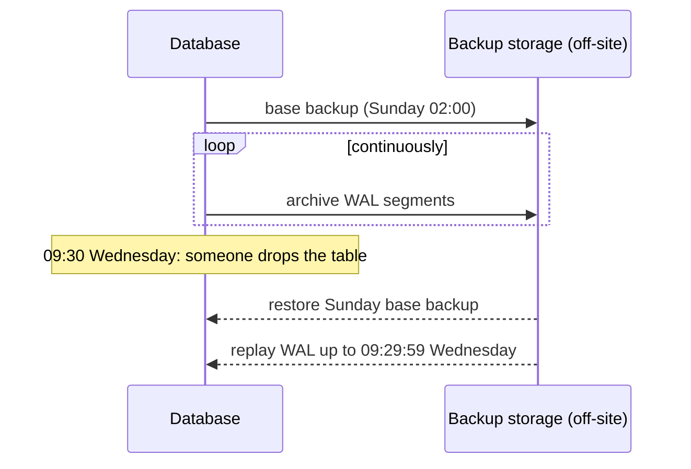

# Backup, Recovery & Data Migration

> A backup you have never restored is a hope, not a backup. Decide your recovery point and recovery time targets, keep backups away from the database, use point-in-time recovery, rehearse restores, and know how to move data between databases without downtime.

Roadmap topic 17 · Stage 5: Operating

**Go deeper:** `05-system-design/29-Backup-Recovery-Security-and-Cost` and `33-Follow-Up-Topics` (migrations) · `7` Storage Engines (WAL) · `14` Replication · `18` Security · `19` Operations · `09-architecture/12-Scalability-Performance-and-Resilience` (RPO/RTO).

**Marks:** 🟢 must know · 🟡 good to know

**How the examples are checked:** a backup, accidental delete and restore are run on SQLite 3.54 (online backup API); PostgreSQL and cloud commands are shown for the idea and not run.

---

#### 1. What Is It?

*Getting your data back after a mistake, a failure or an attack.*

| 🟢 Must know | 🟡 Good to know |
|---|---|
| backups stored away from the database; restores tested | logical vs physical backups |
| RPO and RTO | backup encryption and retention rules |
| point-in-time recovery using the WAL | disaster recovery: multi-AZ and multi-region |
| replication is not a backup | moving data between databases without downtime |
| | deleting data on request and what it means for backups |

1. **RPO (recovery point objective):** how much data you can lose, measured in time.
2. **RTO (recovery time objective):** how long you can be down.
3. **PITR (point-in-time recovery):** restore to a chosen moment by combining a base backup with the log.
4. **3-2-1 rule:** three copies, two kinds of storage, one off-site.

**Signals in an interview:** "what if someone drops the table?", "what are your RPO and RTO?", "how do you know the backups work?", "how do you migrate to a new database with no downtime?".

---

#### 2. How It Works

**Why you need backups even with replicas.** Replicas protect against hardware failure; they copy mistakes instantly (a `DELETE` without `WHERE`, a bad migration, corruption, ransomware, a malicious insider). Backups give you older, separate copies.

**RPO and RTO drive the design.**


| Approach | RPO | RTO |
|---|---|---|
| Nightly full backup | up to 24 hours | hours (restore time) |
| Full + continuous WAL archive (PITR) | seconds–minutes | hours |
| Async replica, manual failover | the lag (seconds) | minutes |
| Sync/quorum standby with automatic failover | ≈ 0 | seconds–minutes |
| Multi-region active-active | ≈ 0 | ≈ 0 (hardest consistency) |

Ask the business for numbers; the cost rises steeply as they shrink.

**Point-in-time recovery.** Take a periodic **base backup** (a full copy) and archive the **write-ahead log** continuously (topic 7). To recover to 09:29, restore the latest base backup before that time, then replay the log up to exactly 09:29 (just before the bad deploy).



**Backups stored away from the database.** Different server, account/credentials and region; immutable or versioned storage so ransomware or a compromised account can't delete them; encrypted; access limited and audited. A backup on the same disk or same cloud account as the database is one failure away from useless.

**Restores that are tested.** Schedule restore drills: restore into a fresh environment, run integrity checks, check row counts and recent data, time it, and compare with your RTO. Automate it. A backup that has never been restored might be empty, corrupt, encrypted with a lost key, or take 3 days to restore.

**Replication is not a backup** (topic 14).

🟡 **Logical vs physical backups.** *Logical* (`pg_dump`, SQL or CSV exports): portable across versions and engines, selective (one table), slow to restore for large data. *Physical* (copy of data files / snapshots, `pg_basebackup`): fast to restore, exact, tied to version and platform, needed for PITR.

🟡 **Backup encryption and retention.** Encrypt backups and manage the keys separately (a lost key = lost data). Retention policy: for example daily for 14–35 days, weekly for 3 months, monthly for a year (or as law requires). Longer retention costs money and extends privacy exposure.

🟡 **Disaster recovery.** Multi-AZ covers the loss of a data centre; a cross-region replica or cross-region backups cover the loss of a region. Document the plan, who decides, and rehearse it.

🟡 **Moving data between databases without downtime.** Backfill → dual-write (or CDC) → validate → cut over → clean up, with a rollback until the end (topics 10 and 20, `SD 33`). **Change data capture (CDC)** reads the log and streams changes to the new system.

🟡 **Deleting data on request.** Privacy rules require deleting a person's data, but backups hold copies. Practice: document that backups expire on their retention schedule, never restore deleted users' data into production without re-applying the deletion list, and keep deletion logs.

---

#### 3. Naive vs Better Design

| Naive | Better |
|---|---|
| nightly dump to the same disk | off-site, immutable, encrypted copies |
| "we have replicas" | replicas + backups + PITR |
| backups never restored | scheduled, automated restore drills with timing |
| no RPO/RTO | agreed numbers per system |
| one copy, one account | 3-2-1, separate credentials |
| keep everything forever | retention policy |
| restore procedure in someone's head | a runbook, practised |
| deleted users reappear after a restore | re-apply the deletion log after restoring |

---

#### 4. SQL & Code

Backup, accident, restore (SQLite online backup API; 1,000 rows):

```text
1. backup the database file to b.db (safe while the app is running)
2. DELETE FROM t;  COMMIT;          → source has 0 rows
3. restore b.db into a new database → 1,000 rows,  PRAGMA integrity_check → ok
```

Checks: after the accidental delete the source has `0` rows while the backup still has `1000`; the restored copy has `1000` rows and `integrity_check` returns `ok`. In Python: `src.backup(dst)`; with the CLI: `sqlite3 app.db ".backup 'backup.db'"` (a safe online backup; avoid copying the file while it is being written).

Room/SQLite on a phone: back up through the system or the server, not by copying open files; user data is usually synced to the server (`MOB 9`), which is the real backup.

PostgreSQL logical and physical backups (not run):

```bash
pg_dump --format=custom --file=notes-$(date +%F).dump notes                     # logical: portable, restore a single table with pg_restore -t
pg_basebackup -D /backups/base -Ft -z -P                                         # physical base backup
# postgresql.conf for PITR:  archive_mode = on ; archive_command = 'cp %p /archive/%f' (or object storage) ; archive_timeout = 300
# recovery:  restore_command = 'cp /archive/%f %p' ; recovery_target_time = '2025-03-05 09:29:59+00'
```

Restore drill script outline:

```bash
createdb notes_restore_test
pg_restore --dbname=notes_restore_test --jobs=4 notes-latest.dump
psql notes_restore_test -c "SELECT count(*) FROM notes;"          # compare with expected size
psql notes_restore_test -c "SELECT max(created_at) FROM notes;"   # how recent is the data? (RPO check)
dropdb notes_restore_test                                         # record: restore took 23 minutes (RTO check)
```

The arithmetic you should do aloud:

```kotlin
fun restoreMinutes(sizeGb: Double, mbPerSecond: Double) = sizeGb * 1000 / mbPerSecond / 60
fun rpoMet(archiveIntervalMinutes: Int, rpoMinutes: Int) = archiveIntervalMinutes <= rpoMinutes
fun rtoMet(restoreMin: Double, replayMin: Double, validateMin: Double, rtoMin: Double) = restoreMin + replayMin + validateMin <= rtoMin
fun meets321(copies: Int, mediaTypes: Int, offsite: Int) = copies >= 3 && mediaTypes >= 2 && offsite >= 1
```

Checks: `restoreMinutes(1000.0, 200.0)` → `83.3` (1 TB at 200 MB/s); an RTO of 60 minutes then needs a standby, not a restore. `rpoMet(5, 15)` → `true`; `rpoMet(1440, 15)` → `false` (nightly backups can't meet a 15-minute RPO). `rtoMet(83.3, 10.0, 15.0, 120.0)` → `true`. `meets321(3, 2, 1)` → `true`; `(2, 1, 0)` → `false`.

Migrating to a new database with CDC (outline):

```text
1. Create the target schema.   2. Take a consistent snapshot of the source; load it to the target (backfill).
3. Start CDC from the snapshot position; the target applies changes continuously.   4. Compare counts/checksums/sample rows until they match.
5. Pause writes briefly (or dual-write), let CDC drain, switch the application to the target.   6. Keep the source read-only for a rollback window, then retire it.
```

Deleting user data and backups:

```text
deletion_log(user_id, deleted_at)   — kept even after the user's rows are gone
After ANY restore into production: re-apply deletion_log (DELETE the listed users again) before opening traffic.
Backups expire on schedule (e.g. 35 days); document this in the privacy policy.
```

Immutable, off-site copy (cloud sketch, not run):

```bash
aws s3 cp notes-2025-03-05.dump s3://backups-other-account/notes/ --sse aws:kms    # separate account, versioned bucket with object lock
```

---

#### 5. Numbers & Limits

| Item | Rule of thumb |
|---|---|
| Restore speed | 100–500 MB/s: 1 TB ≈ 30–170 minutes (plus WAL replay) |
| WAL archive interval | 1–5 minutes gives an RPO of minutes |
| Full backup frequency | daily or weekly, plus continuous WAL |
| Retention | daily 14–35 days, weekly 3 months, monthly 12 months (or as required by law) |
| Restore drill | at least monthly; after every major schema/engine change |
| 3-2-1 | 3 copies, 2 media, 1 off-site (plus 1 immutable) |
| Multi-AZ | ≈ 99.95–99.99% availability for managed databases |
| Cost | storage for backups ≈ size × retention copies (use incremental/compression) |

---

#### 6. Common Mistakes & Edge Cases

1. Never testing a restore.
2. Backups next to (or reachable from) the database.
3. Replicas as the only protection.
4. No agreed RPO/RTO.
5. Lost or untested encryption keys.
6. Backing up the database but not object storage, configuration or secrets.
7. A restore that works but the app cannot run on the old data (schema/version mismatch).
8. Restoring deleted user data back into production.

Edge cases: very large databases (incremental/snapshot backups); a corrupted backup chain (verify checksums); WAL gaps; backups taken during heavy writes; time zones when choosing a recovery target; recovering one table without the rest (logical backup or a restored copy to extract from); long retention for audit vs privacy deletion.

---

#### 7. Say This in the Interview

1. "I set RPO and RTO with the business, then design to meet them: continuous WAL archiving for point-in-time recovery, a standby for fast failover, and off-site backups."
2. "A replica is not a backup; a bad delete replicates instantly. Backups are in a separate account, encrypted and immutable, following 3-2-1."
3. "I run automated restore drills and time them against the RTO, because an untested backup is a hope."
4. "To recover from a bad deploy at 09:30 I restore the last base backup and replay the log to 09:29."
5. "For migrations I backfill, then stream changes with CDC, validate, cut over, and keep the old system read-only for a rollback window. After any restore I re-apply the deletion log."

---

#### 8. Quick Check

1. RPO vs RTO?
2. What makes point-in-time recovery possible?
3. Why isn't a replica a backup?
4. What is the 3-2-1 rule?

<details>
<summary>Answers</summary>

1. RPO is how much data you can lose; RTO is how long you can be down.
2. A base backup plus a continuous archive of the write-ahead log, replayed to the chosen moment.
3. It copies mistakes and corruption immediately; backups are separate, older copies.
4. Three copies, on two kinds of storage, with one off-site.

</details>

---

#### 9. Practice

**Interview questions**

1. A developer ran `DELETE FROM orders` in production. What now?
2. What RPO and RTO would you set for a payments database, and how do you meet them?
3. How do you know your backups work?
4. Logical vs physical backups?
5. How do you migrate a large database with no downtime?
6. How do you honour deletion requests when backups exist?

**Hands-on**

1. Back up and restore a SQLite database, delete rows, and recover them; time the steps.
2. Set up PostgreSQL WAL archiving locally and perform a PITR to a chosen timestamp.
3. Write the restore-drill script and run it monthly; log the time.
4. Do a small CDC-style migration between two local databases and validate with counts and checksums.

**Remember:** RPO and RTO first · backups off-site, encrypted, immutable, 3-2-1 · PITR = base backup + WAL · replication ≠ backup · test restores and time them · migrate with backfill + CDC + validation · re-apply deletions after a restore.
