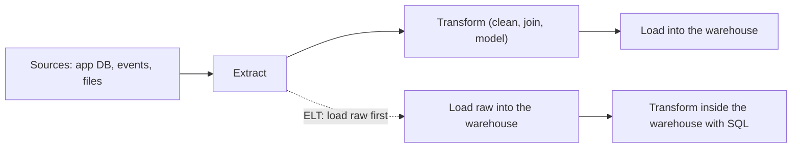
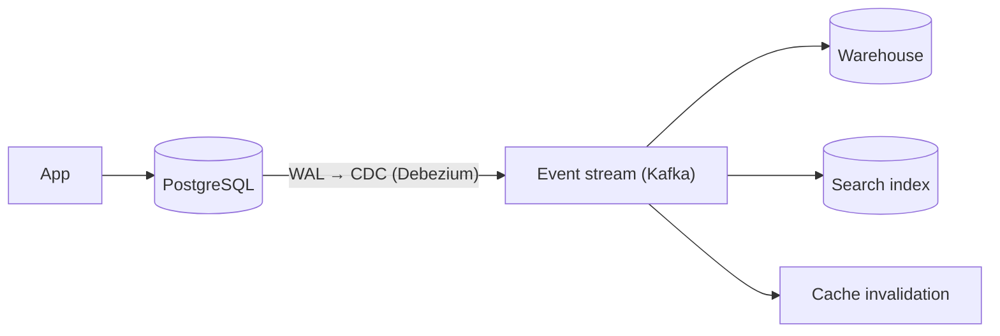

# Analytics, Warehouses & Data Pipelines

> Analytics asks different questions from the app: scan lots of history, group and summarise. Keep it off the production database. Copy data to a warehouse with a pipeline, model it for questions (star schema), and check its quality.

Roadmap topic 20 · Stage 6: Beyond the App Database

**Go deeper:** `1` Database Basics (OLTP vs OLAP) · `7` Storage Engines (row vs column) · `14` Replication (logical replication, CDC) · `05-system-design/26-Service-Boundaries-and-Architecture` (CDC) and `33-Follow-Up-Topics` (batch vs stream) · `09-architecture/09-Data-Architecture`.

**Marks:** 🟢 must know · 🟡 good to know

**How the examples are checked:** the star-schema queries, the incremental load, and the data-quality counts run on SQLite 3.54; the compression and size figures come from a small Python simulation; warehouse products and CDC tools are named, not run.

---

#### 1. What Is It?

*Turning operational data into answers.*

| 🟢 Must know | 🟡 Good to know |
|---|---|
| OLTP vs OLAP; why analytics must not slow the app database | star schema: fact and dimension tables |
| row store vs column store | batch vs stream processing |
| data warehouse vs data lake | lakehouse and open table formats (names) |
| ETL vs ELT | reporting from a replica vs a warehouse |
| change data capture (CDC) | data quality checks and lineage |

1. **OLAP:** analytical queries over lots of history.
2. **Warehouse:** a store of cleaned, modelled data for analysis (BigQuery, Snowflake, Redshift, ClickHouse).
3. **Lake:** cheap storage of raw files of any format (S3, GCS) with query engines on top.
4. **Pipeline:** the jobs that move and transform data from sources to the warehouse.

**Signals in an interview:** "how do we do reporting without slowing the app?", "ETL vs ELT?", "what is a star schema?", "how do you get changes out of the database?".

---

#### 2. How It Works

**OLTP vs OLAP (topic 1).** The app database serves many small, fast, concurrent reads and writes. Analysis scans millions of rows and aggregates them; run on production it competes for CPU, IO and locks with users. So copy the data out.

**Row store vs column store.**

| Row store | Column store |
|---|---|
| a row's values stored together | each column stored together |
| great for "get or update one record" | great for "sum one column over millions of rows" |
| reads whole rows | reads only the columns the query needs |
| poor compression | strong compression (similar values together; run-length, dictionary encoding) |
| OLTP engines | analytics engines |

A query touching 3 of 50 columns reads about `6%` of the bytes in a column store: for 100 million rows of 50 eight-byte columns, `40 GB` as rows versus about `2.4 GB` for the 3 columns needed. Sorted low-cardinality columns compress dramatically: 100,000 country codes sorted become 4 runs.

**Warehouse vs lake.**

| | Data warehouse | Data lake |
|---|---|---|
| Data | structured, modelled tables | raw files: JSON, CSV, Parquet, logs, images |
| Schema | on write (clean first) | on read (interpret later) |
| Users | analysts, BI tools | data engineers, data scientists |
| Cost | higher per GB, fast SQL | cheap storage, more work to query |
| Risk | rigid | "data swamp" without governance |

A **lakehouse** layers table features (transactions, schema, time travel) on lake files with open table formats (Apache Iceberg, Delta Lake, Hudi), giving one copy for both uses.

**ETL vs ELT.**



| | ETL | ELT |
|---|---|---|
| Order | transform before loading | load raw, transform in the warehouse |
| Where | a separate processing tier | warehouse compute (SQL, dbt) |
| Fit | older systems, strict pre-cleaning, privacy before load | modern cloud warehouses: cheap storage and elastic compute |
| Benefit | smaller loaded data | raw data kept; re-transform any time |

**Change data capture (CDC).** Instead of repeatedly querying tables, read the database's change log (the WAL/binlog, topic 7) and stream inserts, updates and deletes to the pipeline (Debezium, cloud DMS, logical replication). Benefits: low load on the source, near-real-time, includes deletes, preserves order. It also feeds search indexes, caches and other services (`SD 26`).



🟡 **Star schema.** Model for questions: a central **fact table** (events or measurements: one row per sale, with numeric measures and foreign keys) surrounded by **dimension tables** (descriptive context: date, product, customer). Queries join facts to dimensions and group by dimension attributes. Simple, fast, understandable by analysts.

🟡 **Batch vs stream (`SD 33`).** *Batch*: process a big set at intervals (nightly, hourly): simpler, cheaper, good for reports. *Stream*: process events as they arrive (fraud, live dashboards): lower latency, more complexity (Kafka, Flink, Spark). Pick the latency the business needs; many "real-time" needs are satisfied by 5-minute micro-batches.

🟡 **Reporting from a replica vs a warehouse.** A read replica gives fresh data for simple reports with no new infrastructure but still shares the schema and can lag or conflict with long queries. A warehouse handles heavy, historical, cross-source analysis. Start with a replica; move to a warehouse as questions and data grow.

🟡 **Data quality and lineage.** Check pipelines like code: row counts, nulls, duplicates, valid ranges, freshness, referential integrity, reconciliation with the source; alert on failures. **Lineage** records where each table or number came from, so you can trace and fix errors (dbt docs, data catalogs).

---

#### 3. Naive vs Better Design

| Naive | Better |
|---|---|
| `SELECT ... GROUP BY` on production at noon | replica or warehouse |
| copy whole tables nightly | incremental loads with a watermark, or CDC |
| analysts query raw app tables | a modelled warehouse (star schema) |
| transform in scripts nobody tests | SQL transformations in version control with tests |
| no checks: "the dashboard is wrong" | automated data quality checks and alerts |
| everything real-time | match latency to the need |
| PII copied into every dataset | minimise, mask, access-control the warehouse |
| a data lake with no catalog | organised zones, catalog, ownership |

```sql
-- Naive: a heavy analytical query on the production primary
SELECT date_trunc('month', created_at), country, SUM(total_cents) FROM orders JOIN users USING (user_id) GROUP BY 1, 2;
```

---

#### 4. SQL & Code

A star schema and the two typical queries (SQLite, small data):

```sql
CREATE TABLE dim_date    (date_id INTEGER PRIMARY KEY, day TEXT, month TEXT);
CREATE TABLE dim_product (product_id INTEGER PRIMARY KEY, name TEXT, category TEXT);
CREATE TABLE dim_user    (user_id INTEGER PRIMARY KEY, country TEXT);
CREATE TABLE fact_sales  (date_id INT, product_id INT, user_id INT, qty INT, amount_cents INT);
-- facts: (1,1,1,10,1000) (1,2,2,1,15000) (2,3,3,2,4000) (3,2,1,1,15000) (3,1,3,5,500)

SELECT d.month, p.category, SUM(f.amount_cents) AS revenue
FROM fact_sales f JOIN dim_date d USING (date_id) JOIN dim_product p USING (product_id)
GROUP BY d.month, p.category ORDER BY 1, 2;
-- 2025-01 furniture 19000 | 2025-01 office 1000 | 2025-02 furniture 15000 | 2025-02 office 500

SELECT u.country, SUM(f.amount_cents) AS revenue, COUNT(DISTINCT f.user_id) AS buyers
FROM fact_sales f JOIN dim_user u USING (user_id) GROUP BY u.country ORDER BY 1;
-- DE 16000 (1 buyer) | US 19500 (2 buyers)
```

Checks: each query joins the fact table to the dimensions it needs and groups by dimension attributes; the January furniture revenue is `15000 + 4000 = 19000`. Adding a new question (revenue by weekday) means adding a column to `dim_date`, not changing the fact table.

Incremental load with a watermark (ELT step; SQLite):

```sql
-- etl_state(name, watermark) holds the last `updated_at` already loaded
INSERT INTO dst(id, v, updated_at)
SELECT id, v, updated_at FROM src WHERE updated_at > :watermark ORDER BY updated_at
ON CONFLICT(id) DO UPDATE SET v = excluded.v, updated_at = excluded.updated_at;       -- idempotent (re-runs are safe)
UPDATE etl_state SET watermark = (SELECT MAX(updated_at) FROM src WHERE updated_at > :watermark) WHERE name = 'src';
```

Checks: the first run loads `3` rows; after one update (`id 2`, `updated_at = 40`) and one insert (`id 4`), the second run loads `2` rows and `dst` shows `b2` and `d`; a third run loads `0`. The watermark approach misses hard deletes (use CDC or soft-delete flags) and rows updated with an older timestamp (use a safety overlap).

CDC event shape (what a pipeline receives):

```json
{ "op": "u", "table": "orders", "key": { "id": 42 },
  "before": { "status": "new", "total_cents": 1000 }, "after": { "status": "paid", "total_cents": 1000 },
  "lsn": 1234567, "ts_ms": 1741170000000 }
```

Apply CDC events idempotently in the warehouse (keep the latest by log position):

```sql
SELECT * FROM (
  SELECT *, ROW_NUMBER() OVER (PARTITION BY id ORDER BY lsn DESC) AS rn FROM orders_changes
) WHERE rn = 1 AND op <> 'd';                      -- current state: latest event per key, deletes excluded
```

Data quality checks (the numbers an automated test compares to rules):

```sql
SELECT COUNT(*) AS rows, COUNT(email) AS non_null_email, COUNT(DISTINCT id) AS distinct_ids, SUM(amount < 0) AS negative_amounts FROM q;
-- on sample data: 4 rows, 3 non-null emails, 3 distinct ids (1 duplicate), 1 negative amount
```

```kotlin
data class Profile(val rows: Long, val nonNull: Long, val distinct: Long, val negatives: Long, val lastLoadedAgeMin: Int)

fun qualityIssues(p: Profile, maxNullPct: Double = 5.0, freshnessMin: Int = 60): List<String> = buildList {
    if (p.rows == 0L) { add("empty table"); return@buildList }
    if ((p.rows - p.nonNull) * 100.0 / p.rows > maxNullPct) add("too many nulls")
    if (p.distinct < p.rows) add("duplicate keys")
    if (p.negatives > 0) add("negative amounts")
    if (p.lastLoadedAgeMin > freshnessMin) add("stale data")
}
```

Checks: the sample profile `Profile(4, 3, 3, 1, 10)` → `[too many nulls, duplicate keys, negative amounts]` (25% nulls); `Profile(1000, 1000, 1000, 0, 5)` → `[]`; `Profile(1000, 1000, 1000, 0, 240)` → `[stale data]`.

Column-store effect (calculated):

```kotlin
fun scanGb(rows: Long, totalColumns: Int, usedColumns: Int, bytesPerValue: Int = 8, columnar: Boolean) =
    rows * (if (columnar) usedColumns else totalColumns) * bytesPerValue / 1e9
```

Checks: `scanGb(100_000_000, 50, 3, columnar = false)` → `40.0` GB; `columnar = true` → `2.4` GB, before compression (which often shrinks columns another 3–10×).

dbt-style transformation (ELT), a SQL model kept in version control:

```sql
-- models/daily_revenue.sql
SELECT date_trunc('day', created_at) AS day, country, SUM(total_cents) / 100.0 AS revenue
FROM {{ ref('stg_orders') }} JOIN {{ ref('stg_users') }} USING (user_id)
WHERE status = 'paid' GROUP BY 1, 2
```

Reporting from a replica for a quick start (PostgreSQL; `reporting` role from topic 18; not run):

```sql
-- connect to the read replica as `reporting`; set a timeout so a bad report cannot run for hours
SET statement_timeout = '60s';
SELECT date_trunc('day', created_at) AS day, COUNT(*) FROM orders WHERE created_at >= now() - interval '30 days' GROUP BY 1 ORDER BY 1;
```

---

#### 5. Numbers & Limits

| Item | Rule of thumb |
|---|---|
| Column vs row scan | a query using 3 of 50 columns reads ~6% of the bytes; compression adds another 3–10× |
| Warehouse query | seconds on billions of rows with the right model |
| Batch cadence | hourly or daily is enough for most reports; micro-batch 1–5 minutes for "near real time" |
| CDC lag | typically seconds |
| Watermark loads | idempotent upserts; add a small overlap window (minutes) for late updates |
| Warehouse cost | storage is cheap; compute (bytes scanned) is the bill: partition and cluster tables, select columns |
| Retention | raw 13–24 months, aggregates longer; follow privacy rules |
| Data quality | checks on every load: counts, nulls, duplicates, freshness, reconciliation |

---

#### 6. Common Mistakes & Edge Cases

1. Running analytics on the production primary.
2. Full-table copies instead of incremental loads or CDC.
3. Analysts querying raw operational tables.
4. No data-quality checks or lineage.
5. Missing deletes in watermark-based loads.
6. Real-time pipelines where hourly would do.
7. PII spread across datasets.
8. Scanning every column ("`SELECT *`") in a column store and paying for it.

Edge cases: late-arriving events; schema changes in the source breaking the pipeline; time zones and daily boundaries; slowly changing dimensions (a customer changes country: keep history with validity dates); duplicate events from at-least-once delivery; backfills that must not double count; GDPR deletion in warehouses and lakes.

---

#### 7. Say This in the Interview

1. "OLTP runs the app; OLAP answers analytical questions over history. I never run heavy analytics on the production primary: I use a replica for quick reports, and a warehouse fed by a pipeline for real analysis."
2. "A column store reads only the columns a query needs and compresses well, which is why warehouses use it."
3. "I prefer ELT for cloud warehouses: load raw data, transform with versioned SQL, and keep the raw data to re-transform later."
4. "To get changes out I use CDC from the write-ahead log, which has low load and includes deletes; or incremental loads with a watermark for simple cases."
5. "I model for questions with a star schema, run data-quality checks on every load, and keep lineage and PII under control."

---

#### 8. Quick Check

1. Why not run reports on the production database?
2. ETL vs ELT?
3. What does CDC give you that a nightly copy doesn't?
4. Fact table vs dimension table?

<details>
<summary>Answers</summary>

1. Heavy scans compete with user traffic for CPU, IO and locks.
2. ETL transforms before loading; ELT loads raw data and transforms inside the warehouse.
3. Continuous, low-load, ordered changes including deletes, with seconds of lag.
4. A fact table holds measurable events (one row per sale); dimension tables hold descriptive context (date, product, customer).

</details>

---

#### 9. Practice

**Interview questions**

1. How would you set up reporting for a growing app?
2. Row store vs column store: why does it matter for analytics?
3. Warehouse vs data lake?
4. ETL or ELT, and why?
5. How do you stream changes out of PostgreSQL?
6. How do you keep analytics data trustworthy?

**Hands-on**

1. Build the star schema above and write three business questions as SQL.
2. Implement the watermark load; test updates, inserts, and a hard delete (and see what is missed).
3. Write the data-quality function and run it on a sample table.
4. Set up Debezium (or logical replication) from a local PostgreSQL to a second database.

**Remember:** keep OLAP off the primary · columns for analytics · warehouse for modelled data, lake for raw files · ELT in modern warehouses · CDC for continuous changes, watermark for simple loads · star schema for questions · test data quality on every load.
