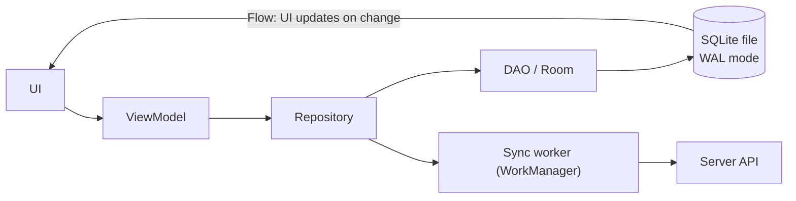

# Mobile Databases

> Every phone app can have a real SQL database inside it: SQLite, usually through Room on Android and Core Data or SwiftData on iOS. Use it as the source of truth for offline-first apps, keep it off the main thread, and migrate it for every old app version.

Roadmap topic 21 · Stage 7: Mobile (New)

**Go deeper:** `06-mobile-engineering/09-Local-Storage-and-Offline-First` (the full client design) · `05-system-design/30-Mobile-Specific-Topics` (the server side of sync) · `10` Schema Migrations · `5` Indexes · `18` Security · `06-mobile-engineering/16-iOS-and-Swift-Essentials`.

**Marks:** 🟢 must know · 🟡 good to know · (New) for a mobile engineer, or still changing

**How the examples are checked:** the SQL (ID mapping, tombstones, pagination, migrations, WAL) runs on SQLite 3.54, the same engine as on phones; Room, Core Data and SwiftData code is shown and not compiled.

---

#### 1. What Is It?

*The on-device database and how it fits with the server.*

| 🟢 Must know | 🟡 Good to know |
|---|---|
| SQLite: the embedded database in every phone | sync design: changes since, conflicts, deletes |
| Room (Android), Core Data / SwiftData (iOS) | encryption on device (SQLCipher) |
| never use the database on the main thread | storing large data: files vs blobs |
| schema versions and on-device migrations | testing database code and migrations |
| offline-first: local DB is the source of truth | other options and their status (check current support) |
| indexes and query design apply on the device | local IDs vs server IDs |
| key-value settings vs a real database | |

1. **SQLite:** a small, serverless SQL engine in one file, with ACID transactions. The most widely deployed database.
2. **Room:** Android's library over SQLite (entities, DAOs, `Flow`, migrations, compile-time query checks).
3. **Core Data / SwiftData:** Apple's object-graph persistence (backed by SQLite by default).
4. **Offline-first:** the UI reads and writes the local database; a sync engine reconciles with the server.

**Signals in an interview:** "how do you store data offline?", "how do you migrate the local database?", "Room vs DataStore?", "how do you sync?", "how do you handle IDs for offline-created items?".

---

#### 2. How It Works

**Layers on a phone.**



**Room essentials.** `@Entity` = table, `@Dao` = queries (checked at compile time), `@Database` = holder with a version. DAO functions are `suspend` (run off the main thread) or return `Flow` (re-emit when tables change). Room refuses main-thread queries by default.

**Never access the database on the main thread.** Disk IO can take milliseconds to seconds; blocking the UI causes jank and ANRs (`MOB 11`). Use `suspend` DAOs / `Flow`, `Dispatchers.IO`, or Swift `actor`/background contexts.

**Settings vs a real database.**

| Need | Use |
|---|---|
| a few flags and preferences | DataStore (Android), `UserDefaults` (iOS) |
| structured, queryable, relational data, lists, search, sync state | Room / SQLite, Core Data / SwiftData |
| secrets (tokens) | Keystore/Keychain-backed storage, not a plain database |
| big files (photos, videos) | files on disk; keep paths and metadata in the database |

**Schema versions and on-device migrations.** There is no migration job you control: **every old app version upgrades itself on the user's device**, from whatever version it has. You must supply a migration path from every supported old schema version to the latest, and test each. A missing path crashes the app (or wipes user data with a destructive migration). This is the mobile twist on topic 10.

**Offline-first.** Local database = source of truth for the UI. Writes go to the local database first (with a local ID and a `dirty` flag), then a sync worker pushes them; pulls bring server changes in. See the full design in `MOB 9` and `SD 30`.

**Indexes and query design apply on the device too.** Phones are slower and have less memory; unindexed queries over thousands of rows cause visible jank. Index foreign keys, filter and sort columns; use keyset pagination; select only needed columns (Android's `CursorWindow` limits a row result to ~2 MB, so don't store huge blobs in rows).

🟡 **Sync design: changes since, conflicts, deletes.**

1. **Pull:** `GET /changes?since=<cursor>`; apply in a transaction; save the cursor after applying.
2. **Push:** send `dirty` rows (outbox) with an idempotency key; mark clean on success.
3. **Conflicts:** same record changed on both sides: last-write-wins by server version, field merge, or ask the user (`SD 23`).
4. **Deletes:** **tombstones** (`deleted = 1`, kept until synced), otherwise the next pull resurrects the item or the server never learns of the delete.

🟡 **Local IDs vs server IDs.** The client must be able to create records offline, so give them a **client-generated ID** (UUID/ULID) and keep an optional `server_id` once the server assigns one. Or make the UUID the server's ID too, which removes the mapping (`SD 20`).

🟡 **Encryption on device.** The app sandbox already isolates files, and the OS encrypts storage on locked devices. For highly sensitive data add encryption: SQLCipher (encrypted SQLite) with a key kept in the Keystore/Keychain, or per-field encryption. Check the current recommended APIs; don't roll your own crypto (`MOB 13`).

🟡 **Large data: files vs blobs.** Store big binary data (images, audio, documents) as files and keep path and metadata in the database; blobs bloat the database, slow queries and hit cursor-size limits.

🟡 **Testing database code and migrations.** In-memory Room databases for DAO tests; `MigrationTestHelper` for every old version to latest; schema export (`exportSchema = true`) committed to source control; tests for sync (fake server), conflict rules and tombstones.

🟡 **Other options and their status.** Realm and Firebase local persistence exist; support, licences and maintenance change (for example, vendors have announced end-of-life or changes for some mobile-sync products), so **check each library's current status before choosing**. Room/SQLite and Core Data/SwiftData are platform-supported defaults. Cross-platform: SQLDelight (Kotlin Multiplatform) over SQLite.

---

#### 3. Naive vs Better Design

| Naive | Better |
|---|---|
| UI waits for the network and shows a spinner offline | UI reads Room; sync updates it |
| database call on the main thread | `suspend`/`Flow`, `Dispatchers.IO` |
| `fallbackToDestructiveMigration()` on user data | real, tested migrations |
| auto-increment local IDs sent to the server | client UUIDs (or a `server_id` mapping) |
| delete the row locally | tombstone until synced |
| store images as blobs | files on disk + path in the database |
| preferences stored in Room rows | DataStore/`UserDefaults` for settings |
| no index on filter/sort columns | indexes on the columns queries use |

```kotlin
// Naive: wipes the user's data on every schema change
Room.databaseBuilder(ctx, AppDatabase::class.java, "app.db").fallbackToDestructiveMigration().build()
```

---

#### 4. SQL & Code

Entities and DAO (Room):

```kotlin
@Entity(tableName = "notes", indices = [Index("updatedAt"), Index(value = ["serverId"], unique = true)])
data class NoteEntity(
    @PrimaryKey val localId: String,                // client-generated UUID
    val serverId: Long? = null,                     // assigned by the server after the first push
    val title: String, val body: String = "",
    val updatedAt: Long, val dirty: Boolean = true, val deleted: Boolean = false     // outbox flag and tombstone
)

@Dao interface NoteDao {
    @Query("SELECT * FROM notes WHERE deleted = 0 ORDER BY updatedAt DESC LIMIT :limit")
    fun observe(limit: Int = 50): Flow<List<NoteEntity>>

    @Query("SELECT * FROM notes WHERE deleted = 0 AND updatedAt < :before ORDER BY updatedAt DESC LIMIT :limit")   // keyset paging
    suspend fun page(before: Long, limit: Int = 50): List<NoteEntity>

    @Query("SELECT * FROM notes WHERE dirty = 1") suspend fun pending(): List<NoteEntity>
    @Upsert suspend fun upsert(note: NoteEntity)
}

@Database(entities = [NoteEntity::class], version = 3, exportSchema = true)
abstract class AppDatabase : RoomDatabase() { abstract fun notes(): NoteDao }
```

Local ID to server ID mapping and tombstones (SQL on SQLite, the same on a phone):

```sql
-- two notes created offline
INSERT INTO note(local_id, title, updated_at) VALUES ('uuid-1','Buy milk',1), ('uuid-2','Plan',2);            -- dirty = 1
-- the push succeeds for uuid-1: the server answers with id 101
UPDATE note SET server_id = 101, dirty = 0 WHERE local_id = 'uuid-1';

-- pull: server changes (101 renamed, 102 created on another device, 101 then deleted)
UPDATE note SET title = COALESCE(:title, title), deleted = :deleted, updated_at = :ts, dirty = 0 WHERE server_id = :sid AND dirty = 0;
-- no row for an unknown server id → INSERT it with a new local UUID
```

Checks: after applying the three changes, the table holds `uuid-1` (server 101, title "Buy oat milk", `deleted = 1`, clean), `uuid-2` (still dirty, never synced) and `srv-102` ("From other device", clean). The list screen query (`deleted = 0 ORDER BY updated_at DESC`) shows `srv-102` and `uuid-2`. A dirty local row is **not** overwritten by the pull (the `AND dirty = 0` guard) so a pending local edit isn't lost: a conflict rule decides later.

Migrations and their tests:

```kotlin
val MIGRATION_2_3 = object : Migration(2, 3) {
    override fun migrate(db: SupportSQLiteDatabase) {
        db.execSQL("ALTER TABLE notes ADD COLUMN deleted INTEGER NOT NULL DEFAULT 0")       // tombstone column
        db.execSQL("CREATE UNIQUE INDEX IF NOT EXISTS index_notes_serverId ON notes(serverId)")
    }
}
Room.databaseBuilder(ctx, AppDatabase::class.java, "app.db")
    .addMigrations(MIGRATION_1_2, MIGRATION_2_3)
    .setJournalMode(RoomDatabase.JournalMode.WRITE_AHEAD_LOGGING).build()

@Test fun migrateAllOldVersionsToLatest() {
    for (v in 1..2) {
        helper.createDatabase("test.db", v).close()
        helper.runMigrationsAndValidate("test.db", 3, true, MIGRATION_1_2, MIGRATION_2_3)       // every path must reach the latest
    }
}
```

Keyset pagination on the device (the SQL behind `page()`):

```sql
SELECT * FROM notes WHERE deleted = 0 AND updated_at < :before ORDER BY updated_at DESC, local_id DESC LIMIT 50;
-- an index on (deleted, updated_at) makes each page cost about the same, however deep the list is
```

Apply a pull page atomically and save the cursor after it:

```kotlin
@Transaction suspend fun applyChanges(changes: List<ServerChange>, nextCursor: String) {
    changes.forEach { apply(it) }            // upsert / tombstone, skipping rows with dirty = 1
    cursors.save(nextCursor)                 // only after the page is applied
}
```

DataStore for settings (not Room):

```kotlin
val Context.settings by preferencesDataStore("settings")
suspend fun Context.setDarkMode(on: Boolean) = settings.edit { it[booleanPreferencesKey("dark")] = on }
```

iOS equivalents (not compiled):

```swift
@Model final class Note {                          // SwiftData
    @Attribute(.unique) var localId: String
    var serverId: Int?
    var title: String
    var updatedAt: Date
    var dirty = true
    var deleted = false
    init(localId: String, title: String, updatedAt: Date) { self.localId = localId; self.title = title; self.updatedAt = updatedAt }
}
// Core Data: lightweight migrations for added attributes; mapping models for bigger changes; test migrations from every shipped model version.
```

Inspect the database on a device or emulator:

```bash
adb shell run-as com.example.notes ls databases/
adb exec-out run-as com.example.notes cat databases/app.db > app.db && sqlite3 app.db ".tables" "PRAGMA user_version;"
```

---

#### 5. Numbers & Limits

| Item | Rule of thumb |
|---|---|
| SQLite size | comfortable up to hundreds of MB–GBs on a phone; keep it lean |
| Writers | one writer at a time (WAL allows readers during a write) |
| Main-thread budget | no database work; a single query can exceed a 16 ms frame |
| Row/cursor size | Android `CursorWindow` ≈ 2 MB per window; avoid huge rows/blobs |
| Page size for lists | 20–50 rows |
| Batch writes | one transaction per batch of hundreds of rows (10–100× faster than single commits) |
| Migrations | one per schema version; test every path from every shipped version |
| Old app versions | support the versions covering ≥ 95–99% of active users |
| Cursor/sync batch | 100–500 changes per request |
| Storage cleanup | clear caches on logout and low storage; keep user data |

---

#### 6. Common Mistakes & Edge Cases

1. Database or file work on the main thread.
2. Destructive migrations on user data; missing migration paths.
3. Server-assigned IDs only, so offline creation is impossible.
4. Deleting locally with no tombstone.
5. Storing large blobs and files inside rows.
6. Overwriting dirty local rows during a pull.
7. Saving the sync cursor before applying the page.
8. No indexes on list/sort columns; loading thousands of rows.
9. Putting secrets in a plain database.

Edge cases: the app updated from a very old version; low storage during a migration; the process killed mid-sync (transactions and idempotency keys make it safe); multiple processes or widgets opening the same database; device clock changes (use server versions); logout with unsynced changes (warn or keep); backup and restore to a new phone (`allowBackup` rules, topic 18 and `MOB 13`).

---

#### 7. Say This in the Interview

1. "SQLite is the embedded database in every phone; I use Room on Android (Core Data or SwiftData on iOS), with `suspend` DAOs and `Flow`, never on the main thread."
2. "For offline-first the local database is the source of truth: writes go local first with a client UUID and a dirty flag, a WorkManager job pushes them with an idempotency key, pulls use a cursor saved after the page is applied, and deletes are tombstones."
3. "Every old app version must upgrade its own database, so I keep a tested migration path for each version and never use destructive migration on user data."
4. "Indexes and keyset pagination matter on the device too; big files live on disk, with paths in the database."
5. "Settings go to DataStore, secrets to the Keystore, and sensitive data can use SQLCipher with a Keystore-held key."

---

#### 8. Quick Check

1. Why client-generated IDs?
2. What is a tombstone?
3. Room or DataStore for user notes?
4. Why test migrations from every old version?

<details>
<summary>Answers</summary>

1. So records can be created offline without waiting for the server, and retries are idempotent.
2. A marker (`deleted = 1`) that keeps a deleted record until the delete has synced.
3. Room: structured, queryable data; DataStore is for small settings.
4. Users upgrade from any old version, and a missing path crashes the app or loses data.

</details>

---

#### 9. Practice

**Interview questions**

1. How do you store and query data offline on a phone?
2. How do you migrate the local schema?
3. How do you sync local changes with the server and handle conflicts?
4. Room vs DataStore vs files?
5. How do you handle IDs for items created offline?
6. How do you keep the UI fast with a large local database?

**Hands-on**

1. Write the Room entities and DAO above, add a migration, and test version 1 → 3.
2. Implement the push/pull SQL for local and server IDs and tombstones against a fake server.
3. Open your app's database on an emulator with `sqlite3` and run `EXPLAIN QUERY PLAN` on its main list query.
4. Add keyset pagination and an index, and compare with `OFFSET` on 100,000 rows.

**Coding warm-ups (LeetCode)**

| # | Question | Link to this topic |
|---|---|---|
| 146 | [LRU Cache](https://leetcode.com/problems/lru-cache/) (Medium) | an on-device cache layer |
| 1146 | [Snapshot Array](https://leetcode.com/problems/snapshot-array/) (Medium) | versions and sync snapshots |
| 981 | [Time Based Key-Value Store](https://leetcode.com/problems/time-based-key-value-store/) (Medium) | changes since a timestamp |
| 380 | [Insert Delete GetRandom O(1)](https://leetcode.com/problems/insert-delete-getrandom-o1/) (Medium) | O(1) local store operations |

**Remember:** SQLite via Room / Core Data / SwiftData · never on the main thread · local DB is the source of truth · client UUIDs, dirty flags, tombstones · cursor saved after the page · migrate from every old version, no destructive migrations · indexes and keyset paging · files for big data · DataStore for settings.
