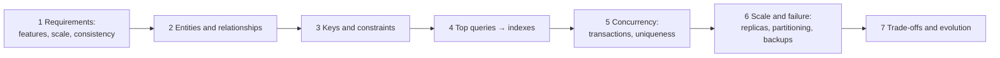

# Database Interview Answer Points

> A database interview asks you to design a schema from requirements, explain each choice (key, index, isolation level), and say what can go wrong. Follow the same steps every time, show numbers, and always name the trade-off.

Roadmap topic 22 · Stage 8: Interview & Practice (New)

**Go deeper:** every note `1`–`21` · `05-system-design/31-Interview-Answer-Structure` · `06-mobile-engineering/21-Mobile-Interview-Answer-Points` · `09-architecture/21-Architecture-Interview-Answers` · `03-leetcode-patterns` (SQL problems).

**Marks:** 🟢 must know · 🟡 good to know · (New) added beyond the original roadmaps

**How the examples are checked:** the booking schema and its outcomes run on SQLite 3.54; other figures are simple arithmetic.

---

#### 1. What Is It?

*A repeatable way to answer schema, SQL and "what if" questions.*

| 🟢 Must know | 🟡 Good to know |
|---|---|
| design a schema from requirements: entities, keys, relationships, top queries | read a query and predict its plan |
| explain each choice: key, index, isolation level | estimate data size and query load |
| ready answers: SQL vs NoSQL, indexes, transactions, isolation, replication, sharding | questions to ask about the data |
| ready answers: double booking, idempotent writes, fixing a slow query | common traps |
| always mention the trade-off and what could go wrong | |

**Signals in an interview:** "design the database for…", "this query is slow, why?", "two people book the last seat", "how would you scale this?", "SQL or NoSQL?".

---

#### 2. How It Works

**The schema-design steps.**



1. **Requirements:** what must the system do; how many users, rows, requests per second; which operations must be strongly consistent; what are the top reads and writes.
2. **Entities and relationships:** nouns become tables; 1:N via a foreign key, N:M via a join table.
3. **Keys and constraints:** surrogate primary keys; `UNIQUE` on natural keys and idempotency keys; foreign keys; `NOT NULL`, `CHECK`.
4. **Top queries and indexes:** write the 5 to 10 queries; add the indexes they need; check with `EXPLAIN`.
5. **Concurrency:** transaction boundaries, atomic updates, unique constraints, optimistic version or locks.
6. **Scale and failure:** read replicas and caching first; partitioning later; backups with PITR; RPO/RTO.
7. **Trade-offs:** say what you chose, what it costs, and when you'd revisit.

**Ready answers.**

| Question | Core of the answer |
|---|---|
| SQL or NoSQL? | Start relational (PostgreSQL): relations, constraints and transactions. Choose another store for a measured need: huge write volume, key lookups at massive scale, relevance search, deep graphs. State the numbers. Real systems use several stores with one source of truth. |
| What is an index? | A sorted B-tree: lookups and ranges in `O(log n)` instead of a scan. Costs: slower writes, more storage. Composite: equality columns first, range/sort last; leftmost prefix. Not used with functions on the column, leading wildcards, type mismatches. |
| What is a transaction? ACID? | Atomicity, consistency, isolation, durability. One transaction per business operation, short, no external calls inside. Use atomic updates and unique constraints. |
| Isolation levels? | Read committed (default), repeatable read, serializable; anomalies: dirty, non-repeatable, phantom, lost update, write skew. Raise isolation only for cross-row invariants and retry on conflicts. |
| How do you prevent a double booking? | An atomic conditional update (`UPDATE ... WHERE status = 'free'`, check the row count) plus a unique constraint on `(show, seat)` as the last line of defence; holds expire; payment is idempotent. |
| How do you make writes idempotent? | A client-supplied idempotency key with a `UNIQUE (user_id, key)` constraint; repeat requests return the first result; consumers de-duplicate by event id. |
| How do you fix a slow query? | Measure (slow-query log), `EXPLAIN ANALYZE`, fix one thing: index, N+1, `SELECT *`, `OFFSET`; measure again. |
| How do you scale reads? Writes? | Reads: indexes, caching, read replicas (mind lag). Writes: bigger machine, batching, partitioning, then sharding with a good key; accept cross-shard costs. |
| Replication and failover? | Leader–follower; async can lose the lag window, semi-sync reduces loss; avoid split brain with quorum and fencing; replicas are not backups. |
| Consistency? | Per feature: strong for money/inventory/uniqueness, eventual for feeds and counters; CAP: during a partition choose C or A. |
| Backup and recovery? | RPO/RTO set with the business; base backup + WAL for PITR; off-site, encrypted, immutable; test restores. |
| Schema change on a live system? | Backward-compatible steps: expand → dual-write → backfill → switch → contract. |
| Mobile? | SQLite/Room as the source of truth, client UUIDs, outbox, cursor sync, tombstones, tested migrations from every old version. |

🟡 **Reading a query and predicting its plan.** Look at the filter columns and available indexes: `WHERE user_id = ?` with an index on `user_id` → index seek; `WHERE lower(email) = ?` with a plain index → scan; `ORDER BY created DESC LIMIT 20` with an index on `(user_id, created)` → no sort; a join without an index on the join column → nested loop over a scan.

🟡 **Estimating data size and load.** 10M daily users × 20 requests = 200M/day ≈ 2,300 requests/s average, ≈ 12,000 at a 5× peak. 1M rows/day × 500 B × 1.5 index factor ≈ 274 GB/year. One well-tuned PostgreSQL node handles that comfortably; say so, then say where it would break.

🟡 **Questions to ask about the data.** Read/write ratio? Data volume and growth? Consistency needs per feature? Latency targets? Retention and privacy rules? Who runs the database? What exists already?

🟡 **Common traps.**

| Trap | Instead |
|---|---|
| NoSQL "for scale" with no numbers | PostgreSQL first; justify any exception |
| sharding early | indexes, cache, replicas, bigger machine first |
| a schema with no constraints | keys, `UNIQUE`, `CHECK`, foreign keys |
| ignoring concurrency | name the race and the fix |
| ignoring failure and backups | RPO/RTO, replicas, PITR |
| only the happy path | duplicates, retries, partial failure |
| designing tables before the queries | queries first |

---

#### 3. Naive vs Better Design

| Naive answer | Better answer |
|---|---|
| "I'd use MongoDB, it's web scale." | "Relational data with transactions: PostgreSQL. I'd revisit for X if we exceed Y." |
| draws tables immediately | clarifies requirements, queries and numbers first |
| "add an index on every column" | "index the top queries; check the plan; mind write cost" |
| "just use a transaction" | "which isolation level, which race, which constraint?" |
| "replicas are our backup" | "replicas for availability, PITR backups for recovery" |
| no numbers | rough rows, requests per second, storage |
| ends at the schema | concurrency, scale, failure, trade-offs, evolution |

---

#### 4. SQL & Code

A worked design: **ticket booking** (SQLite, runnable). Requirements: browse shows, hold a seat for 10 minutes, buy it once, no double booking, safe retries.

```sql
CREATE TABLE shows (id INTEGER PRIMARY KEY, title TEXT NOT NULL, starts_at TEXT NOT NULL);
CREATE TABLE seats (
  show_id INT NOT NULL REFERENCES shows(id), seat_no TEXT NOT NULL,
  status TEXT NOT NULL DEFAULT 'free' CHECK (status IN ('free','held','sold')),
  held_by TEXT, held_until INT,
  PRIMARY KEY (show_id, seat_no)
);
CREATE TABLE bookings (
  id INTEGER PRIMARY KEY, show_id INT NOT NULL, seat_no TEXT NOT NULL, user_id INT NOT NULL, idem_key TEXT NOT NULL,
  UNIQUE (show_id, seat_no),                           -- the last line of defence against a double booking
  UNIQUE (user_id, idem_key),                          -- a retried purchase cannot create a second booking
  FOREIGN KEY (show_id, seat_no) REFERENCES seats(show_id, seat_no)
);
```

Hold a seat (free, or held but expired), and buy it:

```sql
UPDATE seats SET status = 'held', held_by = :user, held_until = :now + 600
WHERE show_id = 1 AND seat_no = :seat AND (status = 'free' OR (status = 'held' AND held_until < :now));      -- 1 row ⇒ you hold it

UPDATE seats SET status = 'sold'
WHERE show_id = 1 AND seat_no = :seat AND status = 'held' AND held_by = :user AND held_until >= :now;       -- 0 rows ⇒ not yours / expired
INSERT INTO bookings(show_id, seat_no, user_id, idem_key) VALUES (1, :seat, :user, :key);                    -- in the same transaction
```

Checks (seats `A1`, `A2`; times in seconds): Ann holds `A1` at `1000` → `1` row. Bob tries at `1100` → `0` rows (still held until 1600). Bob tries at `1700` → `1` row (Ann's hold expired). Ann tries to buy `A1` at `1700` → "not held" (Bob has it). Bob buys `A1` at `1700` → booked; buying again at `1701` → "not held" (already sold). Bob tries to buy `A2` without holding → "not held". Holding `A2` at `1800` and buying at `1801` → booked; a repeat at `1802` is rejected, and a duplicate insert would also fail on the unique constraints.

Indexes for the top queries:

```sql
-- "free seats for a show"                      → CREATE INDEX seats_free ON seats(show_id, status);
-- "expired holds to release (background job)"  → CREATE INDEX seats_expiry ON seats(held_until) WHERE status = 'held';
-- "my bookings"                                → CREATE INDEX bookings_user ON bookings(user_id);
```

Kotlin service sketch with one transaction and a retry:

```kotlin
fun buy(ds: DataSource, showId: Long, seat: String, userId: Long, key: String, now: Long): Result = ds.tx { c ->
    val sold = c.prepareStatement("UPDATE seats SET status='sold' WHERE show_id=? AND seat_no=? AND status='held' AND held_by=? AND held_until>=?").use {
        it.setLong(1, showId); it.setString(2, seat); it.setString(3, userId.toString()); it.setLong(4, now); it.executeUpdate() }
    if (sold == 0) return@tx Result.NotHeld
    c.prepareStatement("INSERT INTO bookings(show_id, seat_no, user_id, idem_key) VALUES (?,?,?,?)").use {
        it.setLong(1, showId); it.setString(2, seat); it.setLong(3, userId); it.setString(4, key); it.executeUpdate() }
    Result.Booked
}
```

Rough sizing you can say aloud:

```kotlin
fun avgRps(dailyUsers: Long, requestsPerUser: Int) = dailyUsers * requestsPerUser / 86_400.0
fun yearlyGb(rowsPerDay: Long, bytesPerRow: Int, indexFactor: Double = 1.5) = rowsPerDay * bytesPerRow * indexFactor * 365 / 1e9
```

Checks: `avgRps(10_000_000, 20)` → `2314.8` per second (about `11,600` at a 5× peak); `yearlyGb(1_000_000, 500)` → `273.75` GB. Both fit one well-tuned PostgreSQL primary with replicas for reads; the first thing to break is read load (add a cache and replicas), then the write path on very hot events (queue the hot seats).

The 45-minute split:

| Step | Minutes |
|---|---|
| Clarify requirements, scale, consistency | 5 |
| Entities, keys, constraints (schema) | 10 |
| Top queries and indexes | 7 |
| Concurrency, transactions, idempotency | 10 |
| Scale, replication, backups, failure | 8 |
| Trade-offs and evolution | 5 |

A self-check after practice:

```kotlin
val checklist = setOf("requirements", "entities", "keys", "constraints", "queries", "indexes", "concurrency", "idempotency", "scale", "failure", "backups", "trade-offs")
fun missing(done: Set<String>) = (checklist - done).sorted()
```

Checks: `missing(setOf("entities", "keys", "indexes"))` → `[backups, concurrency, constraints, failure, idempotency, queries, requirements, scale, trade-offs]`.

---

#### 5. Numbers & Limits

| Item | Rule of thumb |
|---|---|
| Requests | users × requests ÷ 86,400 = average per second; peak 3–10× |
| Storage | rows × bytes × 1.5 (indexes) × replicas |
| One PostgreSQL primary | thousands of write transactions/s; hundreds of GB to a few TB |
| Index lookup | 3–4 page reads even for billions of rows |
| Replication lag | ms–seconds |
| Restore | 1 TB ≈ 1–3 hours |
| Hold duration | 5–15 minutes for bookings |
| Interview schema | 5–10 tables, 5–10 queries, 3–6 indexes |

---

#### 6. Common Mistakes & Edge Cases

1. Starting with tables instead of requirements and queries.
2. No constraints; trusting the application alone.
3. No answer for the race condition.
4. Designing for imaginary scale; or ignoring scale entirely.
5. Forgetting retries and duplicates.
6. Skipping backups, failure and evolution.
7. Not saying the trade-offs.

Edge cases: the interviewer changes a requirement (say what it affects); partial failure after payment (state machine + reconciliation); hot events (queue the contention); time zones for show times (UTC); refunds and cancellations (more states); inventory that must never go negative (`CHECK`).

---

#### 7. Say This in the Interview

1. "First the requirements and the numbers: users, requests per second, data size, and which operations must be strongly consistent."
2. "I'd model entities and relationships, then add keys and constraints so bad data can't exist: primary and foreign keys, `UNIQUE`, `NOT NULL`, `CHECK`."
3. "From the top queries I'd add indexes (equality columns first, then the range or sort) and verify with `EXPLAIN`."
4. "Double booking is prevented by an atomic conditional update and a unique constraint; payments use an idempotency key; everything for one purchase is one short transaction."
5. "For scale: cache and replicas first, partition later, shard last; for failure: replication plus PITR backups, with RPO and RTO agreed."

---

#### 8. Quick Check

1. What are the first two things you do in a schema question?
2. How do you stop two people buying the last seat?
3. Why add a `UNIQUE` constraint besides the conditional update?
4. What do you say about scaling?

<details>
<summary>Answers</summary>

1. Clarify requirements and numbers, then identify entities, relationships and the top queries.
2. An atomic conditional update (check the row count) in a transaction.
3. It is the database-enforced last line of defence under any race or bug.
4. Indexes, cache and read replicas first; partition later; shard last, with the shard key and the cross-shard costs.

</details>

---

#### 9. Practice

**Interview questions**

1. Design the database for ticket booking / e-commerce / chat / URL shortener.
2. This query is slow; how do you find out why?
3. SQL vs NoSQL for this system?
4. How do you handle two concurrent purchases of the last item?
5. How do you scale the reads? The writes?
6. What is your RPO and RTO, and how do you meet them?
7. How do you change this schema with no downtime?

**Exercises**

1. Run the booking schema in SQLite and reproduce each outcome in the checks.
2. Do the 45-minute split aloud for three designs and use `missing(...)`.
3. For one design, write the top 8 queries and the indexes; check with `EXPLAIN`.
4. Estimate size and load for two products and say where a single node would break.

**Remember:** requirements and numbers → entities → keys and constraints → queries and indexes → concurrency and idempotency → scale and failure → trade-offs · atomic update + unique constraint · PostgreSQL first, with reasons for exceptions · name the cost of every choice.
