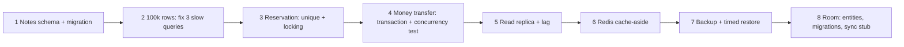

# Practice: Projects & Exercises

> Databases are learned by doing: build schemas, load real volumes, read plans, cause races on purpose, restore from a backup, and practise designs out loud on a timer.

Roadmap topic 23 · Stage 8: Interview & Practice

**Go deeper:** `22` Database Interview Answer Points · `04-backend-engineering/12-Checkpoint-Project-Notes-API` · `05-system-design/32-Practice-Projects-and-Designs` · `06-mobile-engineering/22-Practice-Projects-and-Exercises` · `03-leetcode-patterns` (SQL problems).

**Marks:** 🟢 must know · 🟡 good to know

**How the examples are checked:** the data generator and the exercise queries run on SQLite 3.54; PostgreSQL tasks are described, not run.

---

#### 1. What Is It?

*Eight builds, SQL exercises and seven schema designs.*

| 🟢 Must know | 🟡 Good to know |
|---|---|
| notes app schema and a migration file | add a read replica and see replication lag |
| load 100,000 rows; fix three slow queries | cache a query in Redis (cache-aside, TTL) |
| reservation table: no double booking (unique, then locking) | a backup and full restore, timed |
| money transfer: a transaction and a concurrent test | Room/SQLite in an app: entities, migrations, offline sync stub |
| SQL: joins, group by, having; window functions | recursive query; rewrite a slow query three ways |
| designs: notes, e-commerce, ticket booking, chat | designs: social feed, URL shortener, multi-tenant app |

**Signals in an interview:** "tell me about a database you designed", "how did you find and fix a slow query?", "show me how you tested concurrency".

---

#### 2. How It Works

**The path.**



**Build (in order).**

| # | Build | Done when | Topics |
|---|---|---|---|
| 1 🟢 | **Notes app schema:** tables, keys, constraints, a migration file (`BE 12`) | users, notes, tags, note_tags; `UNIQUE`, `FK`, `CHECK`; migration V001–V003 applied by Flyway/Liquibase | 2, 10 |
| 2 🟢 | **Load 100,000 rows, then find and fix three slow queries** with `EXPLAIN` and indexes | before/after plans and timings for each fix | 5, 6 |
| 3 🟢 | **Reservation table:** prevent double booking with a unique constraint, then with locking | 20 threads book one seat: exactly one wins | 8, 9 |
| 4 🟢 | **Money transfer:** two accounts, a transaction, a concurrent test | total money constant after 1,000 random concurrent transfers; no negative balance | 8, 9 |
| 5 🟡 | **Add a read replica locally** and see replication lag | `pg_stat_replication` shows lag; read-your-writes routing tested | 14 |
| 6 🟡 | **Cache a query in Redis** with cache-aside and TTL | hit ratio measured; invalidation on write | 13 |
| 7 🟡 | **A backup and a full restore, timed** | restore into a new database; row counts match; time recorded vs RTO | 17 |
| 8 🟡 | **Room or SQLite in an app:** entities, migrations, an offline sync stub | migration test from version 1 to latest; outbox + tombstone logic | 21 |

**SQL exercises.**

| # | Exercise | Skill |
|---|---|---|
| 🟢 | Joins, `GROUP BY` and `HAVING` on a small shop dataset | topic 3 |
| 🟢 | Window functions: top N per group, running total, latest row per user | topic 4 |
| 🟡 | A recursive query for a comment tree | topic 4 |
| 🟡 | Rewrite a slow query three ways and compare plans | topic 6 |

**Schema designs to practise.**

| Design | Focus |
|---|---|
| 🟢 Notes app | users, notes, tags, sharing, sync columns |
| 🟢 E-commerce | users, products, orders, order lines, payments, inventory |
| 🟢 Ticket or seat booking | holds, unique booking, idempotent payment |
| 🟢 Chat | users, conversations, members, messages (ordering, read state) |
| 🟡 Social feed and followers | follows, posts, feed (fan-out), counts |
| 🟡 URL shortener | short codes, redirects, analytics, expiry |
| 🟡 Multi-tenant app | tenant column + RLS vs schema per tenant |

**Weekly rhythm.**

| Week | Do |
|---|---|
| 1 | Topics 1–4 with a local PostgreSQL; build 1; SQL exercises |
| 2 | Topics 5–6; build 2 (100k rows, three fixes) |
| 3 | Topics 8–9; builds 3 and 4 (two terminals, then threads) |
| 4 | Topic 10 and build 8 (migrations) ; design the notes schema aloud |
| 5 | Topics 11–16; builds 5 and 6; designs for e-commerce and booking |
| 6 | Topics 17–19; build 7; designs for chat and feed |
| 7+ | Topic 22: practise designs on a timer; repeat the weak ones |

---

#### 3. Naive vs Better Design

| Naive | Better |
|---|---|
| read about indexes, never time one | 100,000 rows, plans before and after |
| "I understand transactions" | a concurrent test that fails without the fix |
| tiny tables in the examples | realistic volumes |
| restore never tried | a timed restore into a clean database |
| design on paper only | run the DDL, load data, run the queries |
| memorise answers | know why each choice, and what breaks |
| practise silently | explain aloud on a timer |

---

#### 4. SQL & Code

Generate 100,000 rows with a recursive CTE (SQLite; PostgreSQL uses `generate_series`):

```sql
CREATE TABLE big (id INTEGER PRIMARY KEY, user_id INT, amount INT, created INT);
WITH RECURSIVE n(i) AS (SELECT 1 UNION ALL SELECT i + 1 FROM n WHERE i < 100000)
INSERT INTO big(user_id, amount, created) SELECT i % 5000, i % 997, i FROM n;
-- PostgreSQL:  INSERT INTO big(user_id, amount, created) SELECT i % 5000, i % 997, i FROM generate_series(1, 100000) AS i;
SELECT COUNT(*) FROM big;                              -- 100000  (about 0.02 s in SQLite)
```

Three slow queries to fix (build 2):

```sql
EXPLAIN QUERY PLAN SELECT * FROM big WHERE user_id = 42;                                    -- SCAN → CREATE INDEX big_user ON big(user_id)
EXPLAIN QUERY PLAN SELECT id FROM big WHERE user_id = 42 AND amount > 900 ORDER BY created DESC LIMIT 10;
                                                                                             -- → CREATE INDEX big_user_created ON big(user_id, created) (equality first, sort last)
EXPLAIN QUERY PLAN SELECT * FROM big ORDER BY id DESC LIMIT 20 OFFSET 90000;                -- → keyset: WHERE id < :last ORDER BY id DESC LIMIT 20
```

Checks: each fix changes the plan from `SCAN` to `SEARCH ... USING INDEX`; the `OFFSET` query becomes a seek on the primary key and keeps the same cost for any page.

Concurrent reservation test (build 3), in Kotlin with threads against PostgreSQL or SQLite:

```kotlin
@Test fun onlyOneBuyerWinsTheSeat() {
    val winners = java.util.concurrent.atomic.AtomicInteger(0)
    val pool = java.util.concurrent.Executors.newFixedThreadPool(20)
    val start = java.util.concurrent.CountDownLatch(1)
    repeat(20) { user ->
        pool.submit {
            start.await()                                              // release all threads together
            val rows = ds.connection.use { c ->
                c.prepareStatement("UPDATE seats SET held_by = ? WHERE seat_no = 'A1' AND held_by IS NULL").use { it.setString(1, "u$user"); it.executeUpdate() } }
            if (rows == 1) winners.incrementAndGet()
        }
    }
    start.countDown(); pool.shutdown(); pool.awaitTermination(10, java.util.concurrent.TimeUnit.SECONDS)
    assertEquals(1, winners.get())                                     // exactly one winner; also check there is one booking row
}
```

Money transfer invariant test (build 4):

```kotlin
@Test fun totalMoneyIsConstant() {
    val before = totalBalance()                                        // e.g. 100 accounts × 1,000
    runConcurrently(threads = 16, iterations = 1_000) { transfer(randomAccount(), randomAccount(), (1..50).random().toLong()) }
    assertEquals(before, totalBalance())                               // nothing created or destroyed
    assertEquals(0, countNegativeBalances())                           // the CHECK (bal >= 0) held
}
```

Lock ordering inside `transfer` (avoid deadlocks): always update the lower account id first (topic 9). If you see deadlock errors in the test, retry the transaction (topic 9).

A timed restore log (build 7):

```text
2025-03-05  base backup 12.4 GB   restore: 6 min 40 s  WAL replay to 09:29: 1 min 10 s   validate counts: 45 s   total 8 min 35 s   (RTO 30 min ✓)
```

Latency model for the cache build (build 6): with a 95% hit ratio, 1 ms cache, 50 ms database → about `3.5 ms` per read.

SQL exercise starters:

```sql
-- top 3 customers by spend:
SELECT user_id, SUM(amount_cents) AS spent FROM orders WHERE status = 'paid' GROUP BY user_id ORDER BY spent DESC LIMIT 3;
-- latest order per user:
SELECT * FROM (SELECT *, ROW_NUMBER() OVER (PARTITION BY user_id ORDER BY created_at DESC, id DESC) rn FROM orders) WHERE rn = 1;
-- users with no orders:
SELECT u.id FROM users u WHERE NOT EXISTS (SELECT 1 FROM orders o WHERE o.user_id = u.id);
```

Self-score a schema design:

```kotlin
data class Design(val pk: Boolean, val fks: Boolean, val uniques: Boolean, val checks: Boolean, val indexes: Boolean, val concurrency: Boolean, val migrationPlan: Boolean, val backupPlan: Boolean)
fun designScore(d: Design) = listOf(d.pk, d.fks, d.uniques, d.checks, d.indexes, d.concurrency, d.migrationPlan, d.backupPlan).count { it }
```

Checks: all eight present → `8`; a design with keys and indexes only `(true, false, false, false, true, false, false, false)` → `2`: add constraints, a race answer, a migration plan and backups.

A README per project:

```text
# Reservation API
Schema + DDL; the 5 queries and their indexes; EXPLAIN before/after; the concurrency test (20 threads → 1 winner);
migration files; backup/restore time; what I'd change at 10× load.
```

---

#### 5. Numbers & Limits

| Item | Guide |
|---|---|
| Rows for index practice | ≥ 100,000 (≥ 1 million to see big differences) |
| Concurrency tests | 16–32 threads, 1,000+ iterations, run several times |
| Time per build | a weekend for builds 1–4; a few evenings for the rest |
| Design practice | 45 minutes + 15 minutes of review; repeat each design a week later |
| Restore drill | monthly in real systems; once in practice |
| Portfolio | 2–3 projects with schema, plans, tests, timings and a README |

---

#### 6. Common Mistakes & Edge Cases

1. Tiny datasets that hide problems.
2. A single-threaded "concurrency" test.
3. Not reading the plan before and after.
4. No migration or restore practice.
5. Designing without writing the queries.
6. Copying a schema from a tutorial without understanding the constraints.
7. Never explaining a design aloud.

Edge cases: SQLite's single-writer model hides some races that PostgreSQL shows (use PostgreSQL for concurrency practice); cloud free tiers with limits; test data that isn't representative (skew, hot keys); flaky concurrency tests (use latches and repeat).

---

#### 7. Say This in the Interview

1. "I built a reservation schema and proved with a 20-thread test that only one buyer gets a seat: an atomic conditional update plus a unique constraint."
2. "I loaded 100,000 rows, found three slow queries with `EXPLAIN`, and fixed them with a composite index, an expression change and keyset pagination; here are the before and after plans and times."
3. "I tested money transfers concurrently: the total stayed constant and no balance went negative; deadlocks were handled by lock ordering and retry."
4. "I timed a full restore against my RTO and wrote the runbook."

---

#### 8. Quick Check

1. What proves a double-booking fix works?
2. Why load 100,000 rows before tuning?
3. What should a project README include?
4. Which database should you use to practise real concurrency?

<details>
<summary>Answers</summary>

1. A concurrent test where many threads race for one seat and exactly one wins.
2. Small tables hide scans; the plans and timings only differ at realistic volume.
3. Schema, queries and indexes, plans before and after, tests, timings, and what you'd change at scale.
4. PostgreSQL (or MySQL InnoDB); SQLite's single-writer model hides some races.

</details>

---

#### 9. Practice

**Interview questions**

1. Walk me through a schema you designed and tested.
2. How did you find and fix a slow query?
3. How did you test for race conditions?
4. How did you restore from a backup, and how long did it take?
5. How would you design the database for a chat app, a feed, a URL shortener?

**Exercises**

1. Do builds 1 to 4 (all 🟢) with a README each.
2. Do the SQL exercises on your own dataset and save the solutions.
3. Record yourself designing the booking and chat schemas in 45 minutes and review.
4. Repeat each design a week later.

**Coding warm-ups (LeetCode SQL)**

| # | Question | Link to this topic |
|---|---|---|
| 175 | [Combine Two Tables](https://leetcode.com/problems/combine-two-tables/) (Easy) | left join |
| 181 | [Employees Earning More Than Their Managers](https://leetcode.com/problems/employees-earning-more-than-their-managers/) (Easy) | self join |
| 182 | [Duplicate Emails](https://leetcode.com/problems/duplicate-emails/) (Easy) | group by / having |
| 184 | [Department Highest Salary](https://leetcode.com/problems/department-highest-salary/) (Medium) | joins and aggregates |
| 262 | [Trips and Users](https://leetcode.com/problems/trips-and-users/) (Hard) | joins, conditions, rates |
| 570 | [Managers with at Least 5 Direct Reports](https://leetcode.com/problems/managers-with-at-least-5-direct-reports/) (Medium) | group by / having |
| 1341 | [Movie Rating](https://leetcode.com/problems/movie-rating/) (Medium) | union, ordering, aggregates |
| 185 | [Department Top Three Salaries](https://leetcode.com/problems/department-top-three-salaries/) (Hard) | window functions |

**Remember:** realistic volumes · read the plan before and after · prove concurrency fixes with a threaded test · practise migrations and a timed restore · write the README with numbers · design aloud on a timer and repeat.
