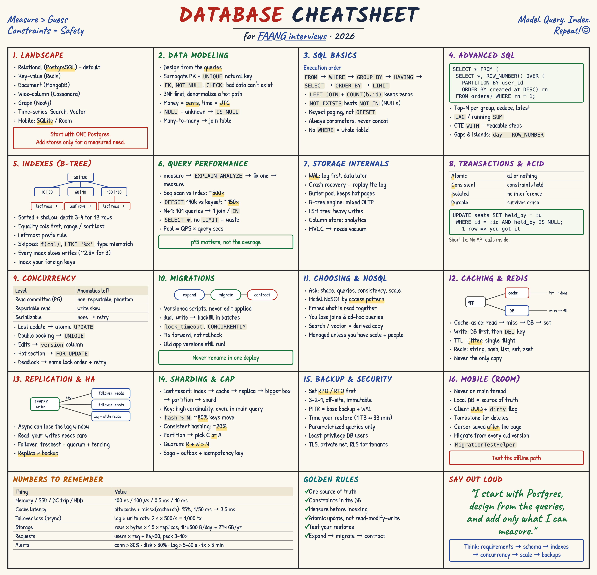
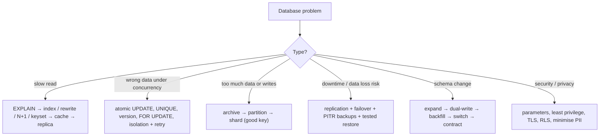

# Database Cheat Sheet

> One-page revision for the night before an interview. The full explanations are in notes 1–23.



---

#### 1. Key Takeaways

1. **Default:** one relational database (PostgreSQL). Add a cache, replicas, a search engine or another store only for a measured need. One source of truth; everything else is derived and rebuildable.
2. **Modeling:** design from the queries; surrogate PK + `UNIQUE` natural key; FK, `NOT NULL`, `CHECK` so bad data can't exist; 3NF first, denormalize a measured hot path; cents not floats, UTC not local time; `NULL` means unknown (`IS NULL`).
3. **SQL:** `FROM → WHERE → GROUP BY → HAVING → SELECT → ORDER BY → LIMIT`. `LEFT JOIN` + `COUNT(right.id)`. `NOT EXISTS` over `NOT IN`. Keyset pagination. Parameters always. Never `UPDATE`/`DELETE` without `WHERE`.
4. **Advanced SQL:** CTEs for readability; windows (`ROW_NUMBER`, `RANK`, `LAG`, running `SUM`) for top-N per group, latest per user, dedupe, gaps and islands.
5. **Indexes:** B-tree = sorted, shallow, equality + range + sort. Composite: equality columns first, range/sort last, leftmost prefix. Not used with functions on the column, leading wildcards, type mismatch. Writes pay for every index. Index foreign keys. Check with `EXPLAIN`.
6. **Performance:** measure (slow-query log, p95) → `EXPLAIN ANALYZE` → fix one thing → measure. Causes: missing index, N+1, `SELECT *`, deep `OFFSET`, no limit. Pool size ≈ QPS × query time; instances × pool < `max_connections`.
7. **Internals:** WAL first, data later (crash recovery = replay); buffer pool for hot pages; B-tree engines for mixed OLTP, LSM for heavy writes; column stores for analytics; MVCC needs vacuum.
8. **Transactions:** ACID; boundary = one business operation; short; no external calls inside; atomic conditional `UPDATE` instead of read-modify-write; `UNIQUE` + idempotency key; outbox for side effects.
9. **Concurrency:** lost update, write skew, double booking → atomic update, unique constraint, optimistic `version`, `FOR UPDATE`, serializable + retry. Default isolation = read committed. Deadlocks: lock in order, short transactions, retry.
10. **Migrations:** versioned scripts, never edit applied ones; backward compatible; expand → dual-write → backfill (batches) → switch → contract; lock timeouts, concurrent index builds; fix forward; mobile DBs migrate from every old version.
11. **Choosing:** ask shape, queries, consistency, scale, skills; PostgreSQL by default; polyglot persistence; managed unless you have scale and people.
12. **NoSQL:** key-value, document, wide-column, graph, time-series, search, vector. Model by access pattern; embed what is read together; you lose joins, ad-hoc queries, often strong consistency. Search/vector stores are derived. Test security rules.
13. **Caching/Redis:** cache-aside, TTL + jitter, DB first then delete the key, single-flight against stampedes, hot keys, never the only copy. Redis: string, hash, list, set, sorted set.
14. **Replication/HA:** leader writes, followers read; async can lose the lag window; read-your-writes; failover needs freshest follower + quorum + fencing; replica ≠ backup.
15. **Sharding:** last resort (indexes → cache → replicas → bigger box → archive → partition → shard). Key: high cardinality, even, in the main query. Consistent hashing/logical shards, not `% N`. Costs: cross-shard queries/transactions.
16. **Consistency:** per feature; CAP: during a partition choose C or A; quorum `R + W > N`; saga + outbox + idempotency; conflicts: version vectors, CRDTs, LWW with care.
17. **Backup:** RPO/RTO first; 3-2-1, off-site, encrypted, immutable; PITR = base backup + WAL; test and time restores; re-apply deletions after a restore.
18. **Security:** parameterized queries; least-privilege users; private network + TLS + encryption at rest; secrets manager; tenant filter in one place + RLS; minimise/mask/delete PII; audit.
19. **Operations:** monitor latency, slow queries, connections, locks, lag, disk, cache hit, backup age; capacity (days to full); vacuum/analyze/reindex; test upgrades; runbooks.
20. **Analytics:** keep OLAP off the primary; warehouse + ELT; CDC from the WAL; star schema; data-quality checks.
21. **Mobile:** SQLite via Room/Core Data/SwiftData; never on the main thread; local DB is the source of truth; client UUIDs, dirty flag, tombstones, cursor after the page; migrate from every old version.

---

#### 2. Numbers and Rules of Thumb

| Topic | Remember |
|---|---|
| Latency | memory 100 ns · SSD 100 µs · data-centre round trip 0.5 ms · HDD 10 ms |
| Scan vs index | 200,000 rows: ~3 ms scan vs ~0.006 ms index (~500×); B-tree depth 3–4 for a billion keys |
| Index write cost | 3 indexes ≈ 2.8× slower inserts in the sample run |
| `OFFSET` vs keyset | offset 190,000 ≈ 150× slower than keyset in the sample run |
| N+1 | 100 items = 101 queries ≈ 50 ms of round trips; fix with a join or `IN` |
| Pool size | ≈ QPS × query seconds (500 × 0.02 = 10); PostgreSQL default max 100 |
| Hot-row update rate | ≈ 1 ÷ transaction time |
| Cache latency | hit × cache + miss × (cache + db): 95% hits, 1 ms / 50 ms → ~3.5 ms |
| Sharding movement | `hash % N`, 4→5: ~80% of keys move; consistent hashing: ~20% |
| Quorum | `R + W > N`; N = 3: R = 2, W = 2 tolerates 1 failure |
| Failover loss (async) | ≈ lag × write rate (2 s × 500/s = 1,000 commits) |
| Restore | 1 TB at 200 MB/s ≈ 83 min |
| Storage | rows × bytes × 1.5 (indexes) × replicas; 1M rows/day × 500 B ≈ 274 GB/year |
| Requests | users × requests ÷ 86,400; peak 3–10× |
| One PostgreSQL primary | thousands of write tx/s, hundreds of GB to a few TB |
| Column store | 3 of 50 columns ≈ 6% of the bytes (40 GB vs 2.4 GB for 100M rows) |
| Alerts | connections > 80%, disk > 80%, lag > 5–60 s, long transaction > 5 min |

| Isolation | Dirty | Non-repeatable | Phantom | Lost update / write skew |
|---|---|---|---|---|
| Read committed (default PG) | no | yes | yes | possible |
| Repeatable read (default InnoDB) | no | no | no (PG snapshot) | write skew possible |
| Serializable | no | no | no | prevented (retry on abort) |

---

#### 3. Patterns and How to Identify Them

| Signal in the question | Think of | Note |
|---|---|---|
| "SQL or NoSQL?" | PostgreSQL by default; measured exceptions | 11, 12 |
| "design the schema for…" | requirements → entities → keys/constraints → queries → indexes | 2, 22 |
| "customers with no orders / count including zeros" | `LEFT JOIN` + `COUNT(right.id)`, `NOT EXISTS` | 3 |
| "top N per group / latest per user / running total" | window functions | 4 |
| "consecutive days" | gaps and islands | 4 |
| "this query is slow" | `EXPLAIN`, index, N+1, keyset | 5, 6 |
| "page through a feed" | keyset pagination | 3 |
| "database crashes mid-write" | WAL, transactions | 7, 8 |
| "two users, last seat / double spend" | atomic update + unique constraint | 8, 9 |
| "edit conflicts" | optimistic version column | 9 |
| "change the schema on a live system" | expand → migrate → contract | 10 |
| "reads are too heavy" | cache, replicas, read-your-writes | 13, 14 |
| "data too big / writes too many" | partition, then shard (key!) | 15 |
| "services must agree" | saga, outbox, idempotency | 16 |
| "someone dropped the table" | PITR backups, tested restores | 17 |
| "protect user data / tenants" | parameters, least privilege, RLS | 18 |
| "reports slow the app" | replica / warehouse / CDC | 20 |
| "offline app" | Room, client UUIDs, outbox, tombstones | 21 |



---

#### 4. Templates to Memorise

**Constraints**

```sql
CREATE TABLE orders (id INTEGER PRIMARY KEY, user_id INT NOT NULL REFERENCES users(id),
  total_cents INT NOT NULL CHECK (total_cents >= 0), status TEXT NOT NULL CHECK (status IN ('new','paid','shipped','cancelled')),
  UNIQUE (user_id, idem_key));
```

**Left join with zeros, anti-join, keyset page**

```sql
SELECT u.id, COUNT(o.id) FROM users u LEFT JOIN orders o ON o.user_id = u.id GROUP BY u.id;
SELECT id FROM users u WHERE NOT EXISTS (SELECT 1 FROM orders o WHERE o.user_id = u.id);
SELECT id FROM orders WHERE id < :last ORDER BY id DESC LIMIT 20;
```

**Top 1 per group / latest per user / dedupe**

```sql
SELECT * FROM (SELECT *, ROW_NUMBER() OVER (PARTITION BY user_id ORDER BY created_at DESC, id DESC) rn FROM orders) WHERE rn = 1;
```

**Atomic conditional update, optimistic lock, idempotent insert**

```sql
UPDATE seats SET held_by = :u WHERE id = :id AND held_by IS NULL;               -- 1 row ⇒ you got it
UPDATE notes SET title = :t, version = version + 1 WHERE id = :id AND version = :v;   -- 0 rows ⇒ conflict
INSERT INTO payment(user_id, idem_key, amount) VALUES (:u, :k, :a) ON CONFLICT (user_id, idem_key) DO NOTHING;
```

**Transaction**

```kotlin
conn.autoCommit = false
try { /* statements */ conn.commit() } catch (e: Throwable) { conn.rollback(); throw e }
```

**Safe schema change:** add nullable → dual-write → backfill in batches (`WHERE new IS NULL … LIMIT 1000`) → switch reads → drop old later. `SET lock_timeout = '3s'`; `CREATE INDEX CONCURRENTLY`.

**Cache-aside:** `GET` → miss → DB → `SET key value EX ttl+jitter`; on write: DB first, then `DEL key`.

**Backup/PITR:** base backup + WAL archive; `recovery_target_time`; restore drill monthly; record the time.

**Least privilege:** `app` (DML only), `migrator` (DDL), `reporting` (read-only on a replica).

**Room:** `@Entity(indices)`, `@Dao` with `Flow`/`suspend`, `Migration(from, to)`, `exportSchema = true`, WAL mode, `MigrationTestHelper`.

**Sync (mobile):** local UUID + `dirty` + `deleted` tombstone; push with idempotency key; pull `changes?since=cursor`; skip dirty rows; save the cursor after the page.

**Design answer:** requirements → entities → keys/constraints → queries/indexes → concurrency/idempotency → scale/failure/backups → trade-offs.

---

#### 5. Naive to Better

| Naive | Better |
|---|---|
| NoSQL "for scale" | PostgreSQL until a measured limit |
| float for money | integer cents / `NUMERIC` |
| tags in a comma-separated column | join table |
| `SELECT *`, no `LIMIT` | needed columns, limit, keyset |
| `"... '" + input + "'"` | parameterized queries |
| index every column | indexes from the top queries, verified by `EXPLAIN` |
| read-modify-write | atomic conditional `UPDATE` |
| "check then insert" | `UNIQUE` constraint |
| call the payment API inside the transaction | short transaction + outbox / idempotent follow-up |
| rename a column in one deploy | expand → contract |
| a replica is our backup | PITR backups + tested restores |
| `hash % N` sharding | consistent hashing / logical shards |
| analytics on the primary | replica / warehouse / CDC |
| destructive Room migration | tested migrations from every old version |
| app connects as superuser | least-privilege users |

---

#### 6. Common Mistakes and Edge Cases

1. No constraints; trusting only the application. No index on foreign keys. `NOT IN` with `NULL`s. `COUNT(*)` after `LEFT JOIN`. `UPDATE` without `WHERE`.
2. N+1 queries; `SELECT *`; `OFFSET` on feeds; indexes ignored because of functions on columns.
3. Read-modify-write races; check-then-act without a constraint; locks in different orders; no retry on deadlock.
4. Long transactions; external calls inside transactions.
5. Breaking old app/server versions with a schema change; one huge `UPDATE`; `NOT NULL` without a plan.
6. Cache with no TTL; stampede; cache as the only copy.
7. Reading your writes from a lagging replica; untested failover; replicas as backups.
8. Sharding too early; a bad shard key; cross-shard transactions in the hot path.
9. Backups never restored; on the same account as the database.
10. SQL injection; superuser app user; public database; secrets in code; tenant filter forgotten.
11. Edge cases: time zones and daily boundaries; `NULL` ordering and comparisons; ties in `ORDER BY`; hot rows and hot keys; late-arriving events; GDPR deletion vs backups; SQLite's single writer hiding races; process killed mid-sync.

---

#### 7. What to Say Out Loud

1. "I'd start with PostgreSQL: relational data, constraints and transactions. I'd add other stores only for a measured need, and keep one source of truth."
2. "I design the schema from the top queries, with keys and constraints so bad data can't exist, then index for those queries, equality columns first, and verify with `EXPLAIN`."
3. "For slow queries I measure, read the plan, and fix one thing: an index, the N+1, `SELECT *`, or keyset pagination instead of `OFFSET`."
4. "Races are solved with an atomic conditional update and a unique constraint; optimistic versions for edits; `FOR UPDATE` for hot critical sections; retries on deadlocks."
5. "A transaction is one short business operation; side effects go through an outbox, with idempotency keys for retries."
6. "Reads scale with caching and replicas, mindful of lag and read-your-writes; writes scale with partitioning and finally sharding on a good key, accepting cross-shard costs."
7. "Replication isn't backup: I set RPO and RTO, use PITR with off-site immutable copies, and time my restores."
8. "Schema changes are expand, migrate, contract, because old versions run alongside; on a phone every old version migrates its own database."
9. "Parameterized queries, least-privilege users, a private network with TLS, and tenant isolation in one place with row-level security."

---

#### 8. Practice Order

| Step | Do |
|---|---|
| 1 | Install PostgreSQL; model the notes schema with constraints; write joins, group by, windows (2–4) |
| 2 | Load 100,000 rows; fix three slow queries with `EXPLAIN` (5, 6) |
| 3 | Reproduce a lost update and a double booking; fix with atomic update + unique (8, 9) |
| 4 | Write and test a migration with expand → contract (10) |
| 5 | Add a cache and a read replica; measure hit ratio and lag (13, 14) |
| 6 | Do a backup, a failure and a timed restore (17) |
| 7 | Write the Room entities, migration and sync stub (21) |
| 8 | Practise schema designs aloud: booking, e-commerce, chat (22, 23) |
| 9 | Read this sheet, then the "Say This in the Interview" parts of your weakest notes |
