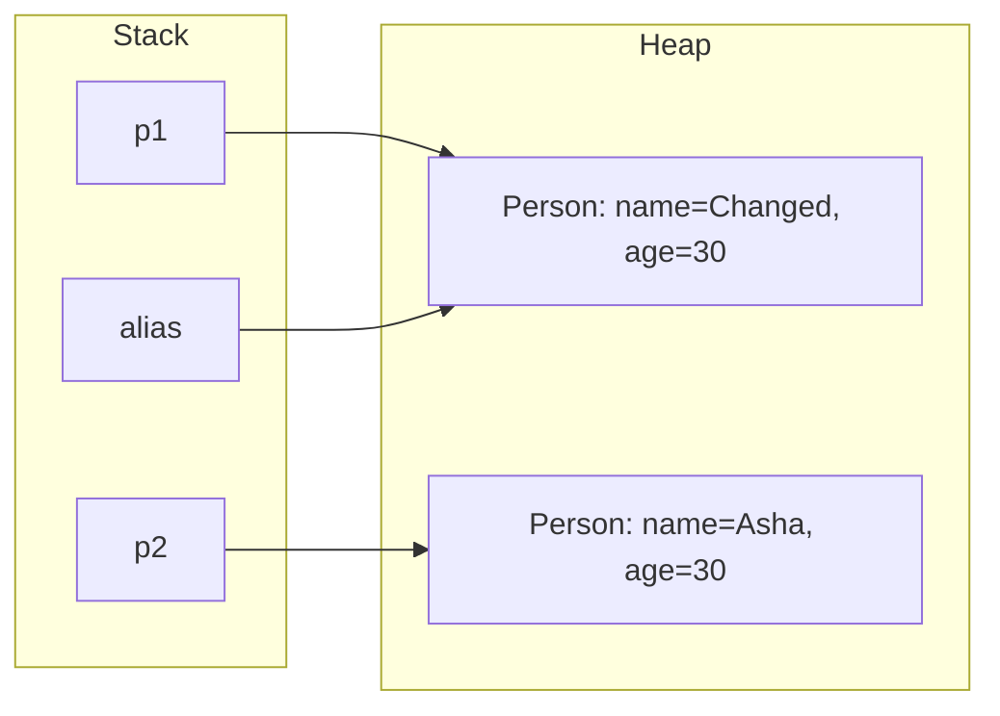
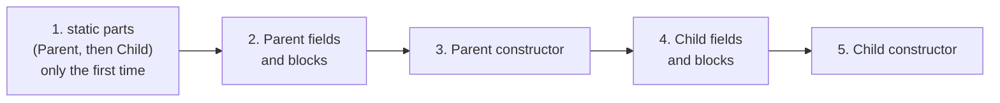

# Classes and Objects

> A class is a blueprint; an object is one thing built from it. Know fields, methods, constructors and `this`, where objects and variables live (heap and stack), what default values Java gives, and the order in which Java sets an object up.

Roadmap topic 1 · Stage 1: The Four Pillars

**Go deeper:** `11 2` Encapsulation · `11 3` Inheritance and Polymorphism · `11 10` `static` and nested classes · `06-mobile-engineering/02-Kotlin-Essentials`.

**Marks:** 🟢 must know · 🟡 good to know

---

#### 1. What Is It?

*The words you need before anything else in OOP makes sense.*

| 🟢 Must know | 🟡 Good to know |
|---|---|
| class and object | initialization order |
| fields (state) and methods (behaviour) | constructor overloading, `this(...)` |
| constructor and `this` | Kotlin primary constructor and `init` |
| reference variable vs object | default values of fields |
| stack vs heap | `toString` default output |
| instance vs `static` (preview) | |

1. **Class:** a blueprint. It says which fields (data) and methods (actions) an object will have.
2. **Object:** one real thing built from the class with `new`. It lives on the **heap**. Many objects can come from one class.
3. **Field:** a variable that belongs to an object (its state), for example `name`.
4. **Method:** a function that belongs to the class (its behaviour), for example `intro()`.
5. **Constructor:** special code that runs when the object is created. It sets the starting state.
6. **`this`:** the object that is running the method right now.
7. **Reference:** a variable that points to an object. It is **not** the object.

**Signals in an interview:** "difference between class and object", "what is a constructor?", "what happens if I write `b = a`?", "what is the default value of a field?", "in what order does Java initialise an object?".

---

#### 2. How It Works

**Variables and objects live in different places.** Local variables (and references) live on the **stack**. Objects live on the **heap**. A reference variable holds the address of an object.



`alias = p1` copies the **reference**, not the object. Both names now point to the same object, so a change through one is visible through the other.

**Constructors.** A constructor has the class name and no return type. If you write none, Java gives you an empty one. If you write one with parameters, the empty one is no longer added. A constructor can call another one with `this(...)` so the setup code is written once (constructor chaining).

**Default values.** Fields get a default if you do not set them. Local variables do **not**: using one before assigning is a compile error.

| Type | Default |
|---|---|
| `int`, `long`, `short`, `byte` | `0` |
| `double`, `float` | `0.0` |
| `boolean` | `false` |
| `char` | `'\u0000'` |
| any object, array, `String` | `null` |

**Order of setup** when you write `new Child()` and `Child extends Parent`:



**Instance vs `static`.** An instance field exists once per object. A `static` field exists once per class and is shared. Full detail is in topic 10.

---

#### 3. Naive vs Better Design

| Naive | Better |
|---|---|
| empty constructor, then set every field with setters | a constructor that takes the required values |
| a constructor with 8 parameters | a data class / builder, or named arguments (Kotlin) |
| public fields anyone can change | private fields (topic 2) |
| objects that can exist half-built | objects that are valid from the first line |
| no `toString` | a readable `toString` for logs and tests |

```java
// Naive: a half-built object. Nothing stops name from staying null.
Person p = new Person();
p.name = null;
p.age = -5;
```

---

#### 4. Templates & Examples

*Checks come from running the Java versions on JDK 21. The Kotlin versions were not compiled.*

**Example 1: constructors and `this(...)`.**

```java
class Person {
    static int count = 0;
    String name; int age;
    Person()              { this("unknown", 0); }
    Person(String name)   { this(name, 18); }
    Person(String name, int age) { this.name = name; this.age = age; count++; }
    String intro() { return name + " (" + age + ")"; }
}
```

```kotlin
class Person(val name: String = "unknown", val age: Int = 0) {
    fun intro() = "$name ($age)"
}
// Person("Ravi", 18), Person(name = "Ravi"), Person()
```

Checks: `new Person("Asha", 30)` → `Asha (30)`; `new Person()` → `unknown (0)`; `new Person("Ravi")` → `Ravi (18)`. After four `new Person(...)` calls, `Person.count` is `4`. Two objects built with the same arguments are different objects: `p1 == p2` → `false`.

**Example 2: copying a reference is not copying an object.**

```java
Person p1 = new Person("Asha", 30);
Person p2 = new Person("Asha", 30);
Person alias = p1;
alias.name = "Changed";
// p1.name -> "Changed"   p2.name -> "Asha"
```

Checks: `p1.name` → `Changed` (same object as `alias`), `p2.name` → `Asha` (a different object).

**Example 3: default values of fields.**

```java
class Defaults { int n; boolean b; double d; String s; int[] arr; }
// new Defaults() -> n=0, b=false, d=0.0, s=null, arr=null
```

Checks: printing the fields gives `0 false 0.0 null null`. Calling `s.length()` here would throw `NullPointerException`.

**Example 4: the order of initialisation.**

```java
class Parent {
    static { log("P-static"); }
    int a = init("P-field");
    { log("P-block"); }
    Parent() { log("P-ctor"); }
}
class Child extends Parent {
    static { log("C-static"); }
    int b = init("C-field");
    { log("C-block"); }
    Child() { log("C-ctor"); }
}
// new Child();  new Child();
```

Checks: the first `new Child()` logs `P-static C-static P-field P-block P-ctor C-field C-block C-ctor`. The second logs only `P-field P-block P-ctor C-field C-block C-ctor`: static parts run once per class, not once per object.

**Kotlin: setup with `init`.**

```kotlin
class Account(initial: Long) {
    var balance: Long = initial
        private set
    init { require(initial >= 0) { "negative" } }      // runs as part of construction
}
```

---

#### 5. Numbers & Rules of Thumb

| Item | Guide |
|---|---|
| Constructor parameters | 3 or fewer; beyond that use a builder or a data class |
| Class | one clear job (topic 2); a few hundred lines at most |
| Fields | private; set in the constructor |
| Object size | you rarely count it; but many tiny objects in a hot loop cost memory (Android: avoid allocating in `onDraw`) |
| `static` state | avoid; it is shared and hard to test |
| Object validity | valid after the constructor ends, never "set it up later" |

---

#### 6. Common Mistakes & Edge Cases

1. Thinking `b = a` copies the object. It copies the reference.
2. Comparing two objects with `==` and expecting equal content (`==` compares references; topic 7).
3. Forgetting to set a field and then calling a method on `null` (`NullPointerException`).
4. Leaving public fields so any code can break the rules (topic 2).
5. Calling an overridable method from a constructor: the subclass fields are not ready yet (topic 3).
6. Mixing up class members (`static`) and object members.
7. Not writing `toString`: logs show `Person@1b6d3586`-style text instead of the data.
8. Using a local variable before assigning it (compile error, because locals have no default).

Edge cases: an object with no references to it is eligible for garbage collection; arrays are objects too (default `null` / `0` elements); a class with only private constructors cannot be created from outside (used by singletons and factories, topic 10).

---

#### 7. Say This in the Interview

1. "A class is the blueprint, an object is one instance built from it. The object lives on the heap and my variable holds a reference to it."
2. "`b = a` copies the reference, so both point to the same object. To get a separate object I build a new one or copy it."
3. "A constructor sets the starting state so an object is valid from the first line. I chain constructors with `this(...)` so the setup is written once."
4. "Fields get default values (`0`, `false`, `null`); local variables do not."
5. "Static parts run once when the class loads. Then for each object: parent fields and blocks, parent constructor, child fields and blocks, child constructor."

---

#### 8. Quick Check

1. What does `Person alias = p1;` create: a new object or a new reference?
2. What is the default value of an `int` field? A `String` field? A local `int`?
3. In which order do the constructors of `Parent` and `Child` run?
4. How many times does a `static { }` block run if you create 100 objects?

<details>
<summary>Answers</summary>

1. A new reference. Both variables point to the same object.
2. `0`; `null`; a local `int` has no default and must be assigned before use (compile error otherwise).
3. `Parent`'s constructor first, then `Child`'s (after the parent's fields and blocks, and before the child's own constructor body).
4. Once, when the class is first loaded.

</details>

---

#### 9. Practice

**Interview questions**

1. Class vs object?
2. What is a constructor? Can it be `private`? Why would you do that?
3. What happens when you write `b = a` for objects?
4. What are the default values of fields?
5. Explain the order of initialisation with inheritance.
6. What does `this` mean? What is constructor chaining?
7. Stack vs heap: which holds what?

**Exercises**

1. Write a `Book` class with `title`, `author`, `year`; add two constructors and a `toString`.
2. Make two variables point to one object; change it through one and print through the other.
3. Add `static` and instance blocks to a parent and child class; predict the order, then run it.
4. Rewrite a class that uses setters to build itself into one with a validating constructor.
5. Write a Kotlin `class` with a primary constructor, default arguments and an `init` block.

**LeetCode (small classes with state, Easy → Medium)**

| # | Question | Practises |
|---|---|---|
| 1603 | [Design Parking System](https://leetcode.com/problems/design-parking-system/) (Easy) | a constructor that sets starting state, one method |
| 705 | [Design HashSet](https://leetcode.com/problems/design-hashset/) (Easy) | fields, constructor, small public API |
| 933 | [Number of Recent Calls](https://leetcode.com/problems/number-of-recent-calls/) (Easy) | an object that keeps its own state between calls |
| 1656 | [Design an Ordered Stream](https://leetcode.com/problems/design-an-ordered-stream/) (Easy) | constructor with a parameter, internal array |
| 2043 | [Simple Bank System](https://leetcode.com/problems/simple-bank-system/) (Medium) | validation inside methods |
| 1472 | [Design Browser History](https://leetcode.com/problems/design-browser-history/) (Medium) | object state plus a clean API |

**Remember:** class = blueprint · object = instance on the heap · variables hold references · `b = a` shares an object · fields have defaults, locals do not · static parts run once.
