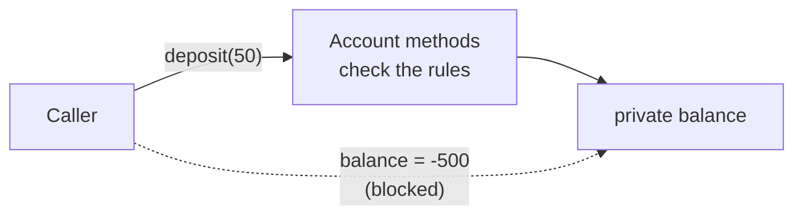

# Encapsulation and Access Modifiers

> Encapsulation means keeping data private and letting it change only through methods that protect the rules. Learn the four access levels in Java and Kotlin, when getters and setters help, and how to stop an internal list from leaking out.

Roadmap topic 2 · Stage 1: The Four Pillars

**Go deeper:** `11 1` Classes and Objects · `11 9` Immutability · `ARCH 24` SOLID in Code (single responsibility) · `06-mobile-engineering/02-Kotlin-Essentials`.

**Marks:** 🟢 must know · 🟡 good to know

---

#### 1. What Is It?

*Hide the data, expose the actions.*

| 🟢 Must know | 🟡 Good to know |
|---|---|
| private fields + public methods | Kotlin properties (`val`, `var`, `private set`) |
| access modifiers: `public`, `protected`, package-private, `private` | custom getters and setters |
| validation inside constructors and methods | encapsulation and testing |
| do not expose an internal mutable list | "tell, don't ask" |
| getters and setters: when they help, when they do not | `internal` visibility for modules |

**The idea in one line:** an object should protect its own rules. Outside code asks the object to do things (`withdraw`), instead of reaching in and changing numbers.

**Why it matters:** if every field is public, any line of code anywhere can break a rule (a negative balance, an empty email), and you can never change the inside later without touching all callers.

**Signals in an interview:** "what is encapsulation?", "why make fields private?", "difference between `private`, `protected` and package-private?", "should every field have a getter and setter?", "how do you stop callers from changing your internal list?".

---

#### 2. How It Works

**The four access levels.**

| Java | Kotlin | Visible to |
|---|---|---|
| `public` | `public` (default) | everyone |
| `protected` | `protected` | subclasses (Java: also the same package) |
| package-private (no keyword) | `internal` | Java: same package · Kotlin: same module |
| `private` | `private` | the class (Kotlin: or the file, for top-level items) |

Rule: start with the **most private** level that works, and open it up only when you need to.

**Protecting rules.** The class decides what changes are allowed:



**Getter vs setter vs behaviour method.** A getter reads, a setter writes. A plain setter (`setBalance`) lets any caller put any value in, which is nearly as bad as a public field. Prefer a method with a **meaning** (`deposit`, `withdraw`, `rename`) that checks the rules.

**Tell, don't ask.** Ask-style code reads the state, decides, then writes it back. That spreads the rule across callers and can race when two threads do it together. Tell-style code just says `account.withdraw(30)` and lets the account decide.

**Leaking internals.** A getter that returns the internal list gives callers the real list. Three safe choices:

| Return | Effect |
|---|---|
| the real list | callers can add and remove: **leak** |
| `Collections.unmodifiableList(list)` (a **view**) | callers cannot change it, but they see later changes |
| `List.copyOf(list)` (a **copy**) | a snapshot; later changes are not seen |

---

#### 3. Naive vs Better Design

| Naive | Better |
|---|---|
| `public long balance;` | `private` field plus `deposit` and `withdraw` |
| `setBalance(long)` that accepts anything | methods named for what they do, with checks |
| `getItems()` returns the internal list | return a copy or an unmodifiable view |
| a getter and setter for every field "just in case" | only the methods callers really need |
| rule checked by every caller | rule checked once, inside the class |

```java
// Naive: anyone can break the rule
class Account { public long balance; }
// acct.balance = -500;   // nothing stops this
```

---

#### 4. Templates & Examples

*Checks come from running the Java versions on JDK 21. The Kotlin versions were not compiled.*

**Example 1: `Account` with private state.**

```java
class Account {
    private long balance;
    Account(long initial) { if (initial < 0) throw new IllegalArgumentException("negative"); balance = initial; }
    void deposit(long c) { if (c <= 0) throw new IllegalArgumentException("amount"); balance += c; }
    boolean withdraw(long c) { if (c <= 0 || c > balance) return false; balance -= c; return true; }
    long balance() { return balance; }
}
```

```kotlin
class Account(initial: Long) {
    var balance: Long = initial.also { require(it >= 0) { "negative" } }
        private set                                             // read from outside, change only inside
    fun deposit(c: Long) { require(c > 0) { "amount" }; balance += c }
    fun withdraw(c: Long): Boolean { if (c <= 0 || c > balance) return false; balance -= c; return true }
}
```

Checks: open with `100`, deposit `50` → `150`; `withdraw(500)` → `false`, balance still `150`; `withdraw(30)` → `true`, balance `120`; `new Account(-1)` throws `IllegalArgumentException("negative")`.

**Example 2: a setter that protects a rule.**

```java
class User {
    private String email;
    void setEmail(String e) {
        if (e == null || !e.contains("@")) throw new IllegalArgumentException("bad email: " + e);
        email = e;
    }
    String email() { return email; }
}
```

```kotlin
class User {
    var email: String = ""
        set(value) { require("@" in value) { "bad email: $value" }; field = value }
}
```

Checks: `setEmail("a@x.com")` works; `setEmail("nope")` throws `bad email: nope` and the stored value stays `a@x.com`.

**Example 3: a leaking list, and the two fixes.**

```java
class Account {
    private final List<String> history = new ArrayList<>();
    List<String> leaky()    { return history; }                              // leak
    List<String> safeView() { return Collections.unmodifiableList(history); } // read-only view
    List<String> safeCopy() { return List.copyOf(history); }                  // snapshot
}
```

```kotlin
class Account {
    private val _history = mutableListOf<String>()
    val history: List<String> get() = _history          // callers see a read-only List
}
```

Checks: after `+50` and `-30`, `account.leaky().add("HACK")` makes the real history `[+50, -30, HACK]`. `safeView().add("x")` throws `UnsupportedOperationException`. After taking `safeCopy()` (3 items) and then depositing again, the copy still has `3` items while `safeView()` has `4`.

*Kotlin note:* returning `List<String>` hides `add`, but the object behind it is still mutable. A caller can cast it. For a true snapshot, return `_history.toList()`.

---

#### 5. Numbers & Rules of Thumb

| Item | Guide |
|---|---|
| Fields | `private` by default |
| Visibility choice | private → package/internal → protected → public; widen only when needed |
| Public methods | as few as callers need; each one is a promise you must keep |
| Setters | avoid; use a method that names the action and checks the rule |
| Collections you return | a copy or a read-only view, never the real mutable one |
| Constructor | sets a valid state; throws if the input is invalid |

---

#### 6. Common Mistakes & Edge Cases

1. Making fields `public` "for speed" (the JVM inlines getters; there is no real cost).
2. A getter and setter for every field: this is public data in disguise.
3. Returning the internal mutable list or array.
4. Validating in the caller, so the rule is copied in many places.
5. Using `protected` fields so subclasses can change state directly; this breaks the parent's rules.
6. Forgetting that Kotlin `List<T>` is only a read-only **view type**, not a guarantee of immutability.
7. Using Kotlin `internal` and expecting it to work like Java package-private: it is per module, not per package.
8. Hiding too much: an overly private design that makes testing impossible. Test through the public API, or inject fakes (`ARCH 24`).

Edge cases: reflection can read private fields (so private is a design tool, not a security tool); serialization frameworks often need a no-argument constructor; Android View binding and Room may need non-private members.

---

#### 7. Say This in the Interview

1. "Encapsulation is keeping state private and changing it only through methods that enforce the rules, so no caller can put the object in an invalid state."
2. "I do not add getters and setters by habit. I add a method named for the action, like `withdraw`, which checks the rule once."
3. "I return a copy or a read-only view of internal collections so callers cannot change my state."
4. "I start with `private` and widen only when needed. Protected gives subclasses access to my internals, so I use it sparingly."
5. "In Kotlin I use `private set` to let others read a property while only the class can change it."

---

#### 8. Quick Check

1. Why is `public long balance` worse than a private field with `deposit` and `withdraw`?
2. What is the difference between `Collections.unmodifiableList(list)` and `List.copyOf(list)`?
3. What does Kotlin `internal` mean?
4. Is `setBalance(long)` good encapsulation?

<details>
<summary>Answers</summary>

1. Any code can set an invalid value, and you can never change how the balance is stored without touching every caller.
2. The first is a read-only **view**: later changes to the original show through. The second is a **copy**: a snapshot that does not change.
3. Visible inside the same module (a Gradle module, for example), not outside it.
4. Usually no. It accepts any value. A `deposit` or `withdraw` method that checks the rules is better.

</details>

---

#### 9. Practice

**Interview questions**

1. What is encapsulation, and why does it matter?
2. `private` vs `protected` vs package-private vs `public`?
3. Do you always need getters and setters?
4. How do you return a collection safely from a method?
5. What does Kotlin's `private set` do?
6. What is the difference between encapsulation and abstraction?

**Exercises**

1. Write `Account` with private state; add tests for a negative deposit and an overdraft.
2. Add a `history` list and return it three ways (real list, view, copy); write a test that tries to modify each.
3. Replace `setStatus(String)` with a method for each allowed change (`activate()`, `suspend()`).
4. Take a class with all public fields and make it safe without changing its callers' behaviour.
5. In Kotlin, expose a `val items: List<Item>` backed by a private `MutableList`.

**LeetCode (hide state behind a small API, Easy → Medium)**

| # | Question | Practises |
|---|---|---|
| 1603 | [Design Parking System](https://leetcode.com/problems/design-parking-system/) (Easy) | private counters, one `addCar` method |
| 303 | [Range Sum Query - Immutable](https://leetcode.com/problems/range-sum-query-immutable/) (Easy) | private precomputed data, read-only API |
| 2043 | [Simple Bank System](https://leetcode.com/problems/simple-bank-system/) (Medium) | validation rules inside `transfer`, `deposit`, `withdraw` |
| 155 | [Min Stack](https://leetcode.com/problems/min-stack/) (Medium) | extra private state kept consistent |
| 1472 | [Design Browser History](https://leetcode.com/problems/design-browser-history/) (Medium) | hidden list and pointer |
| 146 | [LRU Cache](https://leetcode.com/problems/lru-cache/) (Medium) | internals hidden behind `get` and `put` |

**Remember:** private by default · methods that name actions · no leaking internal collections · copy or view · `private set` in Kotlin.
