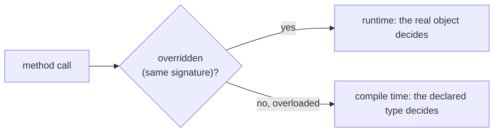
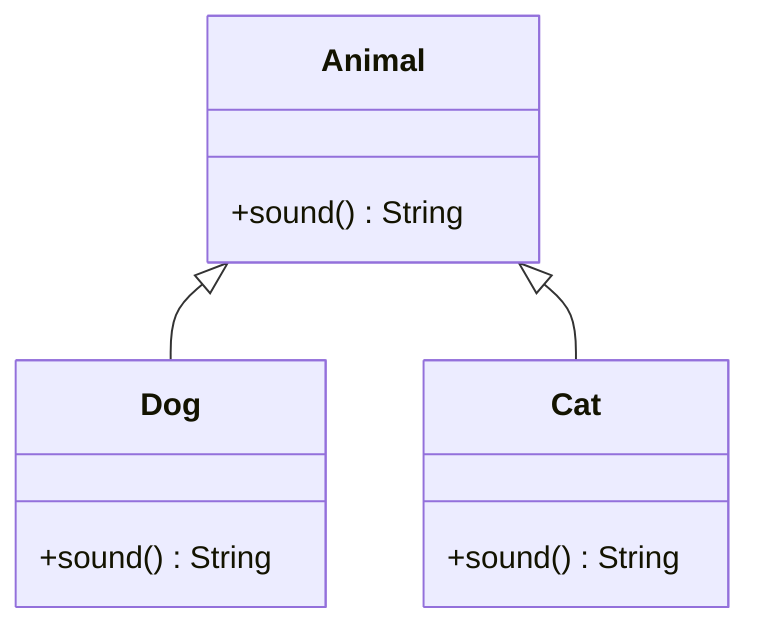

# Inheritance and Polymorphism

> Inheritance lets a subclass reuse and specialise a parent ("is-a"). Polymorphism lets one call run different code depending on the real object. Know overriding vs overloading, `super`, `final`/`open`, and the traps that fill interview questions: the `Dog`/`Animal` overload, hidden fields, and calling an overridable method from a constructor.

Roadmap topic 3 · Stage 1: The Four Pillars

**Go deeper:** `11 4` Abstraction · `11 5` Composition vs Inheritance · `ARCH 24` SOLID (Liskov) · `06-mobile-engineering/02-Kotlin-Essentials`.

**Marks:** 🟢 must know · 🟡 good to know

---

#### 1. What Is It?

*One of the most asked OOP topics: three definitions and three traps.*

| 🟢 Must know | 🟡 Good to know |
|---|---|
| inheritance: `extends`, `super` | `instanceof` / `is` and smart casts |
| overriding vs overloading | method hiding (`static`) |
| polymorphism: static type vs real type | covariant return types |
| `final` (Java) and `open` (Kotlin) | `protected` and subclasses |
| constructor trap (overridable call) | `Object` as the root of all classes |
| field hiding (fields are not polymorphic) | |

1. **Inheritance:** a subclass gets the parent's members and can add or change some. Use it only for a true "is-a" (a `Dog` is an `Animal`).
2. **Overriding:** the subclass gives its own body to a parent method with the **same signature**. Chosen at **runtime** by the real object.
3. **Overloading:** the same method name with **different parameters** in one class. Chosen at **compile time** by the declared types.
4. **Polymorphism:** code calls the parent type, and the right child code runs. This removes `if (type == ...)` chains.

**Signals in an interview:** "overloading vs overriding", "what is polymorphism?", "what does `super` do?", "what happens if a parent constructor calls an overridden method?", "can you override a static method?", "can a class extend two classes?".

---

#### 2. How It Works

**Two types for every variable.**

```java
Animal an = new Dog();
```

| | Meaning | Used for |
|---|---|---|
| **Declared (static) type** | `Animal`: what the variable says | which **overload** and which **fields** the compiler picks |
| **Real (dynamic) type** | `Dog`: what the object actually is | which **overridden method** runs |



**What can be overridden.** Instance methods only. `static` methods are **hidden**, not overridden, and `private` methods are not visible to the subclass. Fields are never overridden: a subclass field with the same name is a separate field.

**Controlling inheritance.**

| Java | Kotlin | Meaning |
|---|---|---|
| classes are open by default | classes are `final` by default; write `open class` | can others extend it? |
| methods can be overridden unless `final` | methods are `final` unless `open` | can others override it? |
| `@Override` (recommended) | `override` (required) | marks an override; the compiler checks the signature |
| `extends` one class | `class B : A()` | only **one** parent class |

**Constructor and `super`.** A subclass constructor must call a parent constructor first (`super(...)`). Java adds `super()` for you if you do not write it. Use `super.method()` to call the parent's version of an overridden method.

**The constructor trap.** The parent constructor runs **before** the child's fields are set. If it calls a method the child overrides, the child code runs while its own fields are still `null` or `0`.

**Why polymorphism is useful.** The caller depends on the parent type only. Adding `Triangle` means adding one class, not editing every `if`.



---

#### 3. Naive vs Better Design

| Naive | Better |
|---|---|
| `if (a is Dog) ... else if (a is Cat) ...` | one `sound()` method, overridden |
| inheritance only to reuse code | composition (topic 5) |
| deep trees (4+ levels) | 1 to 2 levels; small interfaces |
| calling an overridable method from a constructor | call only `final` or `private` methods |
| subclass that breaks the parent's promise | a subtype that honours it (`ARCH 24`, Liskov) |

```java
// Naive: the caller must know every kind of animal
String sound(Animal a) {
    if (a instanceof Dog) return "woof";
    else if (a instanceof Cat) return "meow";
    return "...";
}
```

---

#### 4. Templates & Examples

*Checks come from running the Java versions on JDK 21. The Kotlin versions were not compiled.*

**Example 1: polymorphism removes the `if`.**

```java
class Animal { String sound() { return "..."; } }
class Dog extends Animal { @Override String sound() { return "woof"; } }
class Cat extends Animal { @Override String sound() { return "meow"; } }
// for (Animal an : List.of(new Dog(), new Cat(), new Animal())) print(an.sound());
```

```kotlin
open class Animal { open fun sound() = "..." }
class Dog : Animal() { override fun sound() = "woof" }
class Cat : Animal() { override fun sound() = "meow" }
```

Checks: the loop prints `woof meow ...`. The loop never asks "what kind of animal?", so adding `Cow` changes nothing else.

**Example 2: overloading vs overriding, the classic trap.**

```java
class Animal { String sound() { return "..."; } String meet(Animal a) { return "animal meets animal"; } }
class Dog extends Animal {
    @Override String sound() { return "woof"; }
    String meet(Dog d) { return "dog meets dog"; }          // overload, NOT an override
}
// Animal an = new Dog();  Dog dg = new Dog();
```

Checks: `an.sound()` → `woof` (override: real type decides). `dg.meet(an)` → `animal meets animal` (the argument's declared type is `Animal`). `dg.meet(dg)` → `dog meets dog`. `an.meet(dg)` → `animal meets animal` (the receiver's declared type `Animal` has only `meet(Animal)`).

**Example 3: `super` calls the parent version.**

```java
class Animal { String describe() { return "I am an animal"; } }
class Dog extends Animal { @Override String describe() { return super.describe() + " and a dog"; } }
```

```kotlin
open class Animal { open fun describe() = "I am an animal" }
class Dog : Animal() { override fun describe() = super.describe() + " and a dog" }
```

Checks: `new Dog().describe()` → `I am an animal and a dog`.

**Example 4: fields are not polymorphic.**

```java
class Animal { String name = "animal"; }
class Dog extends Animal { String name = "dog"; }      // a second field that hides the first
// Animal an = new Dog();
```

Checks: `an.name` → `animal` (declared type picks the field); `((Dog) an).name` → `dog`. Avoid same-named fields; expose behaviour through methods instead.

**Example 5: the constructor trap.**

```java
class Base { Base() { setup(); } void setup() { log("base-setup"); } }
class Derived extends Base {
    String label = "ready";
    @Override void setup() { log("derived-setup label=" + label); }
}
// new Derived();
```

Checks: `new Derived()` logs `derived-setup label=null`. The child's `setup` ran inside the parent constructor, before `label = "ready"` had run.

**Example 6: type checks with smart casts.**

```java
Object o = "hello";
if (o instanceof String s && s.length() > 3) System.out.println(s.toUpperCase());   // HELLO
```

```kotlin
val o: Any = "hello"
if (o is String && o.length > 3) println(o.uppercase())      // o is smart-cast to String
```

Checks: prints `HELLO`. Many `instanceof` checks in a row usually mean the behaviour should be a method on the types.

---

#### 5. Numbers & Rules of Thumb

| Item | Guide |
|---|---|
| Inheritance depth | 1 to 2 levels |
| Parents per class | exactly 1 class; as many interfaces as needed |
| Use inheritance when | a true is-a, stable parent code, and substitutability holds |
| `final` / `open` | make a class or method extensible only on purpose |
| `@Override` | always write it; the compiler catches a typo |
| Constructor calls | only `private` or `final` methods |

---

#### 6. Common Mistakes & Edge Cases

1. Using inheritance only to reuse code (a `Stack` extending `ArrayList`).
2. Writing an overload when you meant an override (`meet(Dog)` instead of `meet(Animal)`); `@Override` would have caught it.
3. Calling an overridable method from a constructor.
4. Giving a subclass a field with the same name as the parent's.
5. Believing a `static` method can be overridden. It is hidden, and the declared type decides.
6. Long `instanceof` chains instead of polymorphism.
7. A subclass that throws `UnsupportedOperationException` or does nothing for a parent method (Liskov violation, `ARCH 24`).
8. Forgetting that Kotlin classes are `final` by default, then wondering why `extends` fails.

Edge cases: `private` methods are not overridden even if the subclass has the same name; a subclass can return a more specific type in an override (covariant return); an override cannot be less visible than the parent's method; `super` calls can chain through several levels.

---

#### 7. Say This in the Interview

1. "Inheritance is an is-a relationship where a subclass reuses and specialises the parent. I use it sparingly and prefer composition."
2. "Overriding is decided at runtime by the real object. Overloading is decided at compile time by the declared types of the arguments."
3. "Polymorphism lets me call `animal.sound()` without knowing the concrete type, so adding a new class does not change the caller."
4. "I mark overrides with `@Override` so the compiler catches a signature mistake. In Kotlin classes are final by default, so I open them only on purpose."
5. "I never call an overridable method from a constructor, because the subclass fields are not initialised yet."
6. "A class can extend only one class but implement many interfaces."

---

#### 8. Quick Check

1. `Animal an = new Dog();` What decides which `sound()` runs?
2. Why does `dg.meet(an)` print `animal meets animal` when `Dog` has `meet(Dog)`?
3. What does `new Derived()` print in the constructor trap, and why?
4. Can a `static` method be overridden?

<details>
<summary>Answers</summary>

1. The real type, `Dog`, at runtime (overriding).
2. `meet(Dog)` is an overload, not an override. For the argument `an`, whose declared type is `Animal`, the compiler picks `meet(Animal)`.
3. `derived-setup label=null`. The parent constructor ran first and called the child's `setup` before the child's `label` field was set.
4. No. It is hidden: the declared type of the variable decides which one is called.

</details>

---

#### 9. Practice

**Interview questions**

1. Overloading vs overriding?
2. What is polymorphism? Give an example without `if`.
3. What does `super` do? What is `super()`?
4. Why can a class extend only one class?
5. Can you override a `static` or `private` method?
6. What happens if a parent constructor calls an overridden method?
7. What does `final` do on a class, a method and a variable?
8. When is inheritance the wrong choice?

**Exercises**

1. Model `Shape` with `Circle`, `Rect`, `Triangle`; sum the areas in one loop without `instanceof`.
2. Reproduce the overload trap; then fix it by overriding with the right signature and `@Override`.
3. Reproduce the constructor trap; then fix it by moving the call out of the constructor.
4. Write a field-hiding example and show that the declared type picks the field.
5. Take an `if (x instanceof ...)` chain from real code and replace it with a method.

**LeetCode (type-based behaviour in design problems, Easy → Medium)**

| # | Question | Practises |
|---|---|---|
| 225 | [Implement Stack using Queues](https://leetcode.com/problems/implement-stack-using-queues/) (Easy) | a class that behaves like another type, hiding the difference |
| 232 | [Implement Queue using Stacks](https://leetcode.com/problems/implement-queue-using-stacks/) (Easy) | the same, in the other direction |
| 341 | [Flatten Nested List Iterator](https://leetcode.com/problems/flatten-nested-list-iterator/) (Medium) | one interface, two shapes (integer or list) |
| 173 | [Binary Search Tree Iterator](https://leetcode.com/problems/binary-search-tree-iterator/) (Medium) | implementing a contract (`next`, `hasNext`) |
| 284 | [Peeking Iterator](https://leetcode.com/problems/peeking-iterator/) (Medium) | extending an existing type's behaviour |
| 641 | [Design Circular Deque](https://leetcode.com/problems/design-circular-deque/) (Medium) | a class family with one clear API |

**Remember:** is-a only · override at runtime, overload at compile time · `@Override` always · fields are not polymorphic · never call overridable methods in constructors · one parent class.
