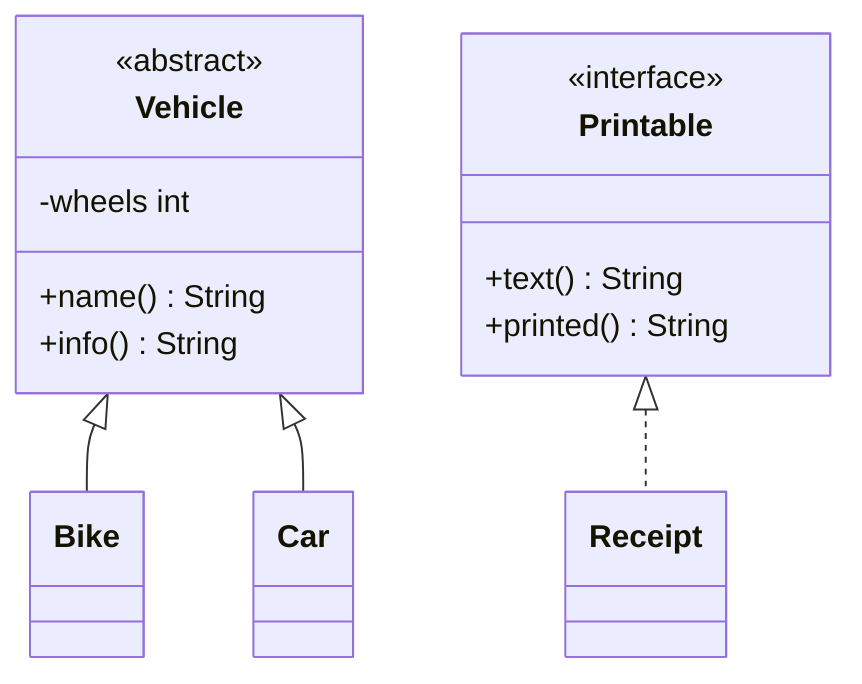
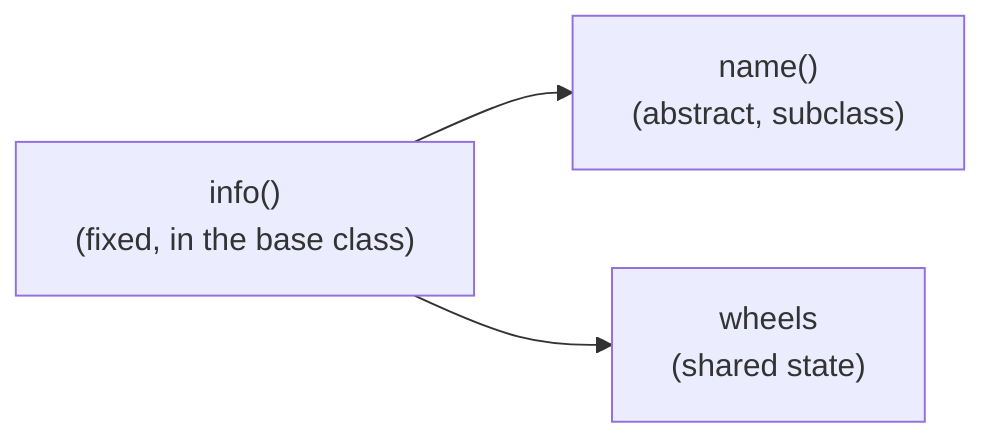

# Abstraction: Abstract Class vs Interface

> Abstraction shows what something does and hides how. In Java and Kotlin you build it with abstract classes and interfaces. Know what each can hold, when to choose which, how `default` methods work (and clash), and what a functional interface is.

Roadmap topic 4 · Stage 1: The Four Pillars

**Go deeper:** `11 3` Inheritance and Polymorphism · `11 5` Composition vs Inheritance · `ARCH 24` SOLID (interface segregation, dependency inversion) · `ARCH 25` Design Patterns (Template Method, Strategy).

**Marks:** 🟢 must know · 🟡 good to know

---

#### 1. What Is It?

*Two tools for the same idea: a promise that hides the details.*

| 🟢 Must know | 🟡 Good to know |
|---|---|
| abstraction: what, not how | Kotlin `fun interface`, sealed interfaces |
| abstract class: shared state and code | marker and functional interfaces |
| interface: a contract, many allowed | static and private methods in interfaces |
| abstract class vs interface table | abstract class + template method |
| `default` methods and conflicts | interface constants |
| start with an interface | |

1. **Abstraction:** callers use a simple view (`shape.area()`), and the formula stays hidden.
2. **Abstract class:** a class you cannot create directly. It can hold fields, constructors, finished methods and `abstract` methods that subclasses must fill in.
3. **Interface:** a pure contract: method signatures that any class can promise to implement. A class may implement many interfaces.
4. **Default method:** an interface method with a body, so you can add behaviour without breaking old implementers.

**Signals in an interview:** "abstract class vs interface", "can an interface have a constructor or fields?", "what is a default method?", "what happens when two interfaces have the same default method?", "when do you choose an abstract class?", "what is a functional interface?".

---

#### 2. How It Works



**Abstract class vs interface.**

| | Abstract class | Interface |
|---|---|---|
| State (fields) | yes | no instance state (only constants) |
| Constructor | yes | no |
| A class can extend / implement | **one** | **many** |
| Method bodies | yes | `default` methods (Java 8+); Kotlin interfaces can have bodies and abstract properties |
| Access modifiers on members | any | public (Java) |
| Use it when | related classes share state and code ("is-a") | you define a **capability** or a contract ("can-do") |

**Rule of thumb:** start with an interface. Use an abstract class only when subclasses really share state or a common algorithm.

**Default methods and the diamond.** If a class implements two interfaces that both have a default method with the same signature, the compiler forces the class to override it and choose (`A.super.m()` in Java, `super<A>.m()` in Kotlin).

**Functional interface.** An interface with exactly **one** abstract method. You can create it with a lambda. Java: `Runnable`, `Comparator`. Kotlin: write `fun interface`.

**Abstract class + template method.** The abstract class writes the fixed steps once and leaves one or two steps abstract. Subclasses fill the gaps.



**Kotlin extras.** An interface can declare abstract properties (`val name: String`). A `sealed interface` limits the allowed implementers to the same module and package, so the compiler can check a `when`.

---

#### 3. Naive vs Better Design

| Naive | Better |
|---|---|
| an abstract base class for every idea | an interface for the capability |
| a base class with only abstract methods | an interface |
| one huge interface | small role interfaces (`ARCH 24`) |
| code that depends on `ArrayList` | code that depends on `List` |
| copy-pasting a common algorithm | an abstract class with a template method |
| `BaseActivity` with 40 unrelated helpers | small interfaces or helper objects (composition) |

```java
// Naive: caller tied to one implementation
ArrayList<String> names = new ArrayList<>();
// Better: depend on the contract, choose the implementation in one place
List<String> names2 = new ArrayList<>();
```

---

#### 4. Templates & Examples

*Checks come from running the Java versions on JDK 21. The Kotlin versions were not compiled.*

**Example 1: abstract class with state and a template method.**

```java
abstract class Vehicle {
    final int wheels;
    Vehicle(int w) { wheels = w; }
    abstract String name();                                    // subclasses fill this in
    String info() { return name() + " has " + wheels + " wheels"; }   // shared code
}
class Bike extends Vehicle { Bike() { super(2); } String name() { return "bike"; } }
class Car  extends Vehicle { Car()  { super(4); } String name() { return "car"; } }
```

```kotlin
abstract class Vehicle(val wheels: Int) {
    abstract fun name(): String
    fun info() = "${name()} has $wheels wheels"
}
class Bike : Vehicle(2) { override fun name() = "bike" }
class Car  : Vehicle(4) { override fun name() = "car" }
```

Checks: `new Bike().info()` → `bike has 2 wheels`; `new Car().info()` → `car has 4 wheels`. `new Vehicle(3)` does not compile (abstract classes cannot be created).

**Example 2: interface with a default method, used as a lambda.**

```java
interface Printable { String text(); default String printed() { return "[" + text() + "]"; } }
// Printable p = () -> "hi";   p.printed() -> "[hi]"
```

```kotlin
fun interface Printable { fun text(): String; fun printed() = "[${text()}]" }
val p = Printable { "hi" }       // p.printed() -> "[hi]"
```

Checks: `p.printed()` → `[hi]`. Interface fields are always constants: `interface Limits { int MAX = 10; }` makes `Limits.MAX` → `10`.

**Example 3: two defaults that clash.**

```java
interface X { default String hi() { return "X"; } }
interface Y { default String hi() { return "Y"; } }
class Z implements X, Y {
    public String hi() { return X.super.hi() + Y.super.hi(); }    // the class must decide
}
```

```kotlin
interface X { fun hi() = "X" }
interface Y { fun hi() = "Y" }
class Z : X, Y { override fun hi() = super<X>.hi() + super<Y>.hi() }
```

Checks: `new Z().hi()` → `XY`. Without the override in `Z`, the code does not compile.

**Example 4: depend on the contract, not the class.**

```kotlin
interface NotesRepo { fun all(): List<String> }              // the contract
class RoomNotesRepo : NotesRepo { override fun all() = listOf("from room") }
class FakeNotesRepo : NotesRepo { override fun all() = listOf("a", "b") }   // for tests

class NotesScreen(private val repo: NotesRepo) { fun count() = repo.all().size }
```

Checks (by reading): `NotesScreen(FakeNotesRepo()).count()` → `2` with no database. This is the basis of dependency inversion (`ARCH 24`).

**Example 5: sealed interface for a closed set (Kotlin).**

```kotlin
sealed interface UiState
data object Loading : UiState
data class Success(val items: List<String>) : UiState
data class Failure(val message: String) : UiState

fun render(s: UiState) = when (s) {          // no else needed: the compiler knows all cases
    Loading -> "spinner"
    is Success -> "${s.items.size} items"
    is Failure -> "error: ${s.message}"
}
```

---

#### 5. Numbers & Rules of Thumb

| Item | Guide |
|---|---|
| Interface size | 1 to 5 methods |
| Parents | one abstract class, many interfaces |
| Choose an abstract class when | subclasses share fields or a fixed algorithm |
| Choose an interface when | unrelated classes share a capability, or you want a fake in tests |
| Default methods | for adding behaviour safely, not for storing state |
| Variable types | declare as the interface (`List`, not `ArrayList`) |

---

#### 6. Common Mistakes & Edge Cases

1. Creating an abstract base class when an interface would do, which blocks a class that already has a parent.
2. Believing an interface can hold instance state. It holds only constants.
3. Adding methods to a widely used interface, breaking every implementer (use a `default` method instead).
4. Ignoring a default-method conflict until the compiler complains.
5. Fat interfaces that force `TODO()` bodies (`ARCH 24`, interface segregation).
6. Making everything abstract "just in case" when there will only ever be one implementation.
7. Declaring variables as the concrete class (`ArrayList`) and losing the freedom to swap.
8. Putting "utility" code in an abstract base class that every screen must extend.

Edge cases: an abstract class can have a constructor, which subclasses must call; an interface method is `public` by default in Java; an abstract class can implement an interface without implementing all of its methods; Java allows `static` and `private` methods inside interfaces; a functional interface can still have many `default` methods.

---

#### 7. Say This in the Interview

1. "Abstraction shows what a thing does and hides how. I express it with an interface or an abstract class."
2. "An abstract class can have state and a constructor, and a class extends only one. An interface is a contract, and a class can implement many."
3. "I start with an interface. I use an abstract class only when subclasses really share state or a fixed algorithm."
4. "If two interfaces have the same default method, the class must override it and pick one with `A.super.m()`."
5. "I depend on interfaces such as `List`, so I can swap the implementation and use a fake in tests."
6. "A functional interface has one abstract method, so I can pass a lambda."

---

#### 8. Quick Check

1. Can an interface have a constructor? Instance fields?
2. Why would you choose an abstract class over an interface?
3. What must a class do if it implements two interfaces with the same default method?
4. What does `new Vehicle(3)` do when `Vehicle` is abstract?

<details>
<summary>Answers</summary>

1. No constructor and no instance fields. Only constants (`public static final`).
2. When subclasses share state (fields), a constructor, or a finished algorithm that calls abstract steps.
3. Override the method and choose with `X.super.hi()` (Java) or `super<X>.hi()` (Kotlin).
4. It does not compile. An abstract class cannot be instantiated.

</details>

---

#### 9. Practice

**Interview questions**

1. Abstract class vs interface: when do you choose each?
2. Can an interface have fields, constructors or method bodies?
3. What is a default method? What problem does it solve?
4. What happens when two interfaces give the same default method?
5. What is a functional interface?
6. Why declare a variable as `List` instead of `ArrayList`?
7. What is abstraction? How is it different from encapsulation?

**Exercises**

1. Model `Shape` as an abstract class with a shared `describe()` and an abstract `area()`.
2. Convert a base class with only abstract methods into an interface.
3. Reproduce the default-method clash, read the compiler error, then fix it.
4. Write a `fun interface Validator` in Kotlin and use it with a lambda.
5. Replace a class that depends on `RetrofitClient` with one that depends on an interface, and write a fake.

**LeetCode (contracts and families of classes, Easy → Medium)**

| # | Question | Practises |
|---|---|---|
| 232 | [Implement Queue using Stacks](https://leetcode.com/problems/implement-queue-using-stacks/) (Easy) | a class that promises one contract using another structure |
| 706 | [Design HashMap](https://leetcode.com/problems/design-hashmap/) (Easy) | hiding buckets behind `get`/`put`/`remove` |
| 705 | [Design HashSet](https://leetcode.com/problems/design-hashset/) (Easy) | the same, with a smaller contract |
| 284 | [Peeking Iterator](https://leetcode.com/problems/peeking-iterator/) (Medium) | adding a capability to an existing iterator contract |
| 341 | [Flatten Nested List Iterator](https://leetcode.com/problems/flatten-nested-list-iterator/) (Medium) | an interface with two implementations |
| 641 | [Design Circular Deque](https://leetcode.com/problems/design-circular-deque/) (Medium) | a clear contract, hidden array |

**Remember:** abstraction hides how · interface = can-do · abstract class = is-a with shared state · start with an interface · defaults can clash · depend on the contract.
