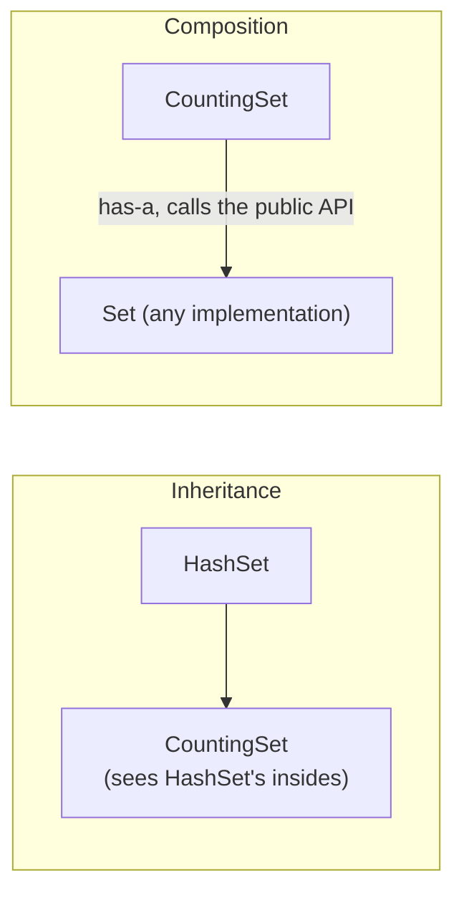
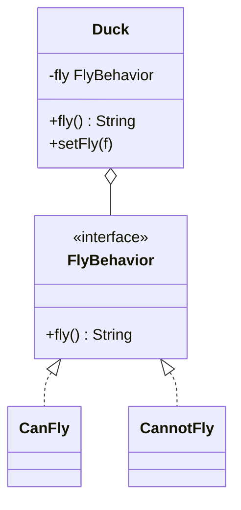

# Composition vs Inheritance

> Inheritance says "is-a" and ties a subclass to its parent's details. Composition says "has-a" and builds behaviour from small parts you can swap. "Prefer composition over inheritance" is a famous rule: learn the reason (the fragile base class), see it fail in code, and refactor it.

Roadmap topic 5 · Stage 1: The Four Pillars

**Go deeper:** `11 3` Inheritance and Polymorphism · `11 4` Abstraction · `ARCH 4` Design Principles · `ARCH 24` SOLID · `ARCH 25` Design Patterns (Strategy, Decorator).

**Marks:** 🟢 must know · 🟡 good to know

---

#### 1. What Is It?

*Two ways to reuse code. One of them is much safer.*

| 🟢 Must know | 🟡 Good to know |
|---|---|
| is-a (inheritance) vs has-a (composition) | delegation with Kotlin `by` |
| why "prefer composition" | strategy as composition |
| the fragile base class problem | decorator (wrap and add) |
| refactor: inheritance → composition | inheritance explosion (many combinations) |
| when inheritance is still right | mixins and traits |

1. **Inheritance:** `class B extends A`. B is an A. It gets all of A's code, including parts you did not mean to depend on.
2. **Composition:** `class B { private final A a; }`. B has an A and uses it through A's public methods.
3. **Delegation:** B forwards a call to its A (`a.doThing()`), maybe adding its own steps.
4. **Fragile base class:** a change inside the parent breaks a subclass that relied on how the parent worked inside.

**Signals in an interview:** "composition vs inheritance", "why prefer composition?", "design a duck that can fly or swim or neither", "how do you extend a class you cannot change?", "what is delegation?".

---

#### 2. How It Works

**The problem with inheritance.** A subclass depends on the **inside** of its parent, not only its public API. If the parent changes how its methods call each other, the subclass can break without any change to its own code.

**The classic example.** `HashSet.addAll` calls `add` for every element. A subclass that counts `add` calls and `addAll` calls then counts each element **twice**. The author of the subclass had to know an internal detail of the parent.

**Composition fixes this.** The wrapper holds a plain `Set` and uses only its public methods. How `Set` works inside no longer matters.



**Swap behaviour at runtime.** With composition you can change a part while the program runs. With inheritance the behaviour is fixed when you choose the class.

**Inheritance explosion.** If ducks can fly or not, and swim or not, inheritance needs a class for every combination (`FlyingSwimmingDuck`, `FlyingDuck`, ...). Composition needs one `Duck` plus small `FlyBehavior` and `SwimBehavior` parts.



**When inheritance is still right.**

| Use inheritance when | Why |
|---|---|
| it is a true is-a and the subtype can replace the parent everywhere | Liskov holds (`ARCH 24`) |
| the parent is designed and documented for extension (abstract class, template method) | stable hooks |
| you are inside one module and you control both classes | you can change them together |
| the framework requires it (`Activity`, `ViewModel`) | no choice |

---

#### 3. Naive vs Better Design

| Naive | Better |
|---|---|
| `class Stack extends ArrayList` | a `Stack` that **has** a list and exposes only `push` and `pop` |
| a class per combination of features | one class plus swappable parts |
| overriding several methods of a library class | wrap it and add behaviour |
| a deep tree of base classes | small interfaces and helper objects |
| `BaseActivity` with 40 helpers | small collaborators passed in |

```java
// Naive: a Stack that is also an ArrayList, so callers can call add(0, x), breaking the stack rules
class Stack<T> extends ArrayList<T> { void push(T t) { add(t); } T pop() { return remove(size() - 1); } }
```

---

#### 4. Templates & Examples

*Checks come from running the Java versions on JDK 21. The Kotlin versions were not compiled.*

**Example 1: the inheritance trap (counting adds).**

```java
class CountingSet<E> extends HashSet<E> {
    int added = 0;
    @Override public boolean add(E e) { added++; return super.add(e); }
    @Override public boolean addAll(Collection<? extends E> c) { added += c.size(); return super.addAll(c); }
}
// CountingSet<String> cs = new CountingSet<>();  cs.addAll(List.of("a", "b", "c"));
```

Checks: after `addAll` of 3 items, `cs.size()` → `3` but `cs.added` → `6`. `addAll` added 3, then `HashSet`'s own `addAll` called our overridden `add` three more times.

**Example 2: composition (the fix).**

```java
class CountingSet<E> {
    private final Set<E> inner = new HashSet<>();
    int added = 0;
    boolean add(E e) { added++; return inner.add(e); }
    boolean addAll(Collection<? extends E> c) { boolean ch = false; for (E e : c) ch |= add(e); return ch; }
    int size() { return inner.size(); }
}
```

Checks: after `addAll` of 3 items, `added` → `3` and `size()` → `3`. The result no longer depends on how `HashSet` is written inside.

**Example 3: Kotlin delegation with `by`.**

```kotlin
class CountingSet<E>(private val inner: MutableSet<E> = HashSet()) : MutableSet<E> by inner {
    var added = 0
        private set
    override fun add(element: E): Boolean { added++; return inner.add(element) }
    override fun addAll(elements: Collection<E>): Boolean { added += elements.size; return inner.addAll(elements) }
}
```

Checks (by reading): `by inner` writes all the forwarding methods for you; only `add` and `addAll` are overridden. `addAll` forwards to `inner.addAll`, which does **not** call our `add`, so each element is counted once.

**Example 4: swap a behaviour at runtime (Duck).**

```java
interface FlyBehavior { String fly(); }
class Duck {
    private FlyBehavior f;
    Duck(FlyBehavior f) { this.f = f; }
    void setFly(FlyBehavior f) { this.f = f; }
    String fly() { return f.fly(); }
}
// Duck duck = new Duck(() -> "flaps");  duck.fly();  duck.setFly(() -> "cannot fly");  duck.fly();
```

```kotlin
fun interface FlyBehavior { fun fly(): String }
class Duck(private var f: FlyBehavior) {
    fun setFly(new: FlyBehavior) { f = new }
    fun fly() = f.fly()
}
```

Checks: the first `fly()` → `flaps`; after `setFly`, `fly()` → `cannot fly`. No new class was needed for the new behaviour.

**Example 5: a Stack that has a list.**

```kotlin
class Stack<T> {
    private val items = ArrayList<T>()           // has-a, hidden
    fun push(t: T) { items.add(t) }
    fun pop(): T = items.removeAt(items.lastIndex)
    val size get() = items.size
}
```

Callers can only `push`, `pop` and read `size`. They cannot insert in the middle.

**Refactor recipe: inheritance → composition.**

| Step | Action |
|---|---|
| 1 | Replace `extends X` with a private field of type `X` (or an interface `X`) |
| 2 | Add forwarding methods only for what callers really use |
| 3 | Move your extra behaviour into the wrapper |
| 4 | If the field type is an interface, add a constructor parameter so the part can be swapped |

---

#### 5. Numbers & Rules of Thumb

| Item | Guide |
|---|---|
| Inheritance depth | 1 to 2 levels |
| Default choice | composition; inherit only for a true is-a |
| Third-party / library classes | wrap them, do not extend them |
| Parts of a class | 3 to 5 collaborators; more suggests two responsibilities |
| Interfaces for parts | add one when you need to swap or fake the part |
| `final` classes | consider `final` (Java) / default (Kotlin) unless designed for extension |

---

#### 6. Common Mistakes & Edge Cases

1. Extending a collection class to add one feature (the `CountingSet` trap).
2. Using inheritance because "it saves typing", then having to inherit methods that make no sense (`Stack.add(0, x)`).
3. Creating a class for every combination of features.
4. Overriding a method and forgetting that other parent methods call it.
5. Wrapping a class but exposing its internal object, which defeats the wrapper.
6. Over-composing: ten tiny wrappers for a problem a single function solves.
7. Thinking "prefer composition" means "never inherit". It means choose inheritance for the right reasons.
8. Forgetting that Android classes (`Activity`, `ViewModel`, `Fragment`) force inheritance, so keep the logic in composed helper classes.

Edge cases: forwarding methods are boilerplate in Java (Kotlin `by` removes it); `equals` and `hashCode` on wrappers need care; a wrapper does not automatically share the wrapped type's interface unless you implement it.

---

#### 7. Say This in the Interview

1. "Inheritance is is-a and shares the parent's internals; composition is has-a and uses only the public API. I prefer composition because it is more flexible and safer."
2. "A subclass can break when the parent changes internally. For example, a counting subclass of `HashSet` double-counts because `addAll` calls `add`."
3. "With composition I can swap a behaviour at runtime, such as a duck's `FlyBehavior`, without creating a class for every combination."
4. "I use inheritance when it is a real is-a, the parent is built for extension, and substitutability holds. Frameworks such as `Activity` force it, so I keep my logic in composed helpers."
5. "In Kotlin I use `by` to delegate to the wrapped object and override only what I change."

---

#### 8. Quick Check

1. Why does the inherited `CountingSet` report `6` for three items?
2. What does "has-a" mean in code?
3. What does Kotlin's `by` do in `class A(b: B) : I by b`?
4. Name one case where inheritance is the right choice.

<details>
<summary>Answers</summary>

1. `addAll` counted 3, then the parent's `addAll` called the overridden `add` three more times.
2. A class holds another object in a field and calls its public methods.
3. It forwards every method of interface `I` to `b` automatically; you override only the ones you want to change.
4. A true is-a where the parent is designed for extension, such as an abstract class with a template method, or a framework class you must extend.

</details>

---

#### 9. Practice

**Interview questions**

1. Composition vs inheritance: which do you prefer and why?
2. What is the fragile base class problem?
3. How would you design ducks that can fly, swim, both or neither?
4. How do you add a feature to a class you cannot modify?
5. What is delegation?
6. When is inheritance the better choice?
7. Why is `Stack extends Vector` considered a design mistake?

**Exercises**

1. Run the inherited `CountingSet`; then write the composed one and compare counts.
2. Refactor `class Stack extends ArrayList` into a `Stack` that has an `ArrayList`.
3. Model `Duck` with `FlyBehavior` and `SwimBehavior`; create a rubber duck that does neither.
4. Write the Kotlin `CountingSet` with `by` and test `addAll`.
5. In your own app, find a `Base...` class and move one responsibility into a helper object.

**LeetCode (composing one structure from others, Easy → Medium)**

| # | Question | Practises |
|---|---|---|
| 232 | [Implement Queue using Stacks](https://leetcode.com/problems/implement-queue-using-stacks/) (Easy) | a class that has two stacks |
| 225 | [Implement Stack using Queues](https://leetcode.com/problems/implement-stack-using-queues/) (Easy) | a class that has a queue |
| 155 | [Min Stack](https://leetcode.com/problems/min-stack/) (Medium) | a class that has two stacks |
| 146 | [LRU Cache](https://leetcode.com/problems/lru-cache/) (Medium) | a class that has a map and a linked list |
| 1670 | [Design Front Middle Back Queue](https://leetcode.com/problems/design-front-middle-back-queue/) (Medium) | two deques working together |
| 1381 | [Design a Stack With Increment Operation](https://leetcode.com/problems/design-a-stack-with-increment-operation/) (Medium) | a stack plus extra bookkeeping |

**Remember:** is-a vs has-a · inheritance leaks the parent's insides · compose and delegate · swap parts at runtime · wrap, don't extend, library classes · Kotlin `by`.
