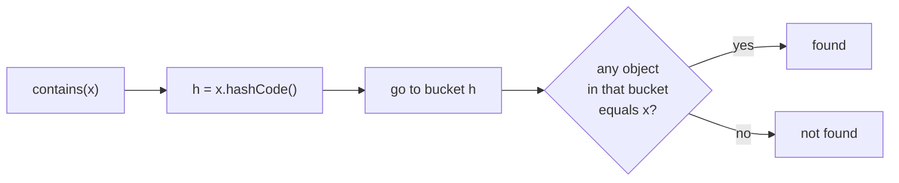

# `equals`, `hashCode` and `toString`

> Every Java object inherits three methods from `Object`: `equals` (same content?), `hashCode` (a number for hash collections) and `toString` (a readable text). Know the contract, watch a `HashSet` lose an object, and learn how `record` and Kotlin `data class` write all three for you.

Roadmap topic 6 · Stage 2: Java Details Interviewers Ask

**Go deeper:** `11 7` `==` vs `equals` · `11 9` Immutability · `01-data-structure` (HashMap, HashSet) · `06-mobile-engineering/02-Kotlin-Essentials`.

**Marks:** 🟢 must know · 🟡 good to know

---

#### 1. What Is It?

*A top-five Java interview question, and a real source of bugs.*

| 🟢 Must know | 🟡 Good to know |
|---|---|
| `equals`: content equality | `equals` and inheritance (symmetry problem) |
| `hashCode`: bucket number | `Objects.hash` and `Objects.equals` |
| the contract: equal ⇒ same hash | `hashCode` of mutable fields |
| override both, or neither | `toString` for logs and tests |
| `record` and `data class` generate all three | `Comparable` and `compareTo` consistent with `equals` |

1. **`equals(Object o)`:** answers "do these two objects mean the same thing?". The default version in `Object` is the same as `==` (same reference).
2. **`hashCode()`:** returns an `int`. Hash-based collections (`HashMap`, `HashSet`) use it to pick a bucket, then use `equals` to find the exact match.
3. **`toString()`:** text for the object. The default is `ClassName@hex`, which is not useful.

**The contract (memorise this).**

| Rule | Meaning |
|---|---|
| Equal objects → **same** `hashCode` | if `a.equals(b)` then `a.hashCode() == b.hashCode()` |
| Same `hashCode` → maybe equal | different objects can share a hash (a collision); `equals` decides |
| `equals` is reflexive | `a.equals(a)` is true |
| `equals` is symmetric | `a.equals(b)` ⇔ `b.equals(a)` |
| `equals` is transitive | `a=b` and `b=c` ⇒ `a=c` |
| `equals` is consistent | same answer while nothing changes |
| `equals(null)` is `false` | never throws |

**Signals in an interview:** "why override `hashCode`?", "what happens if you override `equals` only?", "how does `HashMap` work?", "what is a good `hashCode`?", "can you use a mutable object as a key?", "what does a `data class` generate?".

---

#### 2. How It Works

**How a `HashSet` looks for an object.**



If two equal objects have **different** hash codes, they go to different buckets. The set looks in the wrong bucket and says "not found", even though an equal object is in the set.

**A good `hashCode`** uses the same fields as `equals`, spreads values well, and is cheap. `Objects.hash(x, y)` does this. For two ints, `Objects.hash(1, 2)` is `994`.

**Mutable keys.** If a field used in `hashCode` changes after the object is in a hash set or map, the object is now in the wrong bucket and cannot be found. Use immutable keys (topic 9).

**`equals` with inheritance.** Using `instanceof` in `equals` can break symmetry: a plain `Point` can equal a `ColorPoint`, but the `ColorPoint` does not equal the `Point`. Prefer `final` classes, `record`s, or composition over comparing across a class hierarchy.

**Generated versions.**

| Language | What you write | What you get |
|---|---|---|
| Java | `record Pt(int x, int y) {}` | `equals`, `hashCode`, `toString` (`Pt[x=1, y=2]`), accessors |
| Kotlin | `data class Pt(val x: Int, val y: Int)` | `equals`, `hashCode`, `toString` (`Pt(x=1, y=2)`), `copy`, `componentN` |

Kotlin `data class` uses only the properties in the **primary constructor**.

---

#### 3. Naive vs Better Design

| Naive | Better |
|---|---|
| `equals` without `hashCode` | override both together, or use `record` / `data class` |
| `equals` that compares fields that change | use stable fields (ids), or immutable objects |
| `hashCode` returns `1` | `Objects.hash(...)` on the same fields as `equals` |
| `equals` that throws on `null` or a different type | return `false` |
| default `toString` | a readable `toString` for logs and tests |
| mutable object as a `HashMap` key | immutable key (`String`, `Long`, `record`) |

```java
// Naive: equals without hashCode
class BadPoint { final int x, y; /* ... */
    @Override public boolean equals(Object o) { return o instanceof BadPoint p && p.x == x && p.y == y; } }
```

---

#### 4. Templates & Examples

*Checks come from running the Java versions on JDK 21. The Kotlin versions were not compiled.*

**Example 1: `equals` without `hashCode` loses the object.**

```java
class BadPoint {
    final int x, y;
    BadPoint(int x, int y) { this.x = x; this.y = y; }
    @Override public boolean equals(Object o) { return o instanceof BadPoint p && p.x == x && p.y == y; }
}
class GoodPoint {
    final int x, y;
    GoodPoint(int x, int y) { this.x = x; this.y = y; }
    @Override public boolean equals(Object o) { return o instanceof GoodPoint p && p.x == x && p.y == y; }
    @Override public int hashCode() { return Objects.hash(x, y); }
    @Override public String toString() { return "GoodPoint(x=" + x + ", y=" + y + ")"; }
}
// Set<BadPoint> bs = new HashSet<>();  bs.add(new BadPoint(1, 2));
// bs.contains(new BadPoint(1, 2))
```

Checks: `new BadPoint(1, 2).equals(new BadPoint(1, 2))` → `true`, yet `bs.contains(new BadPoint(1, 2))` → `false` in this run (the two objects get different identity hash codes, so the lookup goes to another bucket; the result can differ on another run, but it will not be reliably `true`). With `GoodPoint` the same test → `true`. `Objects.hash(1, 2)` → `994`.

**Example 2: let the language write it.**

```java
record Pt(int x, int y) {}
```

```kotlin
data class Pt(val x: Int, val y: Int)
// Pt(1, 2) == Pt(1, 2)  -> true     Pt(1, 2).toString() -> "Pt(x=1, y=2)"
// val moved = Pt(1, 2).copy(y = 5)  -> Pt(x=1, y=5)
```

Checks: the Java record prints `Pt[x=1, y=2]`, `new Pt(1, 2).equals(new Pt(1, 2))` → `true` and their hash codes are equal. The Kotlin `data class` prints `Pt(x=1, y=2)`.

**Example 3: a mutable key gets lost.**

```java
class MutKey { int id; /* equals and hashCode use id */ }
// Set<MutKey> mk = new HashSet<>();  MutKey k = new MutKey(1);  mk.add(k);  k.id = 2;
```

Checks: `mk.contains(k)` → `false` and `mk.size()` → `1`. The object is still in the set, in the bucket for `id = 1`, but nobody can find it any more. This is why keys should be immutable.

**Example 4: `equals` and inheritance break symmetry.**

```java
class P2 { final int x; /* equals: o instanceof P2 p && p.x == x */ }
class CP2 extends P2 { final String color; /* equals: o instanceof CP2 c && c.x == x && c.color.equals(color) */ }
// P2 p = new P2(1);  CP2 c = new CP2(1, "red");
```

Checks: `p.equals(c)` → `true` but `c.equals(p)` → `false`. Symmetry is broken, so collections can behave differently depending on the order of the calls. Fix: make `P2` final, use a `record`, or compare `getClass()` for strict type equality (and accept that a subclass is then never equal to its parent).

**Example 5: `null` and `toString`.**

```java
new GoodPoint(1, 2).equals(null);          // false, and no exception
new Object().toString();                   // looks like  java.lang.Object@1b6d3586
```

Checks: `equals(null)` → `false`. A class without `toString` prints text of the form `ClassName@hexNumber`.

**Template: a correct `equals` and `hashCode`.**

```java
@Override public boolean equals(Object o) {
    if (this == o) return true;
    if (!(o instanceof GoodPoint p)) return false;       // handles null too
    return x == p.x && y == p.y;
}
@Override public int hashCode() { return Objects.hash(x, y); }
```

---

#### 5. Numbers & Rules of Thumb

| Item | Guide |
|---|---|
| Fields in `hashCode` | exactly the fields used in `equals` |
| Override | `equals` and `hashCode` together, always |
| Keys of `HashMap`/`HashSet` | immutable: `String`, numbers, `record`, `data class` with `val` |
| `HashMap` lookup | about O(1) when `hashCode` spreads well; degrades with many collisions |
| `Objects.hash(1, 2)` | `994` (31 × (31 × 1 + 1) + 2) |
| Simple data holders | `record` (Java 16+) or `data class` (Kotlin) |
| `equals` across a hierarchy | avoid; use `final` classes or records |

---

#### 6. Common Mistakes & Edge Cases

1. Overriding `equals` but not `hashCode`.
2. Using fields that change in `hashCode`, then mutating the object inside a `HashSet`.
3. Writing `equals(Point p)` instead of `equals(Object o)`. That is an overload, so collections ignore it.
4. Comparing `float`/`double` fields with `==` (use `Double.compare`).
5. Not handling `null` or a different class in `equals`.
6. `hashCode` that always returns a constant: it works, but turns a hash map into a slow list.
7. Using `equals` in a class hierarchy and breaking symmetry.
8. Forgetting that a Kotlin `data class` ignores properties declared in the **body**, not the primary constructor.

Edge cases: arrays use reference `equals` (use `Arrays.equals` / `contentEquals`); `HashMap` treats keys with equal `hashCode` and `equals` as the same key (the later value replaces the earlier); `toString` should not print secrets such as passwords or tokens.

---

#### 7. Say This in the Interview

1. "`equals` checks whether two objects have the same content; `hashCode` gives a number used to choose a bucket. If two objects are equal, they must have the same hash code."
2. "If I override `equals` but not `hashCode`, equal objects land in different buckets, so a `HashSet` or `HashMap` cannot find them."
3. "I use the same fields in both methods, and `Objects.hash` to combine them."
4. "I use immutable keys. A mutable key whose hash changes is lost inside the map."
5. "For simple data classes I use a `record` in Java or a `data class` in Kotlin, which generate `equals`, `hashCode` and `toString`."

---

#### 8. Quick Check

1. If `a.equals(b)` is true, what must be true about their hash codes?
2. If two objects have the same hash code, must they be equal?
3. Why can a `HashSet` fail to `contain` an object that `equals` says is present?
4. What does a Kotlin `data class` use to build `equals`?

<details>
<summary>Answers</summary>

1. They must be the same.
2. No. A collision is allowed; `equals` decides.
3. The `hashCode` differs (not overridden, or a field changed), so the lookup goes to the wrong bucket.
4. The properties in the primary constructor only.

</details>

---

#### 9. Practice

**Interview questions**

1. What is the `equals`/`hashCode` contract?
2. What happens if you override `equals` but not `hashCode`?
3. How does a `HashMap` find a key?
4. Can you use a mutable object as a key?
5. What is a collision, and what does the map do about it?
6. What do `record` and `data class` generate?
7. Why does `equals(Point p)` not work in a `HashSet`?
8. Why is `toString` worth writing?

**Exercises**

1. Write `BadPoint`, put one in a `HashSet`, and show that `contains` can fail; then add `hashCode`.
2. Put a mutable key in a `HashSet`, change it, and show that it is lost.
3. Reproduce the `P2` / `CP2` symmetry problem; fix it with `final` or a `record`.
4. Write `Pt` as a Java `record` and a Kotlin `data class`; print both.
5. Make an `Email` class whose `equals` ignores upper/lower case, with a matching `hashCode`.

**LeetCode (equality and hashing in practice, Easy → Medium)**

| # | Question | Practises |
|---|---|---|
| 705 | [Design HashSet](https://leetcode.com/problems/design-hashset/) (Easy) | buckets and hash functions |
| 706 | [Design HashMap](https://leetcode.com/problems/design-hashmap/) (Easy) | buckets, `equals` on keys, collisions |
| 1 | [Two Sum](https://leetcode.com/problems/two-sum/) (Easy) | a `HashMap` that relies on correct key hashing |
| 49 | [Group Anagrams](https://leetcode.com/problems/group-anagrams/) (Medium) | choosing a good key and its `hashCode` |
| 981 | [Time Based Key-Value Store](https://leetcode.com/problems/time-based-key-value-store/) (Medium) | map of lists, keyed correctly |
| 146 | [LRU Cache](https://leetcode.com/problems/lru-cache/) (Medium) | a hash map plus a linked list |

**Remember:** equal ⇒ same hash · override both or neither · same fields in both · immutable keys · `equals(Object)` not `equals(Point)` · `record` / `data class`.
