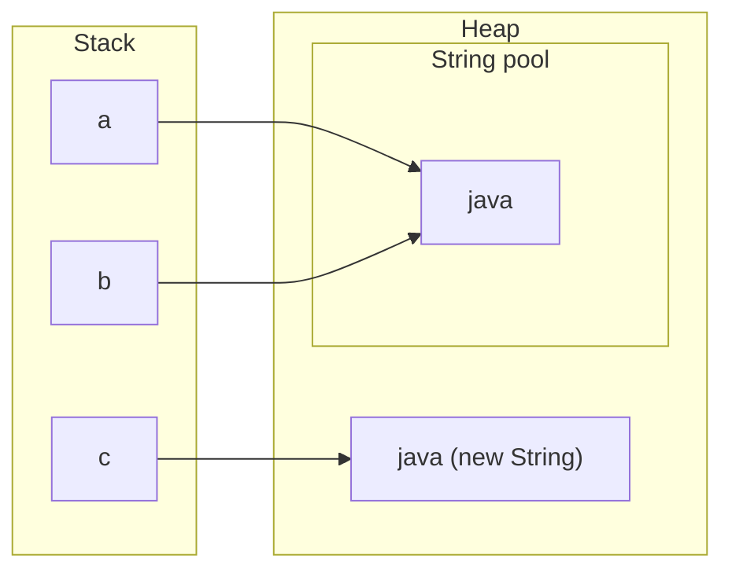

# `==` vs `equals`, String Pool, Integer Cache

> In Java, `==` on objects compares **references** (same object?) and `equals` compares **content**. Learn why `"java" == "java"` is `true` but `new String("java") == "java"` is `false`, why `Integer` 127 behaves differently from 1000, and how Kotlin changed the meaning of `==`.

Roadmap topic 7 · Stage 2: Java Details Interviewers Ask

**Go deeper:** `11 6` `equals`, `hashCode`, `toString` · `11 8` Pass-by-Value · `11 9` Immutability · `06-mobile-engineering/02-Kotlin-Essentials`.

**Marks:** 🟢 must know · 🟡 good to know

---

#### 1. What Is It?

*A favourite "gotcha" question. The answers come from running the code, so run it yourself.*

| 🟢 Must know | 🟡 Good to know |
|---|---|
| `==` (reference) vs `equals` (content) | `float`/`double` comparison and `NaN` |
| string pool and `new String` | `Integer.equals(Long)` is `false` |
| `intern()` | compile-time constants and the pool |
| `Integer` cache -128 to 127 | `Objects.equals` for null-safe compare |
| never compare strings or boxed numbers with `==` | autoboxing, unboxing and `NullPointerException` |
| Kotlin `==` vs `===` | `Long`, `Short`, `Character` caches |

1. **`==` on primitives** (`int`, `double`, `boolean`) compares **values**.
2. **`==` on objects** compares **references**: are these two variables pointing to the exact same object?
3. **`equals`** compares **content**, if the class overrides it (`String`, `Integer`, `List`, `record` do).
4. **String pool:** Java keeps one shared copy of each string literal. Two identical literals are the same object.
5. **Integer cache:** boxed `Integer` values from -128 to 127 are cached and shared. Values outside that range are new objects.

**Signals in an interview:** "difference between `==` and `equals`", "what does `new String("a") == "a"` give?", "why is `Integer` 127 equal but 1000 not?", "what is the string pool?", "how do you compare doubles?", "Kotlin `==` vs `===`?".

---

#### 2. How It Works



`a` and `b` point to the same pooled object, so `a == b` is `true`. `c` points to a different object with the same content, so `a == c` is `false`, but `a.equals(c)` is `true`.

**String rules.**

| Code | `==` result | Why |
|---|---|---|
| `"java" == "java"` | `true` | same pooled literal |
| `new String("java") == "java"` | `false` | `new` always makes a new object |
| `new String("java").intern() == "java"` | `true` | `intern()` returns the pooled copy |
| `("a" + "b") == "ab"` | `true` | the compiler joins constants at compile time |
| `(s1 + "b") == "ab"` (with `String s1 = "a"`) | `false` | joined at runtime, a new object |
| `(f + "b") == "ab"` (with `final String f = "a"`) | `true` | a `final` constant, so joined at compile time |

You never need these tricks in real code. The lesson: **use `equals` for strings**.

**Integer cache.** `Integer x = 127` is autoboxing: Java calls `Integer.valueOf(127)`, which returns a cached object for -128 to 127. For `1000`, it creates a new object each time. So `x == y` is `true` for 127 and `p == q` is `false` for 1000, although `p.equals(q)` is `true`.

**Numbers that surprise.**

| Expression | Result | Reason |
|---|---|---|
| `0.1 + 0.2 == 0.3` | `false` | binary floating point; the sum is `0.30000000000000004` |
| `Double.NaN == Double.NaN` | `false` | `NaN` is never equal to anything with `==` |
| `Double.valueOf(NaN).equals(NaN)` | `true` | `equals` treats `NaN` as equal to itself |
| `0.0 == -0.0` | `true` | primitive compare |
| `Double.valueOf(0.0).equals(-0.0)` | `false` | `equals` compares the bits |
| `Integer.valueOf(1).equals(1L)` | `false` | different classes (`Integer` vs `Long`) |

**Kotlin changed the meaning.**

| Idea | Java | Kotlin |
|---|---|---|
| Same content | `a.equals(b)` | `a == b` (calls `equals`, null-safe) |
| Same object | `a == b` | `a === b` |

---

#### 3. Naive vs Better Design

| Naive | Better |
|---|---|
| `if (s == "yes")` | `if ("yes".equals(s))` (Kotlin: `s == "yes"`) |
| `Integer a == Integer b` | `a.equals(b)` or unbox to `int` |
| `if (x == 0.3)` for doubles | `Math.abs(x - 0.3) < 1e-9` (or `BigDecimal`) |
| `a.equals(b)` where `a` may be `null` | `Objects.equals(a, b)` or `"x".equals(a)` |
| trusting `==` because it passed in a test with small numbers | always `equals` for objects |

```java
// Naive: works for 127, fails for 1000
Integer p = 1000, q = 1000;
if (p == q) { /* never runs */ }
```

---

#### 4. Templates & Examples

*Checks come from running the Java versions on JDK 21. The Kotlin versions were not compiled.*

**Example 1: strings.**

```java
String a = "java", b = "java", c = new String("java");
// a == b -> ?   a == c -> ?   a.equals(c) -> ?   c.intern() == a -> ?
```

Checks (from a real run): `true false true true`.

**Example 2: the Integer cache.**

```java
Integer x = 127, y = 127, p = 1000, q = 1000;
// x == y -> ?   p == q -> ?   p.equals(q) -> ?
```

Checks: `true false true`. The cache covers -128 to 127 by default.

**Example 3: compile-time constants.**

```java
String s1 = "a";
String s2 = s1 + "b";            // runtime join
final String f = "a";
String s3 = f + "b";             // compile-time join (f is a constant)
// ("a" + "b") == "ab"  s2 == "ab"  s3 == "ab"  s2.equals("ab")
```

Checks: `true false true true`.

**Example 4: boxed types of different classes.**

```java
Integer.valueOf(1).equals(1L);       // false: a Long is not an Integer
Long.valueOf(1).equals(1L);          // true
```

Checks: `false true`.

**Example 5: doubles.**

```java
0.1 + 0.2 == 0.3                      // false, the sum is 0.30000000000000004
Double.NaN == Double.NaN              // false
Math.abs(0.1 + 0.2 - 0.3) < 1e-9      // true: compare with a tolerance
```

Checks: `false 0.30000000000000004 false`, then the tolerance test gives `true`. `Double.valueOf(Double.NaN).equals(Double.NaN)` → `true`; `0.0 == -0.0` → `true` but `Double.valueOf(0.0).equals(-0.0)` → `false`.

**Example 6: unboxing a `null`.**

```java
Integer n = null;
int z = n;                            // NullPointerException (unboxing a null)
```

Checks: throws `NullPointerException`.

**Example 7: null-safe comparisons.**

```java
String s = null;
"x".equals(s);                        // false (literal on the left: safe)
Objects.equals(s, null);              // true
```

Checks: `false true`. Writing `s.equals("x")` here would throw.

**Kotlin.**

```kotlin
val a = "java"; val c = String("java".toCharArray())
a == c            // true  (content)
a === c           // false (different objects)

val p: Int? = 1000; val q: Int? = 1000
p == q            // true  (equals)
p === q           // usually false on the JVM (boxed objects); do not rely on it
```

---

#### 5. Numbers & Rules of Thumb

| Item | Guide |
|---|---|
| Objects | `equals` (Java) / `==` (Kotlin) |
| Reference check | `==` (Java) / `===` (Kotlin), only when you really mean it |
| `Integer` cache | -128 to 127 (default; can be extended with a JVM flag) |
| Strings | always `equals`; literals share a pool, `new String` does not |
| Doubles | compare with a tolerance, or use `BigDecimal` for money |
| Null safety | put the known non-null on the left (`"x".equals(s)`) or use `Objects.equals` |
| Money | integer cents or `BigDecimal`, never `double` |

---

#### 6. Common Mistakes & Edge Cases

1. Comparing strings with `==` (works by accident with literals, fails with input from a user or network).
2. Comparing `Integer`/`Long` objects with `==` and passing tests on small numbers.
3. Writing `s.equals("x")` when `s` can be `null`.
4. Comparing `double` values with `==`.
5. Forgetting that `Integer.equals(Long)` is `false`.
6. Unboxing a `null` (`int z = nullInteger`) and getting a `NullPointerException`.
7. Using `new String(...)` or `new Integer(...)`: not needed, and slower.
8. In Kotlin, using `===` for content comparison.

Edge cases: `Long`, `Short`, `Byte` and `Character` also have caches (small values); an `Integer` loaded from a collection or a JSON library may or may not be cached; `String.equals` is case-sensitive (use `equalsIgnoreCase`); `NaN` in a `HashSet`/`equals` is treated as equal to itself.

---

#### 7. Say This in the Interview

1. "In Java `==` on objects compares references, and `equals` compares content. I use `equals` for objects and strings."
2. "String literals share one copy in the string pool, so `\"java\" == \"java\"` is true. `new String(\"java\")` makes a new object, so `==` is false but `equals` is true."
3. "`Integer` values from -128 to 127 are cached, so `==` happens to work there and fails at 1000. That is why I never compare boxed numbers with `==`."
4. "I compare doubles with a tolerance, and I use integers or `BigDecimal` for money."
5. "In Kotlin `==` already calls `equals`, and `===` is the reference check."

---

#### 8. Quick Check

1. What does `new String("a") == "a"` give?
2. Why is `Integer p = 1000, q = 1000; p == q` false?
3. How do you compare two `double` values safely?
4. What do `==` and `===` mean in Kotlin?

<details>
<summary>Answers</summary>

1. `false`. `new` creates a separate object. `equals` would be `true`.
2. Only -128 to 127 are cached. For 1000, each autoboxing creates a new `Integer` object, so the references differ.
3. Check that the difference is smaller than a tolerance, for example `Math.abs(a - b) < 1e-9`, or use `BigDecimal`.
4. `==` is structural equality (calls `equals`). `===` is reference equality.

</details>

---

#### 9. Practice

**Interview questions**

1. `==` vs `equals`?
2. What is the string pool? What does `intern()` do?
3. Why does `Integer` 127 behave differently from 1000?
4. How do you compare two doubles?
5. What is the difference between `==` and `===` in Kotlin?
6. What happens when you unbox a `null` `Integer`?
7. How do you compare strings safely when one may be `null`?

**Exercises**

1. Run the string example and the Integer example; predict each result before running.
2. Write a test that shows `Integer.valueOf(1).equals(1L)` is `false`.
3. Show that `0.1 + 0.2 == 0.3` is `false`, then write a tolerance-based helper.
4. Search your own code for `==` on `String` or `Integer`; fix any you find.
5. In Kotlin, show a case where `==` is `true` and `===` is `false`.

**LeetCode (comparing the right thing, Easy → Medium)**

| # | Question | Practises |
|---|---|---|
| 242 | [Valid Anagram](https://leetcode.com/problems/valid-anagram/) (Easy) | comparing content, not references |
| 125 | [Valid Palindrome](https://leetcode.com/problems/valid-palindrome/) (Easy) | careful character comparison |
| 1 | [Two Sum](https://leetcode.com/problems/two-sum/) (Easy) | boxed `Integer` keys in a `HashMap` |
| 387 | [First Unique Character in a String](https://leetcode.com/problems/first-unique-character-in-a-string/) (Easy) | counting with equality on characters |
| 49 | [Group Anagrams](https://leetcode.com/problems/group-anagrams/) (Medium) | string keys with correct `equals`/`hashCode` |
| 929 | [Unique Email Addresses](https://leetcode.com/problems/unique-email-addresses/) (Easy) | normalising strings before comparing |

**Remember:** `==` is a reference check in Java · `equals` for content · string pool · Integer cache -128 to 127 · tolerance for doubles · Kotlin `==` is `equals`.
