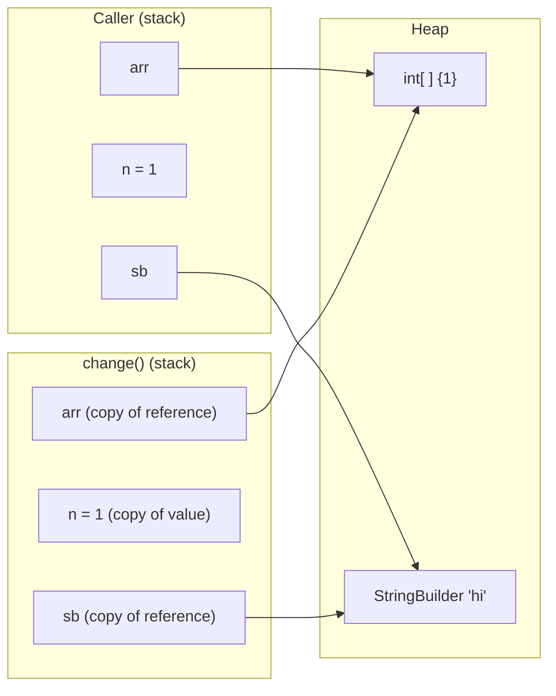

# Pass-by-Value and References

> Java always passes a **copy** of the argument. For primitives the copy is the value. For objects the copy is the **reference**, so a method can change the object's contents but can never make the caller's variable point to a different object. Learn it with one diagram and one demo.

Roadmap topic 8 · Stage 2: Java Details Interviewers Ask

**Go deeper:** `11 1` Classes and Objects (stack vs heap) · `11 2` Encapsulation (defensive copies) · `11 9` Immutability · `06-mobile-engineering/02-Kotlin-Essentials`.

**Marks:** 🟢 must know · 🟡 good to know

---

#### 1. What Is It?

*A question that sounds simple and catches many candidates: "Is Java pass-by-value or pass-by-reference?"*

| 🟢 Must know | 🟡 Good to know |
|---|---|
| Java is always pass-by-value | Kotlin parameters are read-only (`val`) |
| primitives: the value is copied | defensive copies at method boundaries |
| objects: the **reference** is copied | pure functions, returning new values |
| a method can change the object, not the caller's variable | varargs and arrays |
| why `swap(a, b)` cannot work | `final` parameters |
| stack vs heap picture | returning several values (record, `Pair`) |

1. **Pass-by-value:** the method gets its own copy of whatever you pass.
2. **Pass-by-reference** (not in Java): the method would get an alias to the caller's variable itself, so it could re-point it. C++ references and C# `ref` work this way. Java and Kotlin do not.
3. **What is copied for an object?** The reference (the address). Caller and method now hold two references to the **same** object.

**Signals in an interview:** "is Java pass-by-value or by reference?", "write a `swap` method", "what does this method print?" (with an array or `StringBuilder`), "does changing a `String` inside a method change the caller's string?".

---

#### 2. How It Works

Calling `change(arr, n, sb)`:



The caller's `arr` and the method's `arr` are **two different variables** that happen to point to the same array.

| Inside the method you can... | Effect on the caller |
|---|---|
| change the object's contents (`arr[0] = 99`, `sb.append("!")`) | **visible**: same object |
| reassign the parameter (`arr = new int[]{7}`) | **not visible**: you changed your own copy of the reference |
| change a primitive parameter (`n = 99`) | **not visible**: you changed your own copy |
| call a method that returns a new value | visible only if the caller uses the result |

**Why `swap(a, b)` cannot work.** `swap` receives copies of two references. Swapping the copies does nothing to the caller's variables. You must return the two values (a `Pair`) or swap the **contents** of an array.

**Strings.** A `String` is immutable, so a method cannot change the caller's string at all. `s += " world"` inside the method builds a new string and re-points only the method's copy.

**Kotlin.** Function parameters are `val`: you cannot even write `arr = ...` inside the function. The rules about objects are the same as in Java.

---

#### 3. Naive vs Better Design

| Naive | Better |
|---|---|
| a method that changes its argument to "return" a result | return the result |
| trying to return two values by mutating two parameters | return a `record` / `data class` / `Pair` |
| writing `swap(a, b)` for variables | swap array elements, or return a pair |
| a method that silently modifies a list you passed in | return a new list, or document the mutation clearly |
| storing the caller's mutable list in a field | copy it first (defensive copy) |

```java
// Naive: expects the caller's variable to change. It will not.
static void swap(String a, String b) { String t = a; a = b; b = t; }
```

---

#### 4. Templates & Examples

*Checks come from running the Java versions on JDK 21. The Kotlin versions were not compiled.*

**Example 1: the classic demo.**

```java
static void change(int[] arr, int n, StringBuilder sb) {
    arr[0] = 99;                 // changes the shared array
    n = 99;                      // changes only the local copy
    sb.append("!");              // changes the shared StringBuilder
    arr = new int[]{7};          // re-points only the local copy
}
// int[] arr = {1};  int n = 1;  StringBuilder sb = new StringBuilder("hi");  change(arr, n, sb);
```

Checks: after the call, `arr[0]` is `99` (contents changed), `n` is `1` (primitive copied), `sb` is `hi!` (contents changed). The reassignment `arr = new int[]{7}` inside the method is invisible to the caller.

**Example 2: `swap` does not work.**

```java
static void swap(String a, String b) { String t = a; a = b; b = t; }
// String s = "left", t = "right";  swap(s, t);
```

Checks: `s` is still `left` and `t` is still `right`.

**Example 3: `String` vs `StringBuilder` vs reassigning.**

```java
static void grow(String s)               { s += " world"; }
static void growSb(StringBuilder s)      { s.append(" world"); }
static void reassign(StringBuilder s)    { s = new StringBuilder("new"); }
```

Checks: with `"hello"` → still `hello` after `grow`; with a `StringBuilder("hello")` → `hello world` after `growSb`; with a `StringBuilder("old")` → still `old` after `reassign`.

**Example 4: return values instead of mutating.**

```java
record MinMax(int min, int max) {}
static MinMax minMax(int[] a) { int lo = a[0], hi = a[0]; for (int v : a) { lo = Math.min(lo, v); hi = Math.max(hi, v); } return new MinMax(lo, hi); }
```

```kotlin
fun minMax(a: IntArray): Pair<Int, Int> = a.min() to a.max()
val (lo, hi) = minMax(intArrayOf(3, 1, 4))          // lo = 1, hi = 4
```

Checks (by reading): `minMax(new int[]{3, 1, 4})` → `MinMax[min=1, max=4]`.

**Example 5: copy at the boundary.**

```java
class Report {
    private final int[] scores;
    Report(int[] scores) { this.scores = scores.clone(); }       // copy in: later changes by the caller do not leak in
    int[] scores()       { return scores.clone(); }              // copy out: callers cannot change our array
}
```

```kotlin
class Report(scores: IntArray) {
    private val scores = scores.copyOf()
    fun scores() = scores.copyOf()
}
```

**Kotlin: parameters are read-only.**

```kotlin
fun change(arr: IntArray, n: Int) {
    arr[0] = 99            // allowed: changes the shared object
    // n = 99              // compile error: val cannot be reassigned
}
```

---

#### 5. Numbers & Rules of Thumb

| Item | Guide |
|---|---|
| Arguments | always copies (values or references) |
| Mutating an argument | avoid; if you must, say so in the method name or the docs |
| Returning more than one value | `record` / `data class` / `Pair` |
| Mutable inputs stored in fields | copy them on the way in |
| Mutable fields returned | copy them (or return a read-only view) on the way out |
| Prefer | methods that take values and return new values (easy to test) |

---

#### 6. Common Mistakes & Edge Cases

1. Saying "Java passes objects by reference". The reference itself is passed by value.
2. Writing a `swap` method for two variables.
3. Expecting `s += "x"` inside a method to change the caller's `String`.
4. Reassigning a parameter and expecting the caller to see the new object.
5. Storing the caller's list or array in a field and being surprised when the caller changes it.
6. Returning an internal array or list and being surprised when a caller changes it.
7. A method that mutates its argument without saying so; callers cannot tell.
8. Confusing "the object can change" with "the variable can change".

Edge cases: `final` on a parameter only blocks reassignment, not changes to the object; varargs are passed as an array; copying a `List` of mutable objects copies only the list (a **shallow** copy), not the objects inside; Kotlin `copy()` on a `data class` is also shallow.

---

#### 7. Say This in the Interview

1. "Java is always pass-by-value. For objects, the value that is copied is the reference."
2. "So a method can change the object's contents, but if it reassigns the parameter, the caller does not see it."
3. "That is why a `swap(a, b)` method for two variables cannot work in Java."
4. "A `String` is immutable, so a method cannot change the caller's string; it only builds a new one."
5. "To return several values I return a `record` or a Kotlin `data class`. To protect my state I copy mutable arguments and results at the boundary."

---

#### 8. Quick Check

1. After `change(arr, n, sb)`, why is `n` unchanged but `arr[0]` changed?
2. Why does `arr = new int[]{7}` inside the method not affect the caller?
3. Can a Java method change the caller's `String` variable?
4. How do you return two values from a method?

<details>
<summary>Answers</summary>

1. `n` was copied by value, so the method changed its own copy. `arr` was copied as a reference to the same array, so `arr[0] = 99` changed the shared array.
2. It re-points only the method's copy of the reference. The caller's variable still points to the old array.
3. No. Strings are immutable and the variable is passed by value, so the method can only build a new string.
4. Return a `record`, a Kotlin `data class`, or a `Pair`.

</details>

---

#### 9. Practice

**Interview questions**

1. Is Java pass-by-value or pass-by-reference?
2. What does this method print? (Show `change(arr, n, sb)`.)
3. Why can't you write `swap(int a, int b)` in Java?
4. Does Kotlin pass by value or by reference?
5. What is a shallow copy vs a deep copy?
6. How do you protect an array field from outside changes?
7. What does `final` on a parameter do?

**Exercises**

1. Run the `change` demo; predict `arr[0]`, `n` and `sb` before running.
2. Write a `swap` that works on an array (`swap(arr, i, j)`).
3. Write a method that returns `min` and `max` as a `record`; then as a Kotlin `Pair` with destructuring.
4. Write a class that stores a caller's list; show the leak; fix it with a copy.
5. Explain the diagram out loud, with the stack and the heap, in 30 seconds.

**LeetCode (mutating arguments vs returning results, Easy → Medium)**

| # | Question | Practises |
|---|---|---|
| 283 | [Move Zeroes](https://leetcode.com/problems/move-zeroes/) (Easy) | changing an array's contents in place |
| 344 | [Reverse String](https://leetcode.com/problems/reverse-string/) (Easy) | in-place change through a shared array |
| 27 | [Remove Element](https://leetcode.com/problems/remove-element/) (Easy) | in-place update plus a returned count |
| 26 | [Remove Duplicates from Sorted Array](https://leetcode.com/problems/remove-duplicates-from-sorted-array/) (Easy) | the same idea |
| 189 | [Rotate Array](https://leetcode.com/problems/rotate-array/) (Medium) | in-place reordering with swaps of elements |
| 75 | [Sort Colors](https://leetcode.com/problems/sort-colors/) (Medium) | swap array elements, not variables |

**Remember:** always a copy · objects: a copy of the reference · change the contents yes, re-point the caller no · `swap(a, b)` is impossible · return values or a `record` · copy at the boundary.
