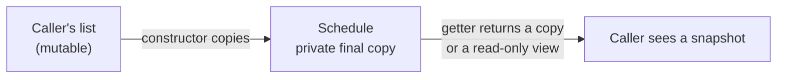

# Immutability and Value Objects

> An immutable object never changes after it is created. It is safe to share, safe as a map key, and safe across threads. Learn the four-step recipe, the defensive copy that makes it really immutable, why `String` is immutable, and how to build small value objects such as `Money`.

Roadmap topic 9 · Stage 2: Java Details Interviewers Ask

**Go deeper:** `11 2` Encapsulation · `11 6` `equals`/`hashCode` (immutable keys) · `11 8` Pass-by-Value · `ARCH 25` Design Patterns (Builder).

**Marks:** 🟢 must know · 🟡 good to know

---

#### 1. What Is It?

*Fewer things that can change means fewer bugs. This topic shows how to make that real.*

| 🟢 Must know | 🟡 Good to know |
|---|---|
| immutable: no change after creation | value objects (`Money`, `Email`) |
| the 4-step recipe | Kotlin `val` vs read-only `List` vs truly immutable |
| defensive copies in and out | `with`-style copy methods, `copy()` |
| why `String` is immutable | thread safety in one line |
| immutable keys for `HashMap` | persistent data structures (idea only) |
| `record` / `data class` | builders for immutable objects |

1. **Immutable object:** after the constructor ends, its state never changes. To "change" it, you build a new object.
2. **Value object:** a small immutable object defined by its values, not by its identity (`Money(500, "INR")`, `Email("a@x.com")`). Two with the same values are interchangeable.
3. **Defensive copy:** copy a mutable input or output so outside code cannot reach inside.

**Why immutability is useful.**

| Benefit | Because |
|---|---|
| Safe to share | nobody can change it under you |
| Safe as a `HashMap` key | the hash code never changes (topic 6) |
| Thread-safe | no writes, so no race conditions |
| Easy to test and reason about | the value you saw is the value you have |
| Valid forever | checked once in the constructor |

**Signals in an interview:** "how do you make a class immutable?", "why is `String` immutable?", "is a `final` list immutable?", "what is a defensive copy?", "Kotlin `val` vs immutable?".

---

#### 2. How It Works

**The recipe.**

| Step | Rule |
|---|---|
| 1 | Make the class `final` (so no subclass can add mutability) |
| 2 | Make all fields `private final` |
| 3 | No setters; "changes" return a new object |
| 4 | Copy any mutable object on the way **in** (constructor) and **out** (getters) |



**`final` is not immutable.** `final List<String> items` stops you from re-pointing `items`, but `items.add("x")` still works. The **reference** is fixed; the **object** is not.

**Why `String` is immutable.**

| Reason | Meaning |
|---|---|
| Safe pool | literals can be shared (topic 7) |
| Safe keys | its hash code can be cached |
| Security | a file path or URL cannot change after it was checked |
| Thread safety | any thread can read it |

`s.toUpperCase()` returns a **new** string; `s` is unchanged.

**Kotlin levels.**

| Kotlin | Meaning |
|---|---|
| `val x = ...` | the variable cannot be re-assigned |
| `List<T>` | a **read-only view type**: no `add` method, but the object behind it may be mutable |
| `data class` with `val`s and read-only types | immutable if every property is itself immutable |
| `toList()` / `copyOf()` | a snapshot copy |

**View vs copy.** `Collections.unmodifiableList(x)` is a read-only **view**: if the original changes, the view changes. `List.copyOf(x)` is a **copy**: it never changes.

---

#### 3. Naive vs Better Design

| Naive | Better |
|---|---|
| public setters on every field | constructor + `with`/`copy` methods |
| `private final List` stored from the caller's list | `List.copyOf(...)` in the constructor |
| a getter that returns the internal list | a copy or a read-only view |
| money as a `double` | integer cents plus a currency (`Money`) |
| a mutable class used as a map key | an immutable key class |
| validating in many places | validating once in the constructor |

```java
// Naive: final reference, but the caller still controls the list
final class BadSchedule {
    private final List<String> items;
    BadSchedule(List<String> in) { items = in; }
}
```

---

#### 4. Templates & Examples

*Checks come from running the Java versions on JDK 21. The Kotlin versions were not compiled.*

**Example 1: defensive copy (the real test of immutability).**

```java
final class Schedule {
    private final List<String> items;
    Schedule(List<String> in) { items = List.copyOf(in); }
    int size() { return items.size(); }
}
final class BadSchedule {
    private final List<String> items;
    BadSchedule(List<String> in) { items = in; }              // keeps the caller's list
    int size() { return items.size(); }
}
// List<String> src = new ArrayList<>(List.of("a", "b"));
// Schedule good = new Schedule(src);  BadSchedule bad = new BadSchedule(src);  src.add("c");
```

```kotlin
class Schedule(items: List<String>) {
    private val items: List<String> = items.toList()          // copy in
    val size get() = items.size
}
```

Checks: after `src.add("c")`: `good.size()` → `2`, `bad.size()` → `3`, `src.size()` → `3`. The "immutable" `BadSchedule` changed because it shares the caller's list.

**Example 2: view vs copy.**

```java
List<Integer> live = new ArrayList<>(List.of(1));
List<Integer> view = Collections.unmodifiableList(live);
List<Integer> copy = List.copyOf(live);
live.add(2);
```

Checks: `view.size()` → `2` (it follows the original); `copy.size()` → `1` (a snapshot).

**Example 3: a value object with a rule, `Money`.**

```java
record Money(long cents, String cur) {
    Money {                                                    // compact constructor: validate once
        if (cents < 0) throw new IllegalArgumentException("negative");
    }
    Money plus(Money o) {
        if (!cur.equals(o.cur)) throw new IllegalArgumentException("currency");
        return new Money(cents + o.cents, cur);                // a NEW object
    }
}
```

```kotlin
data class Money(val cents: Long, val cur: String) {
    init { require(cents >= 0) { "negative" } }
    operator fun plus(o: Money): Money { require(cur == o.cur) { "currency" }; return Money(cents + o.cents, cur) }
}
```

Checks: `new Money(500, "INR").plus(new Money(250, "INR"))` → `Money[cents=750, cur=INR]`, and the first object is still `Money[cents=500, cur=INR]`. `new Money(-1, "INR")` throws `negative`.

**Example 4: `String` stays the same.**

```java
String up = "java";
String up2 = up.toUpperCase();
```

Checks: `up` → `java`, `up2` → `JAVA`.

**Example 5: "change" by copying (Kotlin `copy`, Java `with`).**

```kotlin
data class Settings(val dark: Boolean, val fontSize: Int)
val s1 = Settings(dark = false, fontSize = 14)
val s2 = s1.copy(dark = true)                 // s1 is unchanged
```

```java
record Settings(boolean dark, int fontSize) {
    Settings withDark(boolean d) { return new Settings(d, fontSize); }
}
```

**Example 6: a `val` that is not immutable (Kotlin).**

```kotlin
val names = mutableListOf("a")      // val: the variable is fixed, the list is not
names.add("b")                      // allowed
val ro: List<String> = names        // read-only VIEW of the same list
names.add("c")                      // ro.size is now 3
```

For a real snapshot use `names.toList()`.

---

#### 5. Numbers & Rules of Thumb

| Item | Guide |
|---|---|
| Default | make a class immutable unless there is a reason not to |
| Mutable inputs | copy on the way in |
| Mutable outputs | copy, or return a read-only view |
| Map keys | immutable only |
| Money | `Money(cents, currency)`, not `double` |
| Copies of big objects | cheap enough for small value objects; for large ones consider builders or persistent structures |
| `record` / `data class` | the shortest immutable class, if all fields are immutable |

---

#### 6. Common Mistakes & Edge Cases

1. Thinking `final` makes an object immutable. It only fixes the reference.
2. Storing the caller's mutable list or array without copying it.
3. Returning the internal list from a getter.
4. Adding a setter "just for tests".
5. Using a mutable object as a `HashMap` key (topic 6).
6. In Kotlin, believing `List<T>` is immutable; it is only read-only.
7. Making a `data class` with a `MutableList` property and calling it immutable.
8. Copying only the outer collection when the elements are mutable too (a **shallow** copy).

Edge cases: immutability costs a new object per change, which is fine for small objects; arrays are always mutable; a class that is not `final` can be subclassed into a mutable one; builders let you create an immutable object with many fields (`ARCH 25`).

---

#### 7. Say This in the Interview

1. "An immutable object never changes after creation. I make the class final, the fields private and final, add no setters, and copy mutable inputs and outputs."
2. "`final` is not enough. A `final List` can still be changed, so I copy it in the constructor."
3. "`String` is immutable so it is safe to share through the string pool, to cache its hash code, and to use as a map key."
4. "Immutable objects are thread-safe and safe as `HashMap` keys, because their hash code never changes."
5. "In Kotlin, `val` fixes the variable and `List` is a read-only view, so for real immutability I use `val` properties and a copy such as `toList()`."

---

#### 8. Quick Check

1. Is `final List<String> items` immutable?
2. What is wrong with `BadSchedule`?
3. Why is `String` immutable?
4. Difference between `Collections.unmodifiableList(x)` and `List.copyOf(x)`?

<details>
<summary>Answers</summary>

1. No. The reference cannot change, but the list's contents can.
2. It keeps the caller's list, so when the caller changes the list, `BadSchedule` changes too (size became `3`).
3. For safe sharing (string pool), a cached hash code, security (a checked path cannot change) and thread safety.
4. The first is a read-only view that follows later changes. The second is a snapshot that never changes.

</details>

---

#### 9. Practice

**Interview questions**

1. How do you create an immutable class?
2. Why is `String` immutable?
3. Is a `final` collection immutable?
4. What is a defensive copy, and when do you need one?
5. What is a value object? Give an example.
6. Kotlin `val` vs read-only `List` vs immutable?
7. What are the costs of immutability?
8. Why must a `HashMap` key be immutable?

**Exercises**

1. Make `BadSchedule` really immutable; write the test that fails before and passes after.
2. Write `Money` with `plus`, `minus` and a currency check; test the invalid cases.
3. Convert a class with setters into an immutable class with `copy` or `with` methods.
4. Show the difference between a view and a copy with a test.
5. Write a Kotlin `data class` with a `List` property and make a safe copy in `init`.

**LeetCode (immutable or read-only state, Easy → Medium)**

| # | Question | Practises |
|---|---|---|
| 303 | [Range Sum Query - Immutable](https://leetcode.com/problems/range-sum-query-immutable/) (Easy) | state fixed in the constructor, queries only |
| 304 | [Range Sum Query 2D - Immutable](https://leetcode.com/problems/range-sum-query-2d-immutable/) (Medium) | the same with a 2D table |
| 706 | [Design HashMap](https://leetcode.com/problems/design-hashmap/) (Easy) | keys that must not change |
| 1146 | [Snapshot Array](https://leetcode.com/problems/snapshot-array/) (Medium) | saving immutable snapshots of state |
| 981 | [Time Based Key-Value Store](https://leetcode.com/problems/time-based-key-value-store/) (Medium) | values that are stored once per timestamp, never changed |
| 1472 | [Design Browser History](https://leetcode.com/problems/design-browser-history/) (Medium) | state with a controlled API |

**Remember:** final class · private final fields · no setters · copy in and out · `final` ≠ immutable · `String` is immutable · immutable keys · `record` / `data class`.
