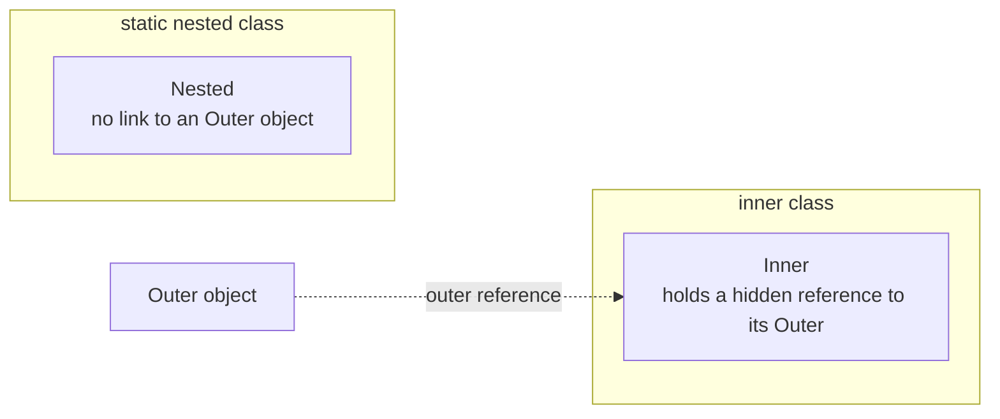

# `static`, `final`, Nested Classes and Enums

> Four keywords and concepts that decide what belongs to the class, what can never change, what lives inside another class, and how to model a fixed set of values. Learn what each means in Java and Kotlin, and the Android trap that inner classes create.

Roadmap topic 10 · Stage 2: Java Details Interviewers Ask

**Go deeper:** `11 1` Classes and Objects · `11 9` Immutability · `11 4` Abstraction (sealed) · `ARCH 25` Design Patterns (Singleton).

**Marks:** 🟢 must know · 🟡 good to know

---

#### 1. What Is It?

*Small keywords, big interview questions: "what does `static` mean?", "what does `final` do?", "inner vs nested class?".*

| 🟢 Must know | 🟡 Good to know |
|---|---|
| `static` fields and methods | static initialisation blocks |
| `final` on a variable, a method and a class | `const val`, `lateinit`, `lazy` |
| Kotlin `companion object`, `object`, top-level functions | anonymous classes vs lambdas |
| enums with fields and methods | `EnumMap`, `EnumSet` |
| nested (static) vs inner class | enums with abstract methods per constant |
| global mutable state is risky | Kotlin `sealed class` as a richer enum |

1. **`static`:** belongs to the **class**, not to one object. There is one copy for all objects.
2. **`final`:** cannot change. A final variable is assigned once, a final method cannot be overridden, a final class cannot be extended.
3. **Nested class:** a class declared inside another class. A **static nested** class does not hold a reference to the outer object. An **inner** class does.
4. **Enum:** a class with a fixed set of named instances (`FREE`, `PRO`, `TEAM`), which can have fields and methods.

**Signals in an interview:** "what does `static` mean?", "can a static method use instance fields?", "`final` vs `finally` vs `finalize`?", "inner class vs static nested class?", "why use an enum?", "how do you do `static` in Kotlin?".

---

#### 2. How It Works

**`static`.**

| Member | Lives | Accessed as |
|---|---|---|
| instance field | once **per object** | `object.field` |
| `static` field | once **per class** (shared) | `ClassName.field` |
| instance method | needs an object; can use instance and static members | `object.method()` |
| `static` method | no object; can use **only** static members (no `this`) | `ClassName.method()` |

A `static` field is shared, so mutating it is like using a global variable: hard to test and to reason about. `static final` constants are fine.

**`final`.**

| On a... | Meaning |
|---|---|
| variable | assigned once. For an object, the **reference** is fixed, the object can still change |
| method | cannot be overridden |
| class | cannot be extended (`String` is final) |
| parameter | cannot be reassigned inside the method |

Do not confuse `final` (keyword), `finally` (a block that always runs after `try`) and `finalize` (an old, discouraged cleanup method).

**Kotlin equivalents.**

| Java | Kotlin |
|---|---|
| `static` method / field | `companion object { }` or a top-level function / property |
| `static final int MAX = 10` | `const val MAX = 10` (compile-time constant) |
| `final` variable | `val` |
| `final` class | classes are final by default |
| singleton | `object Name { }` |
| `enum` | `enum class` |
| inner (holds outer) | `inner class` |
| static nested | a plain nested `class` (it does not hold the outer by default) |

**Nested vs inner.**



**The Android trap.** An inner (non-static) class or an anonymous class holds a reference to its outer class. If a long-lived object (a `Handler`, a thread, a callback) holds such a class created inside an `Activity`, the `Activity` can never be freed: a **memory leak**. Use a static nested class or a top-level class and pass only what you need (or a weak reference).

**Enums.** Each constant is one instance. An enum can have fields, a constructor and methods. `values()` gives all constants, `valueOf("PRO")` finds one (throws on an unknown name), `ordinal()` is the position (do not store it). `EnumMap` is a fast map keyed by an enum.

**Lambdas vs anonymous classes.** A lambda is shorter and does not create a new `this`. An anonymous class creates a new class, with its own `this`, and can hold state.

---

#### 3. Naive vs Better Design

| Naive | Better |
|---|---|
| a `static` mutable list that any class edits | an object passed in (dependency injection) |
| magic strings (`"PRO"`, `"FREE"`) | an `enum` |
| magic numbers (`if (x > 86400)`) | `static final` / `const val` with a name |
| an inner class for a callback in an `Activity` | a static nested class + weak reference, or a lambda scoped to the lifecycle |
| `ordinal()` saved to a database | a stable code or `name()` |
| a "utility" class full of `static` helpers with hidden state | small functions, or an object you can fake in tests |

```java
// Naive: a string that can be misspelt anywhere
if (plan.equals("PRO")) { /* ... */ }
```

---

#### 4. Templates & Examples

*Checks come from running the Java versions on JDK 21. The Kotlin versions were not compiled.*

**Example 1: an enum with fields and methods.**

```java
enum Plan {
    FREE(0), PRO(10), TEAM(25);
    final int price;
    Plan(int p) { price = p; }
    String label() { return name().charAt(0) + name().substring(1).toLowerCase() + " $" + price; }
}
```

```kotlin
enum class Plan(val price: Int) {
    FREE(0), PRO(10), TEAM(25);
    fun label() = name.lowercase().replaceFirstChar { it.uppercase() } + " $$price"
}
```

Checks: `Plan.PRO.label()` → `Pro $10`; `Plan.values()` → `[FREE, PRO, TEAM]`; `Plan.valueOf("TEAM").price` → `25`; `Plan.FREE.ordinal()` → `0`.

**Example 2: `valueOf` with a bad name, and `EnumMap`.**

```java
Plan.valueOf("GOLD");                                // throws IllegalArgumentException
EnumMap<Plan, Integer> users = new EnumMap<>(Plan.class);
users.put(Plan.TEAM, 3); users.put(Plan.FREE, 40);
```

Checks: `valueOf("GOLD")` throws `IllegalArgumentException` with a message that starts `No enum constant` and ends with `.GOLD`. Printing the map gives `{FREE=40, TEAM=3}`: an `EnumMap` iterates in the enum's declaration order.

**Example 3: `when` over an enum (Kotlin).**

```kotlin
fun discount(p: Plan) = when (p) {            // no else needed; adding a constant forces you to update this
    Plan.FREE -> 0
    Plan.PRO -> 10
    Plan.TEAM -> 20
}
```

**Example 4: nested vs inner.**

```java
class Outer {
    int v = 5;
    class Inner { int twice() { return v * 2; } }          // uses the outer object's field
    static class Nested { int ten() { return 10; } }       // no outer object needed
}
// Outer o = new Outer();  Outer.Inner in = o.new Inner();  new Outer.Nested().ten()
```

```kotlin
class Outer {
    val v = 5
    inner class Inner { fun twice() = v * 2 }              // `inner` keyword needed to reach the outer
    class Nested { fun ten() = 10 }                        // a plain nested class: no outer reference
}
```

Checks: `in.twice()` → `10`; `new Outer.Nested().ten()` → `10`. `Inner` needs an `Outer` object to exist; `Nested` does not.

**Example 5: `final` reference, mutable content.**

```java
final List<String> fl = new ArrayList<>();
fl.add("ok");           // allowed
// fl = new ArrayList<>();   // compile error: cannot re-assign a final variable
```

Checks: `fl` → `[ok]`.

**Example 6: `static`, `companion object` and `object` in Kotlin.**

```kotlin
class Config {
    companion object {
        const val MAX_RETRIES = 3                          // like static final
        fun default() = Config()                           // like a static factory
    }
}
object Logger { fun log(msg: String) = println(msg) }      // a singleton: Logger.log("hi")
```

Checks (by reading): `Config.MAX_RETRIES` → `3`; `Config.default()` makes a `Config`; `Logger.log("hi")` prints `hi`.

---

#### 5. Numbers & Rules of Thumb

| Item | Guide |
|---|---|
| `static` state | avoid mutable static fields; use `static final` constants |
| Constants | `static final` / `const val` with a clear name |
| Fixed set of values | an enum (or a sealed class if cases carry data) |
| `final` | default for fields; classes `final` unless designed for extension |
| Nested classes | static nested / plain Kotlin nested by default; `inner` only when needed |
| Enum storage | store `name()` or a stable code, never `ordinal()` |
| Singletons | prefer dependency injection to global `static`/`object` state |

---

#### 6. Common Mistakes & Edge Cases

1. A mutable `static` field shared by tests, leaking state between them.
2. Using strings or integers where an enum belongs.
3. Saving `ordinal()` to a database: reordering the enum corrupts data.
4. An inner or anonymous class in an `Activity` that outlives it (memory leak).
5. Calling an instance method from a `static` method (no `this`).
6. Thinking `final` makes an object immutable.
7. Mixing up `final`, `finally` and `finalize`.
8. Forgetting that `valueOf` throws on an unknown name (use a safe lookup).

Edge cases: static initialisation order across classes can surprise you; Kotlin `const val` works only for primitives and `String`; Kotlin `companion object` members are not truly `static` unless you add `@JvmStatic`; enums are singletons per constant and safe to compare with `==`; an enum constructor is always private.

---

#### 7. Say This in the Interview

1. "`static` belongs to the class and is shared by all objects. A static method has no `this`, so it can use only static members."
2. "`final` on a variable means assigned once, on a method no override, on a class no extending. A `final` list can still change; only the reference is fixed."
3. "I use enums instead of strings or numbers for a fixed set of values; the compiler checks them and `when` can be exhaustive."
4. "A static nested class has no link to the outer object. An inner class holds one, which can leak an `Activity` in Android."
5. "In Kotlin I use `const val`, `companion object` and top-level functions for static things, and `object` for a singleton."

---

#### 8. Quick Check

1. Can a `static` method read an instance field? Why?
2. What does `fl.add("x")` do when `fl` is `final List`?
3. Why is `ordinal()` a bad value to store?
4. What does `inner` mean in Kotlin?

<details>
<summary>Answers</summary>

1. No. A static method has no object (`this`), so there is no instance whose field it could read.
2. It works. `final` fixes the reference, not the list's contents.
3. It is the position in the declaration. Adding or reordering constants changes the number and breaks stored data.
4. The nested class keeps a reference to an outer object and can use its members.

</details>

---

#### 9. Practice

**Interview questions**

1. What does `static` mean? Can a static method be overridden?
2. What does `final` do on a variable, a method and a class?
3. `final` vs `finally` vs `finalize`?
4. Inner class vs static nested class?
5. Why use an enum? What can it contain?
6. How do you write static members in Kotlin?
7. Why can an inner class cause a memory leak on Android?
8. What is wrong with `ordinal()`?

**Exercises**

1. Replace the strings `"FREE"`, `"PRO"`, `"TEAM"` in a small program with a `Plan` enum with a price.
2. Show that a `final` list can still be changed; fix the design if that is a problem.
3. Write an `Outer` with an inner and a nested class; try to create each without an `Outer` object.
4. Write a Kotlin `enum class` and a `when` with no `else`; add a constant and read the compiler error.
5. Turn a static helper with a hidden mutable list into a small class you pass in.

**LeetCode (constants, enums and small classes, Easy → Medium)**

| # | Question | Practises |
|---|---|---|
| 1603 | [Design Parking System](https://leetcode.com/problems/design-parking-system/) (Easy) | three car types: a natural enum |
| 1656 | [Design an Ordered Stream](https://leetcode.com/problems/design-an-ordered-stream/) (Easy) | state kept in instance fields |
| 705 | [Design HashSet](https://leetcode.com/problems/design-hashset/) (Easy) | a named constant for the bucket count |
| 2336 | [Smallest Number in Infinite Set](https://leetcode.com/problems/smallest-number-in-infinite-set/) (Medium) | per-object state, no globals |
| 1845 | [Seat Reservation Manager](https://leetcode.com/problems/seat-reservation-manager/) (Medium) | encapsulated state, no shared static data |
| 1396 | [Design Underground System](https://leetcode.com/problems/design-underground-system/) (Medium) | a small nested class for a trip record |

**Remember:** `static` = per class · `final` = cannot change (the reference, not the object) · enums for fixed sets · static nested over inner · beware global mutable state · never store `ordinal()`.
