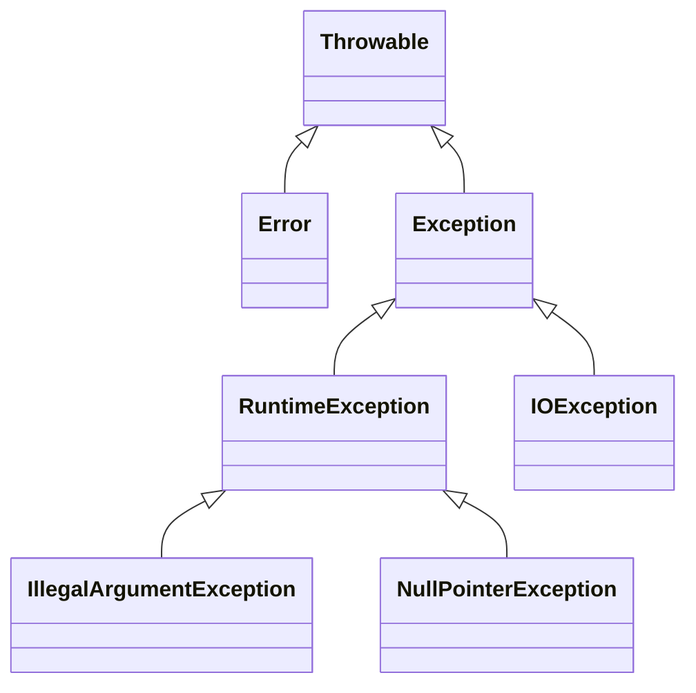
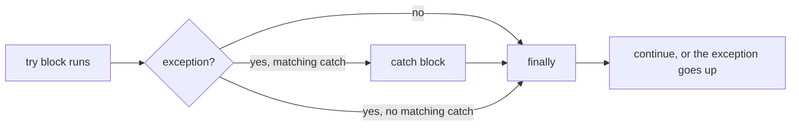

# Exceptions and Resource Handling

> An exception is how a method says "I could not do my job". Learn the checked vs unchecked split, the order in which `try`, `catch` and `finally` run, how try-with-resources (Java) and `use {}` (Kotlin) close resources, and what to never do: swallow an exception.

Roadmap topic 11 · Stage 2: Java Details Interviewers Ask

**Go deeper:** `11 2` Encapsulation (validate and throw) · `11 4` Abstraction · `06-mobile-engineering/02-Kotlin-Essentials` · `04-backend-engineering` (error handling in APIs).

**Marks:** 🟢 must know · 🟡 good to know

---

#### 1. What Is It?

*Errors happen. Good code reports them clearly and cleans up after itself.*

| 🟢 Must know | 🟡 Good to know |
|---|---|
| checked vs unchecked exceptions | Kotlin `Result` and `runCatching` |
| the `Throwable` family: `Error`, `Exception`, `RuntimeException` | exceptions in constructors |
| `try` / `catch` / `finally` order | `finally` that returns |
| try-with-resources and `use {}` | stack traces and logging |
| custom exceptions | `Exception` chaining (`cause`) |
| never swallow an exception | `assert`, `require`, `check`, `error` (Kotlin) |

1. **Exception:** an object that describes what went wrong. Throwing it stops the normal flow and looks for a `catch`.
2. **Checked exception:** the compiler forces you to catch it or declare it with `throws` (for example `IOException`). Java only.
3. **Unchecked exception:** `RuntimeException` and its children (`NullPointerException`, `IllegalArgumentException`). No forced handling. Usually a **bug** in the program.
4. **Error:** serious JVM problems (`OutOfMemoryError`, `StackOverflowError`). Do not catch them in normal code.
5. **Resource:** something that must be closed (a file, a socket, a cursor, a database connection).

**Signals in an interview:** "checked vs unchecked?", "what does `finally` do? Does it always run?", "what is try-with-resources?", "can a `finally` block return?", "how do you create a custom exception?", "should you catch `Exception`?", "does Kotlin have checked exceptions?".

---

#### 2. How It Works

**The family tree.**



| Kind | Examples | Handling |
|---|---|---|
| Checked | `IOException`, `SQLException`, your own `extends Exception` | must catch or declare |
| Unchecked | `IllegalArgumentException`, `NullPointerException`, `IndexOutOfBoundsException` | optional; fix the bug |
| Error | `OutOfMemoryError` | do not catch |

**When to use which.** Use an **unchecked** exception for a programming mistake or a broken rule (bad argument, wrong state). Use a **checked** one only when the caller can realistically recover (a file is missing, retry). Many modern libraries and Kotlin use unchecked exceptions or result types for everything.

**Order of execution.**



`finally` runs whether the `try` succeeded, failed or even returned. If `finally` itself returns a value, that value **replaces** the one from `try` or `catch`, and it also hides any exception, so never return from `finally`.

**Try-with-resources.** Resources declared in `try (...)` are closed automatically in **reverse** order, even if an exception is thrown. If the body throws and `close()` also throws, the body's exception wins and the second one is attached as a **suppressed** exception.

**Chaining.** When you catch a low-level exception and throw a higher-level one, pass the original as the **cause**, so the full story is kept: `new IllegalStateException("config invalid", e)`.

**Catch order.** Put the specific type first and the general type last. Catching a parent before its child is a compile error.

**Kotlin.** No checked exceptions: you never need `throws`. Use `use {}` instead of try-with-resources. `require(cond)` throws `IllegalArgumentException`, `check(cond)` throws `IllegalStateException`, `error("msg")` throws `IllegalStateException`. `runCatching { ... }` wraps the outcome in a `Result`.

---

#### 3. Naive vs Better Design

| Naive | Better |
|---|---|
| `catch (Exception e) { }` (swallow it) | catch the specific type; handle, log with context, or rethrow |
| `return null` for every failure | an exception, or a result type that carries the reason |
| manual `finally { r.close(); }` | try-with-resources / `use {}` |
| throwing `Exception` or `RuntimeException` | a specific type (`InsufficientFunds`) |
| losing the original error | pass it as the `cause` |
| `return` inside `finally` | cleanup only in `finally` |
| using exceptions for normal flow (a loop that ends by an exception) | normal conditions |

```java
// Naive: the error disappears and the bug is invisible
try { process(); } catch (Exception e) { }
```

---

#### 4. Templates & Examples

*Checks come from running the Java versions on JDK 21. The Kotlin versions were not compiled.*

**Example 1: a custom checked exception.**

```java
class InsufficientFunds extends Exception {
    InsufficientFunds(String m) { super(m); }
}
static void withdraw(int bal, int amt) throws InsufficientFunds {
    if (amt > bal) throw new InsufficientFunds("need " + (amt - bal) + " more");
}
```

```kotlin
class InsufficientFunds(message: String) : Exception(message)      // no `throws` in Kotlin
fun withdraw(bal: Int, amt: Int) { if (amt > bal) throw InsufficientFunds("need ${amt - bal} more") }
```

Checks: `withdraw(100, 150)` throws with the message `need 50 more`. `InsufficientFunds` is an `Exception` (checked), and **not** a `RuntimeException`. A call without `try` or `throws` does not compile in Java.

**Example 2: the order of `try`, `catch`, `finally`.**

```java
static String order() {
    try { log.append("try "); throw new RuntimeException("x"); }
    catch (RuntimeException e) { log.append("catch "); return "ret"; }
    finally { log.append("finally "); }
}
```

Checks: `order()` returns `ret`, and the log is `try catch finally`. `finally` ran after the `return` was prepared and before the method actually left.

**Example 3: `finally` and `return`.**

```java
static int tryFinally()      { int x = 1; try { return x; } finally { x = 2; } }
static int finallyReturns()  { try { return 1; } finally { return 2; } }      // never do this
```

Checks: `tryFinally()` → `1` (the return value was already copied before `finally` changed `x`); `finallyReturns()` → `2` (the `finally` return replaces the `try` return and would also hide an exception).

**Example 4: try-with-resources closes in reverse order.**

```java
class Res implements AutoCloseable {
    final String n;
    Res(String n) { this.n = n; System.out.println("open " + n); }
    public void close() { System.out.println("close " + n); }
}
// try (Res r1 = new Res("A"); Res r2 = new Res("B")) { System.out.println("work"); }
```

```kotlin
Res("A").use { a -> Res("B").use { b -> println("work") } }
```

Checks: prints `open A`, `open B`, `work`, `close B`, `close A`. The same order happens if the body throws.

**Example 5: suppressed exceptions.**

```java
class BadRes implements AutoCloseable { public void close() { throw new IllegalStateException("close failed"); } }
// try (BadRes br = new BadRes()) { throw new RuntimeException("body failed"); } catch (RuntimeException e) { ... }
```

Checks: the caught exception message is `body failed`; `e.getSuppressed().length` → `1` and its message is `close failed`. The body's error is not lost behind the close error.

**Example 6: wrap with a cause.**

```java
try {
    try { Integer.parseInt("abc"); }
    catch (NumberFormatException e) { throw new IllegalStateException("config invalid", e); }
} catch (IllegalStateException e) { /* e.getMessage(), e.getCause() */ }
```

Checks: message `config invalid`, cause `NumberFormatException: For input string: "abc"`.

**Example 7: common unchecked exceptions and their messages.**

```java
int zero = 0;      int r = 1 / zero;          // ArithmeticException: / by zero  (integers only)
int[] z = new int[2];  z[2] = 1;               // ArrayIndexOutOfBoundsException: Index 2 out of bounds for length 2
Object o = "s";    Integer i = (Integer) o;    // ClassCastException
```

Checks: the messages seen were `/ by zero` and `Index 2 out of bounds for length 2`; the cast threw `ClassCastException`. (Integer division by zero throws; `double` division gives `Infinity`.)

**Example 8: multi-catch and Kotlin `Result`.**

```java
try { throw new IOException("disk"); }
catch (IOException | IllegalStateException e) { System.out.println("multi-catch " + e.getMessage()); }
```

```kotlin
val n: Int? = "12x".toIntOrNull()                                  // no exception, null on failure
val r: Result<Int> = runCatching { "12x".toInt() }                 // wraps the exception
r.getOrDefault(0)                                                  // 0
```

Checks: the multi-catch prints `multi-catch disk`. In the Kotlin lines, `"12x".toIntOrNull()` → `null`, and `runCatching { "12x".toInt() }` holds a `NumberFormatException`.

---

#### 5. Numbers & Rules of Thumb

| Item | Guide |
|---|---|
| Throw early | validate inputs at the start of the method |
| Exception type | the most specific that fits; a custom one for domain errors |
| Catch | the narrowest type; as close as you can act on it |
| Resources | always try-with-resources / `use {}` |
| `finally` | cleanup only; no `return`, no `throw` |
| Messages | include the bad value and what was expected |
| `catch (Throwable)` | almost never |
| Exceptions for control flow | never |

---

#### 6. Common Mistakes & Edge Cases

1. Swallowing an exception with an empty `catch`.
2. Catching `Exception` or `Throwable` when a specific type is enough.
3. Throwing a generic `RuntimeException("error")` with no details.
4. Losing the original cause when wrapping.
5. Returning from `finally`.
6. Closing resources by hand and forgetting the failure path.
7. Catching an exception and logging it, then also rethrowing (the same error appears twice in the logs).
8. Using exceptions as normal control flow; they are slow and hide intent.

Edge cases: Java integer division by zero throws, but `double` division gives `Infinity` or `NaN`; an exception thrown inside a constructor leaves no object, so close partial resources there; an `Error` such as `StackOverflowError` usually means infinite recursion; in Kotlin, `catch` can be used as an expression (`val x = try { ... } catch (e: Exception) { 0 }`); on Android, an uncaught exception on the main thread crashes the app.

---

#### 7. Say This in the Interview

1. "Checked exceptions must be caught or declared. Unchecked exceptions, which extend `RuntimeException`, usually signal a programming bug. Kotlin has only unchecked ones."
2. "`finally` runs after `try` and `catch` whether or not an exception happened. I use it only for cleanup and never return from it."
3. "I use try-with-resources in Java and `use` in Kotlin so resources close in reverse order, even on failure."
4. "I never swallow an exception. I catch the narrowest type, handle it or add context, and rethrow with the original as the cause."
5. "I validate early and throw a specific exception with a message that names the bad value."

---

#### 8. Quick Check

1. Is `IOException` checked or unchecked? `IllegalArgumentException`?
2. What does `finallyReturns()` return, and why is that a problem?
3. In what order do try-with-resources close `A` and `B` opened in that order?
4. What happens to the second exception if the body and `close()` both throw?

<details>
<summary>Answers</summary>

1. `IOException` is checked. `IllegalArgumentException` is unchecked.
2. `2`. A `return` in `finally` replaces the `try` result and hides any exception.
3. `B` first, then `A` (reverse order).
4. The body's exception is thrown; the close exception is attached as suppressed (`getSuppressed()`).

</details>

---

#### 9. Practice

**Interview questions**

1. Checked vs unchecked exceptions? Which would you use for a business rule?
2. `final` vs `finally` vs `finalize`?
3. Does `finally` always run? When might it not?
4. What is try-with-resources and what does it need (`AutoCloseable`)?
5. How do you write a custom exception?
6. Is it good to catch `Exception`? Why or why not?
7. How do you preserve the original error when you wrap it?
8. How does error handling in Kotlin differ?

**Exercises**

1. Write `InsufficientFunds` and use it in a `withdraw`; handle it in the caller.
2. Predict the output of `order()`, `tryFinally()` and `finallyReturns()`, then run them.
3. Write two `AutoCloseable` classes and watch the close order; then make one throw in `close()`.
4. Rewrite a method that returns `null` on failure to throw a specific exception.
5. In Kotlin, replace a `try/finally` that closes a file with `use {}`.

**LeetCode (validating input in class design, Easy → Medium)**

| # | Question | Practises |
|---|---|---|
| 1603 | [Design Parking System](https://leetcode.com/problems/design-parking-system/) (Easy) | rejecting an impossible request |
| 2043 | [Simple Bank System](https://leetcode.com/problems/simple-bank-system/) (Medium) | invalid account, not enough money: report failure cleanly |
| 20 | [Valid Parentheses](https://leetcode.com/problems/valid-parentheses/) (Easy) | handling an empty stack safely |
| 155 | [Min Stack](https://leetcode.com/problems/min-stack/) (Medium) | pop or top on an empty stack |
| 1797 | [Design Authentication Manager](https://leetcode.com/problems/design-authentication-manager/) (Medium) | expired and unknown tokens |
| 1472 | [Design Browser History](https://leetcode.com/problems/design-browser-history/) (Medium) | boundary cases for `back` and `forward` |

**Remember:** checked = must handle · unchecked = usually a bug · never swallow · `finally` for cleanup only · try-with-resources / `use {}` · keep the cause · Kotlin has no checked exceptions.
