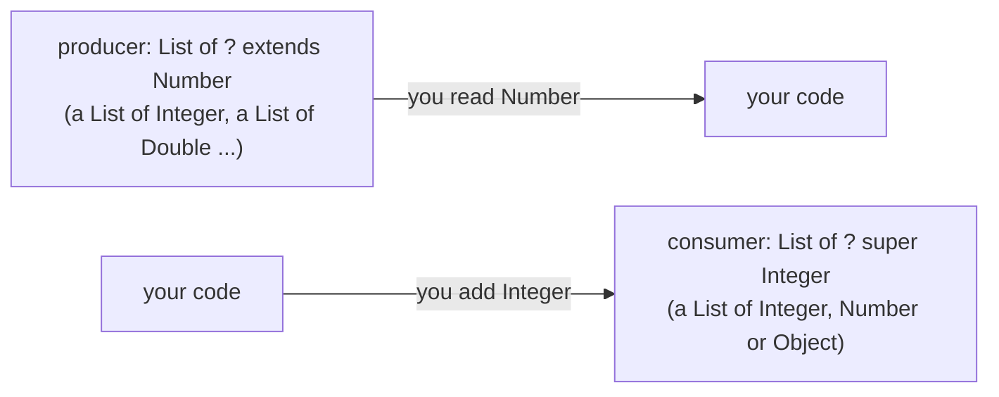

# Generics

> Generics let a class or method work with a type chosen by the caller, with the type checked at compile time. Learn the basics, bounded types, wildcards (`? extends`, `? super`), type erasure and why it matters, and Kotlin's `in` and `out`.

Roadmap topic 12 · Stage 2: Java Details Interviewers Ask

**Go deeper:** `11 4` Abstraction (interfaces) · `01-data-structure` (collections) · `06-mobile-engineering/02-Kotlin-Essentials` · `03-leetcode-patterns/03-Kotlin for Coding Interviews`.

**Marks:** 🟡 good to know (often a follow-up question, rarely the whole question)

---

#### 1. What Is It?

*You already use generics in `List<String>` and `Map<String, Int>`. This topic explains what that means and where it bites.*

| 🟡 Good to know |
|---|
| type safety at compile time |
| generic classes and methods |
| bounded types: `<T extends Comparable<T>>` |
| wildcards: `? extends`, `? super`, the PECS rule |
| type erasure: types vanish at runtime |
| Kotlin `in` / `out` variance and `reified` |
| why you cannot write `new T()` or `new T[]` |

1. **Generic type:** a class or interface with a type parameter, such as `Box<T>`. The caller fills in `T`: `Box<Integer>`.
2. **Generic method:** a method with its own type parameter, such as `<T> void swapAt(T[] a, int i, int j)`.
3. **Bound:** a limit on the type: `T extends Comparable<T>` means "any `T` that can be compared".
4. **Wildcard `?`:** "some unknown type". `List<? extends Number>` means a list of `Number` or any subtype.
5. **Type erasure:** the compiler checks the types, then removes them. At runtime a `List<String>` is just a `List`.

**Why generics?** Before generics, collections held `Object`, so you had to cast on the way out and could put the wrong type in. Generics move those mistakes from run time to compile time.

**Signals in an interview:** "what are generics?", "what is type erasure?", "what does `<? extends T>` mean?", "can you create `new T()`?", "why is `List<Object>` not a `List<String>`?", "what is PECS?".

---

#### 2. How It Works

**Invariance.** `List<String>` is **not** a `List<Object>`, even though `String` is an `Object`. If it were, you could put an `Integer` into a list that is really a `List<String>`.

**Wildcards: PECS.** "Producer Extends, Consumer Super".

| You... | Use | Meaning |
|---|---|---|
| **read** items out of a collection (it *produces* values for you) | `List<? extends Number>` | any list of `Number` or a subtype; you can read `Number`, but you cannot add |
| **put** items into a collection (it *consumes* values from you) | `List<? super Integer>` | any list of `Integer` or a supertype; you can add `Integer`, but you can only read `Object` |



**Type erasure.** The compiler replaces `T` with its bound (or `Object`) and inserts casts. Consequences:

| You cannot... | Because |
|---|---|
| `new T()` or `new T[n]` | the type is unknown at runtime |
| `obj instanceof List<String>` | the `<String>` part no longer exists (use `List<?>`) |
| overload `f(List<String>)` and `f(List<Integer>)` | same erased signature |
| tell `ArrayList<String>` from `ArrayList<Integer>` at runtime | both are `ArrayList` |

**Arrays are different.** Arrays keep their element type at run time and are **covariant**: a `String[]` can be used as an `Object[]`. Putting a wrong type in then throws `ArrayStoreException`. Generic lists catch that mistake at compile time instead.

**Kotlin.**

| Idea | Java | Kotlin |
|---|---|---|
| Producer | `? extends T` | `out T` (declaration-site, on the class) or `out T` in use-site |
| Consumer | `? super T` | `in T` |
| Unknown | `?` | `*` (star projection) |
| Type at runtime | erased | erased, except `inline fun <reified T>` |
| Read-only list | `List<? extends E>` | `List<out E>` (already declared `out`) |

---

#### 3. Naive vs Better Design

| Naive | Better |
|---|---|
| `List` of `Object` and casts | `List<String>` |
| raw types (`List list = new ArrayList()`) | always give the type argument |
| `void printAll(List<Object> xs)` | `void printAll(List<?> xs)` or `List<? extends Object>` |
| `Number sum(List<Integer>)` only for ints | `double sum(List<? extends Number>)` |
| a method that returns `Object` and callers cast | a generic method `<T> T first(List<T> xs)` |
| copy-pasting a method for each type | one generic method with a bound |

```java
// Naive: raw type, no safety, a bug waiting for run time
List names = new ArrayList();
names.add("a"); names.add(1);               // allowed
String s = (String) names.get(1);           // ClassCastException
```

---

#### 4. Templates & Examples

*Checks come from running the Java versions on JDK 21. The Kotlin versions were not compiled.*

**Example 1: a bounded generic method.**

```java
static <T extends Comparable<T>> T max(List<T> xs) {
    T best = xs.get(0);
    for (T x : xs) if (x.compareTo(best) > 0) best = x;
    return best;
}
```

```kotlin
fun <T : Comparable<T>> max(xs: List<T>): T {
    var best = xs[0]
    for (x in xs) if (x > best) best = x
    return best
}
```

Checks: `max(List.of(3, 9, 4))` → `9`; `max(List.of("b", "z", "a"))` → `z`. A `List` of objects that are not `Comparable` does not compile.

**Example 2: a generic class.**

```java
class Box<T> {
    private final T v;
    Box(T v) { this.v = v; }
    T get() { return v; }
    <R> Box<R> map(Function<T, R> f) { return new Box<>(f.apply(v)); }
}
```

```kotlin
class Box<T>(private val v: T) {
    fun get(): T = v
    fun <R> map(f: (T) -> R): Box<R> = Box(f(v))
}
```

Checks: `new Box<>(21).map(v -> v * 2).get()` → `42`; `.map(v -> "n=" + v).get()` → `n=21`.

**Example 3: PECS in action.**

```java
static double sum(List<? extends Number> xs) { double t = 0; for (Number n : xs) t += n.doubleValue(); return t; }
static void fill(List<? super Integer> xs)    { xs.add(1); xs.add(2); }
```

Checks: `sum(List.of(1, 2, 3))` → `6.0` and `sum(List.of(1.5, 2.5))` → `4.0` (one method for both `Integer` and `Double` lists). `fill` works on a `List<Number>` and on a `List<Object>`; both end up as `[1, 2]`.

**Example 4: erasure at work.**

```java
new ArrayList<String>().getClass() == new ArrayList<Integer>().getClass();       // true
```

Checks: `true`. At runtime both are just `ArrayList`.

**Example 5: heap pollution shows up late.**

```java
List raw = new ArrayList<String>();   raw.add(1);          // the compiler only warns
List<String> strs = raw;
String s = strs.get(0);                                    // ClassCastException here
```

Checks: the exception appears at `strs.get(0)`, far from where the wrong value went in. This is why raw types are discouraged.

**Example 6: arrays vs lists.**

```java
Object[] oa = new String[1];
oa[0] = 1;                                                 // ArrayStoreException
// List<Object> lo = new ArrayList<String>();             // does not compile: caught early
```

Checks: the array case throws `ArrayStoreException: java.lang.Integer` at run time; the list case is a compile error.

**Example 7: a generic helper for arrays.**

```java
static <T> void swapAt(T[] a, int i, int j) { T t = a[i]; a[i] = a[j]; a[j] = t; }
```

Checks: `swapAt(new String[]{"a","b","c"}, 0, 2)` leaves `[c, b, a]`.

**Kotlin variance and `reified`.**

```kotlin
interface Source<out T> { fun next(): T }               // producer only: Source<String> is a Source<Any>
interface Sink<in T> { fun put(t: T) }                  // consumer only: Sink<Any> is a Sink<String>

inline fun <reified T> List<*>.firstOfType(): T? = firstOrNull { it is T } as T?   // `is T` allowed because of reified
```

---

#### 5. Numbers & Rules of Thumb

| Item | Guide |
|---|---|
| Raw types | never |
| Type parameters | one or two per class (`T`, `K`/`V`); more suggests a design problem |
| Wildcards | `? extends` to read, `? super` to write (PECS) |
| Bounds | `T extends Comparable<T>` when you need to compare |
| Arrays vs lists | prefer lists for generics |
| Kotlin | `out` for producers, `in` for consumers, `reified` when you need `is T` |
| In an interview | know erasure and PECS by name; the rest you can reason out |

---

#### 6. Common Mistakes & Edge Cases

1. Using raw types and getting `ClassCastException` later.
2. Expecting `List<Integer>` to be a `List<Number>` (invariance).
3. Trying to create `new T()` or `new T[n]`.
4. Using `instanceof List<String>`.
5. Adding to a `List<? extends Number>` (not allowed: its real element type is unknown).
6. Overloading two methods that differ only in the type argument.
7. Mixing arrays and generics (`List<String>[]` produces warnings).
8. Over-engineering with deeply nested generics (`Map<String, List<Map<Int, Foo>>>`): name a type.

Edge cases: a bound like `<T extends A & B>` allows several interfaces; static members cannot use the class's `T`; a generic method can have its own `T` independent of the class; primitives cannot be type arguments (`List<int>` is not allowed in Java; Kotlin hides this by using boxed types or `IntArray`).

---

#### 7. Say This in the Interview

1. "Generics give compile-time type safety, so I do not cast and I cannot put the wrong type into a collection."
2. "Due to type erasure the type arguments disappear at runtime, so I cannot write `new T()` or check `instanceof List<String>`."
3. "A `List<String>` is not a `List<Object>`, because it would allow adding the wrong type. I use wildcards instead."
4. "PECS: Producer Extends, Consumer Super. I read from `? extends T` and write to `? super T`."
5. "In Kotlin, `out` marks a producer and `in` marks a consumer, and `reified` keeps the type in an inline function."

---

#### 8. Quick Check

1. Why is `List<String>` not assignable to `List<Object>`?
2. What does `<T extends Comparable<T>>` allow you to do?
3. What does PECS stand for?
4. Why can't you write `new T()`?

<details>
<summary>Answers</summary>

1. You could then add an `Integer` through the `List<Object>` view, breaking the `List<String>`.
2. Call `compareTo` on values of type `T`, for example to find a maximum.
3. Producer Extends, Consumer Super.
4. Type arguments are erased at runtime, so the JVM does not know which class to create.

</details>

---

#### 9. Practice

**Interview questions**

1. What are generics, and why do we have them?
2. What is type erasure? What can't you do because of it?
3. `List<? extends T>` vs `List<? super T>`: when do you use each?
4. Why is `List<Integer>` not a `List<Number>`?
5. What is a raw type, and why avoid it?
6. How do arrays differ from generic lists?
7. What are `in`, `out` and `reified` in Kotlin?
8. Write a generic method that returns the max of a list.

**Exercises**

1. Write `max(List<T>)` for `Comparable` types and test it with `Int` and `String`.
2. Write `Box<T>` with `map`; chain two `map` calls.
3. Write `sum(List<? extends Number>)` and `fill(List<? super Integer>)`; call each with several list types.
4. Reproduce the raw-type `ClassCastException` and the array `ArrayStoreException`.
5. In Kotlin, write a `Source<out T>` and a `Sink<in T>`; assign them to wider and narrower types.

**LeetCode (types and contracts in generic structures, Easy → Medium)**

| # | Question | Practises |
|---|---|---|
| 155 | [Min Stack](https://leetcode.com/problems/min-stack/) (Medium) | a stack of a comparable type |
| 232 | [Implement Queue using Stacks](https://leetcode.com/problems/implement-queue-using-stacks/) (Easy) | a generic container built from another |
| 173 | [Binary Search Tree Iterator](https://leetcode.com/problems/binary-search-tree-iterator/) (Medium) | an `Iterator`-style contract |
| 284 | [Peeking Iterator](https://leetcode.com/problems/peeking-iterator/) (Medium) | a wrapper around `Iterator<T>` |
| 341 | [Flatten Nested List Iterator](https://leetcode.com/problems/flatten-nested-list-iterator/) (Medium) | one interface, two shapes |
| 981 | [Time Based Key-Value Store](https://leetcode.com/problems/time-based-key-value-store/) (Medium) | `Map<String, List<Pair<...>>>`: nested generic types |

**Remember:** compile-time safety · erased at runtime · no `new T()` · `List<String>` is not a `List<Object>` · PECS · never raw types · Kotlin `in` / `out`.
