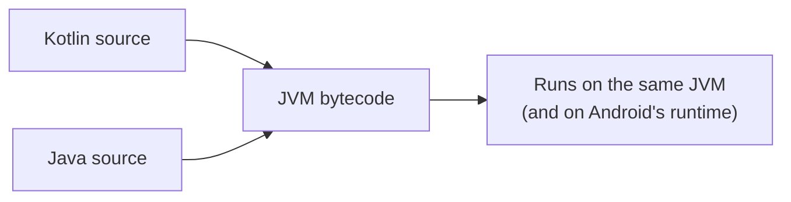

# Java vs Kotlin Cheat Table

> You write Kotlin every day, but many interviews and OOP books use Java. This page puts the two side by side: what is the same, what differs, and the Java idioms with their Kotlin one-liners. Read it once, then keep it open when you switch languages.

Roadmap topic 13 · Stage 3: Java and Kotlin

**Go deeper:** `11 3` Inheritance · `11 6` `equals` · `11 10` `static`/`final` · `11 11` Exceptions · `06-mobile-engineering/02-Kotlin-Essentials` · `03-leetcode-patterns/03-Kotlin for Coding Interviews`.

**Marks:** 🟢 must know · 🟡 good to know

---

#### 1. What Is It?

*Same JVM, same ideas, different defaults.*

| 🟢 Must know | 🟡 Good to know |
|---|---|
| `open`/`final` defaults | `lateinit`, `lazy`, `by` delegation |
| `==` and `===` | extension functions |
| no checked exceptions | `when` as an expression |
| null safety in the type | named and default arguments |
| `object`, `companion object` vs `static` | `inline`, `reified` |
| `data class` vs `record` | coroutines vs threads |
| properties vs fields + getters | SAM conversion and lambdas |

**The big picture.** Kotlin compiles to the same bytecode as Java and runs on the same JVM. It changes defaults to remove common bugs: classes are final, types are non-null, `==` means content equality, and getters and setters are generated for you.

**Signals in an interview:** "you know Kotlin: how would you write this in Java?", "what is different about `==`?", "why are Kotlin classes final by default?", "how do you do a singleton in each?", "does Kotlin have checked exceptions?".

---

#### 2. How It Works

**The core differences.**

| Idea | Java | Kotlin |
|---|---|---|
| Inherit from a class | open by default | `final` by default; write `open` |
| Override | `@Override` (recommended) | `override` (required) |
| Static members | `static` | `companion object` or top-level functions |
| Singleton | enum or holder class | `object` |
| Value class with `equals` | `record` (Java 16+) | `data class` |
| Reference equality | `==` | `===` |
| Content equality | `.equals()` | `==` |
| Checked exceptions | yes | no |
| Null safety | annotations only | built into the type (`String?`) |
| Getters and setters | write them (or Lombok) | generated for `val` / `var` properties |
| Constructors | several overloads | primary constructor + default and named arguments |
| Type inference | `var` (local only, Java 10+) | `val` / `var` everywhere |
| Interface bodies | `default` methods | methods with bodies; abstract properties |
| Closing resources | try-with-resources | `use {}` |
| Switch | `switch` (expression form since Java 14) | `when` (an expression) |
| Generics variance | `? extends` / `? super` | `out` / `in` |
| Lambdas | functional interfaces, SAM | function types `(A) -> B`; `fun interface` for SAM |
| Async | threads, `CompletableFuture` | coroutines |

**What stays exactly the same.** Classes and objects, inheritance and one parent class, interfaces, polymorphism, overriding vs overloading, pass-by-value, immutability ideas, `hashCode` contract, type erasure.

**Two traps that move with you.**

| Trap | Why |
|---|---|
| Kotlin `==` is safe, but Java `==` on strings is a bug | habit carried from Kotlin to a Java interview |
| a Kotlin class is `final` by default, so frameworks (mocking, some proxies) need `open` or a compiler plugin (`all-open`) | Spring, Mockito, Room and others rely on this |



---

#### 3. Naive vs Better Design

| Naive (Java habits in Kotlin) | Better (Kotlin style) |
|---|---|
| `getName()` / `setName()` functions | a `val` / `var` property |
| `if (x != null)` everywhere | `?.`, `?:`, `let`, or a non-null type |
| a `StringBuilder` loop | string templates, `joinToString` |
| a utility class with `static` methods | top-level functions |
| a class with 5 constructors | default and named arguments |
| `for (i in 0 until list.size)` | `for (x in list)` or `list.forEach` |
| `instanceof` + cast | `is` with smart cast |

| Naive (Kotlin habits in Java) | Better (Java style) |
|---|---|
| `a == b` on strings | `a.equals(b)` or `Objects.equals(a, b)` |
| assuming a class can be extended | check if it is `final` |
| expecting a `null`-checked type | add a null check or `Objects.requireNonNull` |
| expecting a data class | use a `record` (Java 16+) |

---

#### 4. Templates & Examples

*Side-by-side idioms. The Java compiled on JDK 21 for the earlier topics; here the pairs are shown for comparison and the Kotlin is not compiled.*

**A class with a constructor and a method.**

```java
class Person {
    private final String name;
    private final int age;
    Person(String name, int age) { this.name = name; this.age = age; }
    String name() { return name; }
    int age() { return age; }
    String intro() { return name + " (" + age + ")"; }
}
```

```kotlin
class Person(val name: String, val age: Int) {
    fun intro() = "$name ($age)"
}
```

**A value class.**

```java
record Point(int x, int y) {}
```

```kotlin
data class Point(val x: Int, val y: Int)
```

**Null handling.**

```java
String city = (user != null && user.address != null) ? user.address.city : "unknown";
```

```kotlin
val city = user?.address?.city ?: "unknown"
```

**Static members and singleton.**

```java
class Config {
    static final int MAX = 3;
    static Config create() { return new Config(); }
}
enum Logger { INSTANCE; void log(String m) { System.out.println(m); } }
```

```kotlin
class Config { companion object { const val MAX = 3; fun create() = Config() } }
object Logger { fun log(m: String) = println(m) }
```

**Interface with a default.**

```java
interface Printable { String text(); default String printed() { return "[" + text() + "]"; } }
```

```kotlin
fun interface Printable { fun text(): String; fun printed() = "[${text()}]" }
```

**Loops and collections.**

```java
List<String> names = new ArrayList<>();
for (Person p : people) if (p.age() > 18) names.add(p.name().toUpperCase());
```

```kotlin
val names = people.filter { it.age > 18 }.map { it.name.uppercase() }
```

**Resource handling.**

```java
try (BufferedReader r = new BufferedReader(new FileReader(path))) { return r.readLine(); }
```

```kotlin
File(path).bufferedReader().use { it.readLine() }
```

**`switch` vs `when`.**

```java
String label = switch (plan) { case FREE -> "Free"; case PRO -> "Pro"; case TEAM -> "Team"; };
```

```kotlin
val label = when (plan) { Plan.FREE -> "Free"; Plan.PRO -> "Pro"; Plan.TEAM -> "Team" }
```

**Default and named arguments (no overload needed).**

```java
Person(String name) { this(name, 18); }                    // overload per combination
```

```kotlin
class Person(val name: String, val age: Int = 18)           // Person("Asha"), Person("Asha", age = 30)
```

**Delegation.**

```java
class CountingSet<E> { private final Set<E> inner = new HashSet<>(); /* forward each method by hand */ }
```

```kotlin
class CountingSet<E>(private val inner: MutableSet<E>) : MutableSet<E> by inner
```

**Calling Java from Kotlin and back (interop in one line each).**

| Direction | Notes |
|---|---|
| Kotlin calls Java | works directly; Java types appear as "platform types" (`String!`): treat them as nullable if unsure |
| Java calls Kotlin | `companion object` members need `@JvmStatic` to look like `static`; top-level functions live in `FileNameKt` |

---

#### 5. Numbers & Rules of Thumb

| Item | Guide |
|---|---|
| Interviews in Java | write Java if asked; do not translate mid-answer |
| Interviews in Kotlin | allowed at most companies; state the language at the start |
| Null handling | prefer non-null types; avoid `!!` |
| Equality | Kotlin `==` for content, `===` only when you mean identity |
| Class design | `final` by default is good; open only for designed extension |
| Data holders | `data class` / `record` with immutable fields |
| Java `var` | local variables only |

---

#### 6. Common Mistakes & Edge Cases

1. Using `==` on strings in a Java interview because it is safe in Kotlin.
2. Forgetting `open` on a Kotlin class or method and wondering why it cannot be extended or overridden.
3. Using `!!` to silence null errors instead of handling them.
4. Writing getters and setters in Kotlin by hand.
5. Expecting a `data class` to ignore a body property in `equals`: only primary-constructor properties count.
6. Assuming Kotlin `List` is immutable (it is read-only).
7. Forgetting `@JvmStatic` or `@JvmOverloads` when Java code calls Kotlin.
8. Assuming platform types from Java are non-null.

Edge cases: Kotlin `Int` becomes Java `int` or `Integer` depending on nullability; Kotlin has no `static` keyword, no `new`, no semicolons needed; Kotlin has no ternary operator (`if` is an expression); Java records cannot extend classes; Kotlin `object` is created lazily and thread-safely on first use.

---

#### 7. Say This in the Interview

1. "Kotlin runs on the same JVM and has the same OOP model. The differences are mostly defaults: classes are final, types are non-null, and `==` means content equality."
2. "In Java I use `equals` for objects, and `==` only for primitives or when I mean the same reference."
3. "Kotlin has no checked exceptions, so I never write `throws`."
4. "For a value class I use a `record` in Java and a `data class` in Kotlin; both generate `equals`, `hashCode` and `toString`."
5. "For static members Kotlin uses `companion object` or top-level functions, and `object` for a singleton."

---

#### 8. Quick Check

1. What does `==` mean in Kotlin? In Java for objects?
2. Which is final by default: a Java class or a Kotlin class?
3. How do you write a singleton in Kotlin?
4. Does Kotlin have checked exceptions?

<details>
<summary>Answers</summary>

1. Kotlin: structural equality (calls `equals`). Java: reference equality.
2. A Kotlin class. A Java class is open unless you write `final`.
3. `object Name { ... }`.
4. No.

</details>

---

#### 9. Practice

**Interview questions**

1. What are the main differences between Java and Kotlin?
2. `==` vs `===` in Kotlin; `==` vs `equals` in Java?
3. Why are Kotlin classes final by default?
4. How does Kotlin handle null safety?
5. `record` vs `data class`?
6. How do `static` and singletons look in Kotlin?
7. How would you call Kotlin code from Java?

**Exercises**

1. Take a small Java class (fields, getters, `equals`, `hashCode`, `toString`) and rewrite it as a Kotlin `data class`.
2. Translate a Java `for` loop with an `if` and a `list.add` into a Kotlin `filter` + `map`.
3. Translate a Kotlin `?.` / `?:` chain into explicit Java null checks.
4. Rewrite the `CountingSet` from topic 5 in both languages.
5. Write the same enum with fields and a `when` / `switch` in both languages.

**LeetCode (solve the same problem in both languages, Easy → Medium)**

| # | Question | Practises |
|---|---|---|
| 1 | [Two Sum](https://leetcode.com/problems/two-sum/) (Easy) | `HashMap` in both languages |
| 20 | [Valid Parentheses](https://leetcode.com/problems/valid-parentheses/) (Easy) | stack and `when` / `switch` |
| 242 | [Valid Anagram](https://leetcode.com/problems/valid-anagram/) (Easy) | arrays and strings in both |
| 706 | [Design HashMap](https://leetcode.com/problems/design-hashmap/) (Easy) | a small class in both languages |
| 49 | [Group Anagrams](https://leetcode.com/problems/group-anagrams/) (Medium) | collections and lambdas |
| 146 | [LRU Cache](https://leetcode.com/problems/lru-cache/) (Medium) | class design; `LinkedHashMap` in both |

**Remember:** same JVM, different defaults · final by default · `==` is `equals` in Kotlin · no checked exceptions · `data class` ↔ `record` · `object` ↔ singleton · `companion object` ↔ `static` · null safety in the type.
