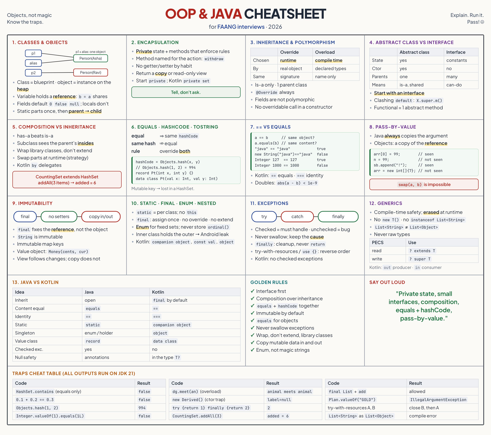

# OOP & Java Cheat Sheet

> One-page revision for the night before an interview. The full explanations are in notes 1–13. Java code is shown first; the Kotlin equivalent is next to it where it differs. Java outputs were checked on JDK 21; Kotlin snippets were not compiled.



---

#### 1. Key Takeaways

1. **Class and object:** a class is a blueprint, an object is one instance on the heap. A variable holds a **reference**, so `b = a` shares one object. Fields get defaults (`0`, `false`, `null`); locals do not. Setup order: static parts once, then parent fields and constructor, then child fields and constructor.
2. **Encapsulation:** private state, methods that enforce the rules, no getter/setter by habit. Return a copy or a read-only view of an internal collection. Start with `private`. Kotlin: `private set`.
3. **Inheritance and polymorphism:** inherit only for a true is-a. **Overriding** is decided at runtime by the real object; **overloading** at compile time by the declared types. Fields are not polymorphic. Never call an overridable method from a constructor. One parent class only.
4. **Abstraction:** interface = capability ("can-do"), many allowed, no state. Abstract class = shared state or algorithm, one parent. Start with an interface. Two clashing `default` methods: override and choose `X.super.m()`. Functional interface = one abstract method.
5. **Composition vs inheritance:** has-a beats is-a. Inheritance leaks the parent's insides (the fragile base class: a counting `HashSet` subclass reports `6` for three items). Wrap, do not extend, library classes. Swap behaviour at runtime. Kotlin `by`.
6. **`equals` / `hashCode` / `toString`:** equal objects must have equal hash codes. Override both or neither, using the same fields. A mutable key gets lost in a `HashSet`. `equals(Object)`, not `equals(Point)`. `record` / `data class` generate all three.
7. **`==` vs `equals`:** Java `==` on objects compares references. String literals share a pool; `new String` does not. `Integer` is cached from -128 to 127. Compare doubles with a tolerance. Kotlin `==` is `equals`; `===` is identity.
8. **Pass-by-value:** Java always copies the argument; for objects it copies the **reference**. A method can change the object, not the caller's variable. `swap(a, b)` is impossible.
9. **Immutability:** `final` class, `private final` fields, no setters, copy in and out. `final` fixes the reference, not the object. `String` is immutable. Immutable keys. Value objects (`Money`).
10. **`static` / `final` / nested / enum:** `static` is per class; a static method has no `this`. `final` = assign once / no override / no extend. Enum for a fixed set; never store `ordinal()`. Inner classes hold the outer object (Android leak). Kotlin: `companion object`, `const val`, `object`.
11. **Exceptions:** checked = must handle; unchecked = usually a bug; `Error` = do not catch. Never swallow. `finally` is for cleanup and never returns. try-with-resources / `use {}` close in reverse order. Keep the cause when wrapping. Kotlin has no checked exceptions.
12. **Generics:** compile-time safety, erased at runtime (no `new T()`, no `instanceof List<String>`). `List<String>` is not a `List<Object>`. PECS: Producer Extends, Consumer Super. Never use raw types. Kotlin `in` / `out`.
13. **Java vs Kotlin:** same JVM, different defaults: final classes, non-null types, `==` is `equals`, no checked exceptions, properties instead of getters, `object`/`companion` instead of `static`.

---

#### 2. Numbers and Rules of Thumb

| Item | Guide |
|---|---|
| Constructor parameters | 3 or fewer; beyond that a builder or a data class |
| Inheritance depth | 1 to 2 levels |
| Interface size | 1 to 5 methods |
| Class size | a few hundred lines; split when you can name two reasons to change |
| `Integer` cache | -128 to 127 |
| `Objects.hash(1, 2)` | `994` |
| Parents | one class, many interfaces |
| Map and set keys | immutable only |
| Money | integer cents plus a currency; never `double` |
| Doubles | compare with `Math.abs(a - b) < 1e-9` |
| Resources | always try-with-resources / `use {}` |
| Exception messages | name the bad value |
| Static mutable state | avoid |
| Fields | `private` by default |
| Raw types | never |

---

#### 3. Patterns and How to Identify Them

| You see / hear | Think | Topic |
|---|---|---|
| "what is encapsulation?", public fields, `setBalance` | private state + methods that enforce rules | 2 |
| `if (x is Dog) ... else if (x is Cat)` | polymorphism: one overridden method | 3 |
| "overloading or overriding?" | runtime (override) vs compile time (overload) | 3 |
| base class with only abstract methods | an interface | 4 |
| two interfaces, same default method | override and choose `X.super.m()` | 4 |
| `class Stack extends ArrayList`, a counting subclass of a library class | composition + delegation | 5 |
| a class per feature combination (`FlyingSwimmingDuck`) | small swappable parts (strategy) | 5 |
| `HashSet.contains` returns `false` for an equal object | missing or wrong `hashCode` | 6 |
| a mutable object used as a map key | immutable key | 6, 9 |
| `==` on `String` or `Integer` | `equals` | 7 |
| `0.1 + 0.2 == 0.3` | tolerance or `BigDecimal` | 7 |
| "write `swap(a, b)`", "what does this print?" with an array or `StringBuilder` | pass-by-value, copy of the reference | 8 |
| a `final List` field that still changes | defensive copy in the constructor | 9 |
| strings like `"PRO"` and `"FREE"` | enum | 10 |
| inner class in an `Activity` with a callback | memory leak risk: static nested + weak reference | 10 |
| empty `catch`, `return null` on failure | specific exception, keep the cause | 11 |
| manual `finally { close() }` | try-with-resources / `use {}` | 11 |
| `List` of `Object` and casts, raw types | generics | 12 |
| `? extends` / `? super` question | PECS | 12 |
| "you know Kotlin: how in Java?" | defaults table | 13 |

---

#### 4. Templates to Memorise

**Class with validated state (Java, then Kotlin).**

```java
class Account {
    private long balance;
    Account(long initial) { if (initial < 0) throw new IllegalArgumentException("negative"); balance = initial; }
    void deposit(long c) { if (c <= 0) throw new IllegalArgumentException("amount"); balance += c; }
    boolean withdraw(long c) { if (c <= 0 || c > balance) return false; balance -= c; return true; }
}
```

```kotlin
class Account(initial: Long) {
    var balance = initial.also { require(it >= 0) { "negative" } }
        private set
}
```

**`equals` and `hashCode`.**

```java
@Override public boolean equals(Object o) {
    if (this == o) return true;
    if (!(o instanceof GoodPoint p)) return false;
    return x == p.x && y == p.y;
}
@Override public int hashCode() { return Objects.hash(x, y); }
```

```kotlin
data class Pt(val x: Int, val y: Int)          // Java: record Pt(int x, int y) {}
```

**Immutable class with a defensive copy.**

```java
final class Schedule {
    private final List<String> items;
    Schedule(List<String> in) { items = List.copyOf(in); }
}
```

**Abstract class + template method, and an interface with a default.**

```java
abstract class Vehicle {
    final int wheels;
    Vehicle(int w) { wheels = w; }
    abstract String name();
    String info() { return name() + " has " + wheels + " wheels"; }
}
interface Printable { String text(); default String printed() { return "[" + text() + "]"; } }
```

**Composition by delegation.**

```kotlin
class CountingSet<E>(private val inner: MutableSet<E> = HashSet()) : MutableSet<E> by inner {
    var added = 0; private set
    override fun add(element: E): Boolean { added++; return inner.add(element) }
}
```

**Enum with fields, and a safe lookup.**

```java
enum Plan { FREE(0), PRO(10); final int price; Plan(int p) { price = p; } }
// Plan.valueOf("GOLD") throws IllegalArgumentException
```

**Custom exception, try-with-resources, `use`.**

```java
class InsufficientFunds extends Exception { InsufficientFunds(String m) { super(m); } }
try (Res a = new Res("A"); Res b = new Res("B")) { /* work; closes B then A */ }
```

```kotlin
Res("A").use { a -> Res("B").use { b -> /* work */ } }
```

**Bounded generic and PECS.**

```java
static <T extends Comparable<T>> T max(List<T> xs) { /* ... */ }
static double sum(List<? extends Number> xs) { /* read */ }
static void fill(List<? super Integer> xs)   { /* write */ }
```

---

#### 5. Naive to Better

| Naive | Better |
|---|---|
| `public long balance;` | private field + `deposit` / `withdraw` |
| `getItems()` returns the internal list | `List.copyOf(items)` or an unmodifiable view |
| `if (a instanceof Dog) ... else if ...` | `a.sound()`, overridden |
| `class Stack extends ArrayList` | a `Stack` that has an `ArrayList` |
| `equals` without `hashCode` | both, or `record` / `data class` |
| `s == "yes"` | `"yes".equals(s)` (Kotlin: `s == "yes"`) |
| `Integer a == Integer b` | `a.equals(b)` |
| `swap(a, b)` on variables | swap array elements, or return a pair |
| `final List` copied from the caller | `List.copyOf(in)` in the constructor |
| `"PRO"` strings everywhere | `enum Plan` |
| `catch (Exception e) { }` | catch a specific type; handle or rethrow with the cause |
| manual `finally { r.close(); }` | try-with-resources / `use {}` |
| `List` of `Object` + casts | `List<String>` |
| `double` for money | integer cents + currency |

---

#### 6. Common Mistakes and Edge Cases

1. `equals` without `hashCode`; a mutable key in a hash collection.
2. `==` on strings and boxed numbers; `double` compared with `==`.
3. "Java passes objects by reference."
4. `final` mistaken for immutable; the caller's list stored without a copy.
5. Inheritance used only for code reuse; deep trees; a counting subclass of a library collection.
6. An overload where an override was meant (no `@Override`).
7. An overridable method called from a constructor.
8. Mutable `static` state shared between tests; `ordinal()` stored in a database.
9. An inner class or anonymous class in an `Activity` that outlives it.
10. Swallowing exceptions; `return` in `finally`; losing the cause.
11. Raw types; expecting `List<Integer>` to be a `List<Number>`; `new T()`.
12. Kotlin habits in Java (`==` on strings), Java habits in Kotlin (manual getters, `!!`).

Edge cases: `equals(null)` must be `false`; `equals` across a class hierarchy breaks symmetry; arrays use reference equality (`Arrays.equals`); a shallow copy shares the elements; `NaN != NaN` with `==`; integer `/ 0` throws but `double / 0` gives `Infinity`; try-with-resources attaches a close failure as suppressed.

---

#### 7. What to Say Out Loud

1. "A class is a blueprint, an object is an instance on the heap, and my variable holds a reference. `b = a` shares the object."
2. "Encapsulation: private state and methods that enforce the rules, so no caller can create an invalid object."
3. "Overriding is chosen at runtime by the real object, overloading at compile time by the declared types. I use `@Override` so the compiler catches mistakes."
4. "I start with an interface. I use an abstract class only for shared state or a fixed algorithm."
5. "I prefer composition to inheritance because a subclass depends on the parent's internals; the counting `HashSet` subclass double-counts."
6. "If I override `equals`, I override `hashCode`, with the same fields, because hash collections find the bucket first. Keys must be immutable."
7. "`==` compares references; I use `equals`. Literals share the string pool; `Integer` is cached from -128 to 127."
8. "Java is pass-by-value. For objects, the reference is copied: the method can change the object but not my variable."
9. "An immutable class: final class, private final fields, no setters, defensive copies. `final` alone is not enough."
10. "Checked exceptions must be handled; unchecked ones signal bugs. I never swallow an exception, and I close resources with try-with-resources."
11. "Generics give compile-time safety but are erased at runtime. PECS: read from `extends`, write to `super`."
12. "Kotlin runs on the same JVM; the differences are defaults: final classes, non-null types, `==` is `equals`."

---

#### 8. Practice Order

| Step | Do |
|---|---|
| 1 | Write `Account`, `Shape` and `Animal` in Java and Kotlin (1 to 4) |
| 2 | Reproduce the overload trap and the constructor trap, then fix them (3) |
| 3 | Run the counting-`HashSet` inheritance trap, then rewrite it with composition (5) |
| 4 | Break `equals` / `hashCode` on purpose and watch a `HashSet` fail (6) |
| 5 | Run the string, `Integer` cache and double examples; predict first (7) |
| 6 | Run the `change(arr, n, sb)` demo and explain the diagram (8) |
| 7 | Make `BadSchedule` really immutable; write `Money` (9) |
| 8 | Replace strings with an enum; write a static nested vs inner example (10) |
| 9 | Write a custom exception; predict the output of `try` / `catch` / `finally` examples (11) |
| 10 | Write `max` with a bound, and `sum` / `fill` with PECS (12) |
| 11 | Translate one class from Java to Kotlin and back (13) |
| 12 | Do the LeetCode design problems at the end of each note, then read `ARCH 24` and `ARCH 25` |
| 13 | Read this sheet, then the "Say This in the Interview" parts of your weakest notes |
